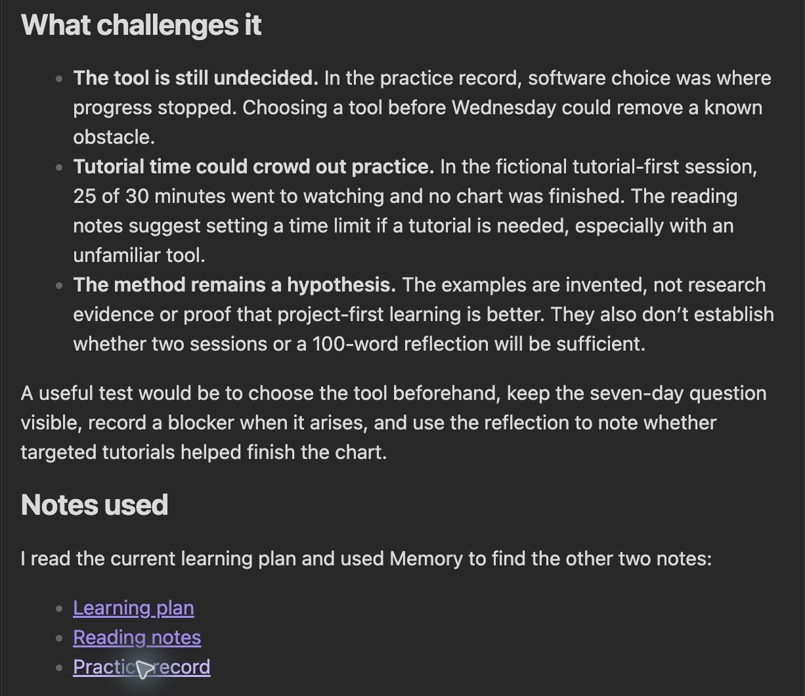
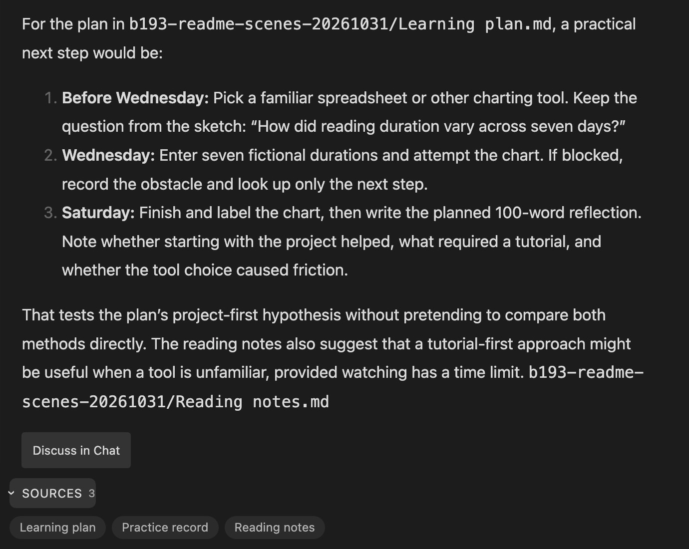
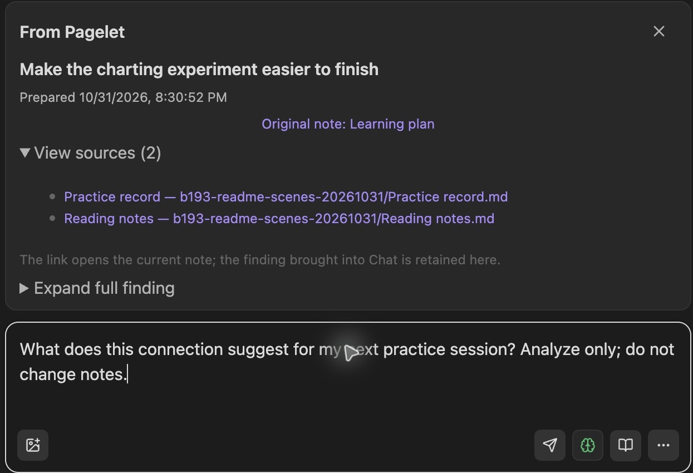

# Obsidian Personal Assistant

理解正在看的笔记，找回以前记下的材料，继续探索笔记之间的关联。

PA 是 Obsidian 的开源 AI 助手，适合希望复用阅读、学习和项目笔记的人。笔记留在 Obsidian，用 Chat 提问，核对实际使用的材料，再决定下一步。

**[用一篇笔记试试](#用一篇笔记试试)** · [看看三个工作流](#三种使用笔记的方式)

[完整能力](#完整能力) · [使用手册](./Manual-CN.md) · [English](./README.md)

**笔记中：绘图工具尚未决定。**


**Chat：保留未决事项，并链接原文，方便核对。**


[查看笔记与 Chat 的完整对照画面](./docs/assets/readme/chat-note-context.jpg)

以上两处局部来自同一画面。本文图片均为 **2026 年 10 月 31 日 master** 在 Obsidian **1.15.0** 的真实桌面截图，使用英文界面和[虚构演示笔记](./docs/guides/readme-examples.md)。点击图片可查看原尺寸。

本 README 按**当前 `master`** 编写，随下一次正式版交付，需要 Obsidian **1.11.4 或更新版本**。正式版发布前，请使用包含这些改动的当前 checkout 构建；[已发布版本](https://github.com/edonyzpc/personal-assistant/releases)的设置界面可能较旧。

## 用一篇笔记试试

### 连接 AI 服务前

- **数据**：Chat 可能将问题及允许的笔记／工具上下文发送给配置的服务商。本地 Memory 索引不等于全部在本地处理。
- **后台调用**：Memory 默认开启。配置完成后的首次 Chat 可能在后台准备允许范围内的笔记，使用 embedding 额度。拾页自动发现满足条件时也可能调用服务。
- **控制与费用**：首次请求前检查“笔记与隐私 → PA 可以使用的笔记”及排除范围；这是明确规则，不会自动识别全部敏感信息。本次练习先关闭“使用来自笔记的 Memory”和拾页自动发现，只配置 Chat。模型费用以服务商为准。

[完整数据、网络、依赖与法律披露](./docs/operations/network-and-dependencies.md)

### 安装与最少配置

1. 取得与本文对应的构建。相关改动发布后，可在 **设置 → 第三方插件 → 浏览** 搜索 **Personal Assistant**（作者 **edonyzpc**）安装（[官方目录](https://obsidian.md/plugins?id=personal-assistant)），或从[同一发布版本](https://github.com/edonyzpc/personal-assistant/releases)下载 `main.js`、`manifest.json` 和 `styles.css`。发布准备期间，按下方说明构建当前 checkout。将三个文件一起放入 `<笔记库>/<配置目录>/plugins/personal-assistant/` 后启用；默认配置目录通常为 `.obsidian`。
2. 在 PA 设置中检查数据边界，本次练习关闭上面提到的后台能力。
3. 打开 **AI 连接 → 添加默认服务**，选择 OpenAI、DashScope 中国／国际或兼容的自定义聊天服务，填写 API Key 并保存。核对“聊天”一行；需要时在“高级设置”检查模型和 API 地址。新建 OpenAI 连接默认使用 `gpt-6.1-terra`，账户仍需具备访问权限。笔记上下文需要模型支持相应工具能力；图片提问才需要视觉模型。本次不需要配置 embedding 或图片生成服务。
4. 打开命令面板，运行 **Personal Assistant：打开PA智能体**。兼容性取决于具体接口、模型与能力；“OpenAI-compatible”标签不能保证所有功能可用。

<details>
<summary>正式版发布前，从当前 checkout 构建</summary>

使用 Node.js 22 LTS、npm 10 或 11，在本仓库根目录执行：

```sh
npm ci
npm run build
```

将 `dist/main.js`、`dist/manifest.json` 和 `dist/styles.css` 一起复制到上述插件目录，再重新加载或启用 PA。请构建包含这些改动的 checkout；旧发布包或旧源码不提供相同界面。测试库操作见[开发说明](./DEVELOPEMENT.md)。

</details>

### 复制一篇虚构示例

在允许的目录新建 `学习计划.md`，复制：

```markdown
# 学习计划（虚构示例）

目标：本周用虚构数据完成一张柱状图。
已确定：周三和周六各安排 30 分钟；使用七天虚构阅读时长；
完成后写 100 字复盘。
待验证：先做小项目、遇到问题再查教程，是否适合我？
尚未决定：使用哪个绘图工具。
```

保持这篇笔记打开。在 Chat 选择“我的笔记”作为回答资料范围，然后提问：

> 根据当前笔记“学习计划”，我可以先做什么，还需要决定什么？请区分笔记中的已知信息、待验证假设和你的建议。只分析，不修改笔记。

核对回答是否使用原文的目标与安排、保留工具尚未决定的事实，并区分建议与笔记已有信息。原笔记应保持不变。模型措辞不需要与演示完全相同。

缺少上下文时，保持 Markdown 笔记处于活动状态，检查排除范围和 Chat 资料选择。请求失败时，检查已保存的连接、凭据和模型工具能力。[Chat 操作与排错](./Manual-CN.md#ai-chat)

**下一次使用**：在 Chat 继续理解当前笔记；需要旧材料时再启用并准备 Memory；阅读时想探索关联就打开拾页。三者各有前提，可以独立选择。

## 三种使用笔记的方式

### 1. 理解眼前这篇笔记 — Chat

**输入**：活动笔记和一个具体问题。**PA 做什么**：读取允许的笔记上下文，辅助分析。**得到什么**：能与原文对照的回答。**继续**：追问，或回到笔记核对。

上面的首次任务就是一个小例子。Chat 也支持兼容的图片输入和明确授权的笔记操作。明确的新建、追加、编辑或属性更新请求可直接执行；希望先检查时，请要求“先给预览”。[操作与撤销边界](./Manual-CN.md#6-网页搜索与笔记操作)

### 2. 让旧笔记参与新任务 — Memory

**输入**：问题，以及允许范围内、已完成 Memory 准备的笔记。**PA 做什么**：检索已索引材料辅助回答。**得到什么**：相关内容及实际返回的来源。**核对**：打开来源，与回答对照。

使用[虚构演示材料](./docs/guides/readme-examples.md)，可以问：

> 使用 Memory 找出与本周学习计划相关的阅读摘记和实践记录，比较它们提供了哪些支持或不同意见，并列出你使用的笔记。只分析，不修改笔记。

Memory 需要配置 embedding 模型，并在本设备准备。首次准备与后续后台更新可能向服务商发送允许的笔记正文并产生费用。关闭 Memory 会取消准备；恢复或手动重建等路径仍保留相应确认。[Memory 设置与控制](./Manual-CN.md#7-memory)



这次 Memory 检索返回了学习计划、阅读摘记和实践记录。回答指出过往“选择软件”的阻碍，也保留了学习方法仍待验证的前提。可打开来源核对这项比较。

### 3. 发现关联后继续探索 — 拾页 Pagelet

**输入**：一篇活动 Markdown 笔记。**PA 做什么**：在允许材料中寻找有依据的关联。**得到什么**：发现有效关联时的洞察及来源。**继续**：打开来源，选择“在聊天中讨论”，检查附带材料，再主动发送问题。

运行“拾页：发现关联”，随后可以问：“这条关联对我的下一次练习有什么启发？先分析，不修改笔记。”只打开拾页面板不会启动发现，交接也不会自动发送。Memory 可提供线索，但不是统一前提；没有新洞察可能是正常结果。[拾页指南](./docs/guides/pagelet-user-guide.md)



<details>
<summary>看看拾页交给 Chat 的材料</summary>



检查发现与来源，编辑问题，再点击 **Ask**。这次实际接续中，Chat 根据携带的发现继续分析，并提示未能独立重读原笔记。可从来源链接自行核对原文；继续讨论不等于重新核验来源。

</details>

## 完整能力

下表对应当前 `master`。各能力需要对应的兼容模型与连接；服务商能聊天，不代表支持视觉、embedding、工具或生图。

| 想完成的任务 | 功能／入口 | 配置与状态 | 详细说明 |
| --- | --- | --- | --- |
| 围绕笔记或图片思考 | Chat／打开PA智能体 | 已支持；聊天模型，笔记操作所需工具能力，图片提问所需视觉能力 | [手册](./Manual-CN.md#ai-chat) |
| 找回过去材料 | 使用来自笔记的 Memory | 已支持；embedding 连接、允许范围及本设备准备；不同 profile 保留兼容索引 | [Memory](./Manual-CN.md#7-memory) |
| 保留有用的个人上下文 | 个人记忆／AI 记忆提取 | 开关与同意条件满足时可用；可从用户消息学习并使用 Chat 额度，在 Memory 设置查看、更正或遗忘 | [Memory 控制](./Manual-CN.md#7-memory) |
| 探索笔记关联 | 拾页发现、来源、Chat 接续 | 已支持；适用的聊天／工具能力；自动发现另有控制与费用 | [指南](./docs/guides/pagelet-user-guide.md) |
| 生成或修改图片 | Chat 图片任务、Featured Images | 已支持对应的 OpenAI 或 Wan 图片连接；与图片输入分开 | [图片指南](./docs/guides/multimodal-chat-user-guide.md) |
| 制作分享卡片 | Share Card | 已支持；卡片排版本身不需要生图模型，远程图片可能联网获取 | [Share Card](./docs/architecture/share-card-architecture.md) |
| 记录与回看 | Quick Capture、Records Preview | 已支持；本地能力，可选 AI 处理单独配置 | [手册](./Manual-CN.md#fleeting-thoughts-记录功能) |
| 查看活动与笔记结构 | Statistics、Callout、局部图谱、AI 摘要 | 已支持；本地工具不需要模型，AI 摘要需要 Chat，桌面悬浮图谱需要 Hover Editor | [手册](./Manual-CN.md) |
| 准备 Ghost 文章 | 明确调用 `@blog2ghost` | 桌面端与 Ghost 凭据；准备可写草稿／上传媒体；首发在 Ghost 完成，已检查更新需确认 | [工作流](./skills/blog2ghost/SKILL.md) |
| 使用语音模型 | 语音 | 规划中；没有可用语音流程或承诺日期 | 关注 [Issues](https://github.com/edonyzpc/personal-assistant/issues) |

插件／主题更新、插件启停命令、旧 Memos 入口及 metadata 自动更新已不是当前能力。[历史演示](./docs/guides/historical-demos.md)保留其适用背景。

### 按任务选择连接

保存可复用的 AI 连接，选定“默认 AI 服务”，让聊天、笔记检索（Memory）和图片使用它支持的对应能力。需要时通过“按功能调整”为某项任务选择其他已保存连接。可以先配置 Chat，用到其他能力时再补充。

Memory 为不同检索配置保留独立的本设备 profile。更换 embedding 模型／维度可能需要重新准备；兼容的已有索引可复用，未启用的 profile 不执行付费后台维护。切换 profile 并不天然触发整库上传或重建。

Custom Chat 使用 OpenAI-compatible Chat Completions 接口。OpenAI 图片生成／编辑只接受官方 `https://api.openai.com/v1`；Wan 识别受支持的 DashScope 端点。Custom 的 Chat／embedding 兼容不提供图片生成适配。[连接设置](./Manual-CN.md#3-配置) · [图片指南](./docs/guides/multimodal-chat-user-guide.md)

### Mobile VSS 验证说明

PA 支持桌面与移动端，各能力有独立限制；Ghost 仅桌面。历史 SQLite/WASM Memory smoke 覆盖 Desktop 与 iOS；**Android Memory/VSS 尚未完成实机验证**。本页不据此承诺任意服务商或图片能力跨平台兼容。

## 继续使用与反馈

阅读时用 Chat，找旧材料时用 Memory，探索关联时用拾页。新想法可用 Quick Capture 记录，有值得分享的成果后再使用卡片或发布能力。

在 [Issues](https://github.com/edonyzpc/personal-assistant/issues) 描述**想完成什么、卡在哪里、希望怎样改善**。请不要公开 API Key 或私人笔记。

[中文手册](./Manual-CN.md) · [指南](./docs/guides/README.md) · [BRAT 测试版](./docs/operations/brat-beta-testing.md) · [开发](./DEVELOPEMENT.md) · [项目文档](./docs/index.md) · [历史演示](./docs/guides/historical-demos.md)

客户端源码自 2.8.0 起使用 **AGPL-3.0-only**；历史版本保留原许可。PA 名称、插件 ID、图标与市场身份另有商标条款。参阅 [LICENSE](./LICENSE)、[NOTICE](./NOTICE)、[第三方声明](./THIRD_PARTY_NOTICES.md)、[商标说明](./TRADEMARKS.md)及[详细披露](./docs/operations/network-and-dependencies.md)。

由 [edony](https://github.com/edonyzpc) 创建，感谢第三方声明中列出的上游项目。
