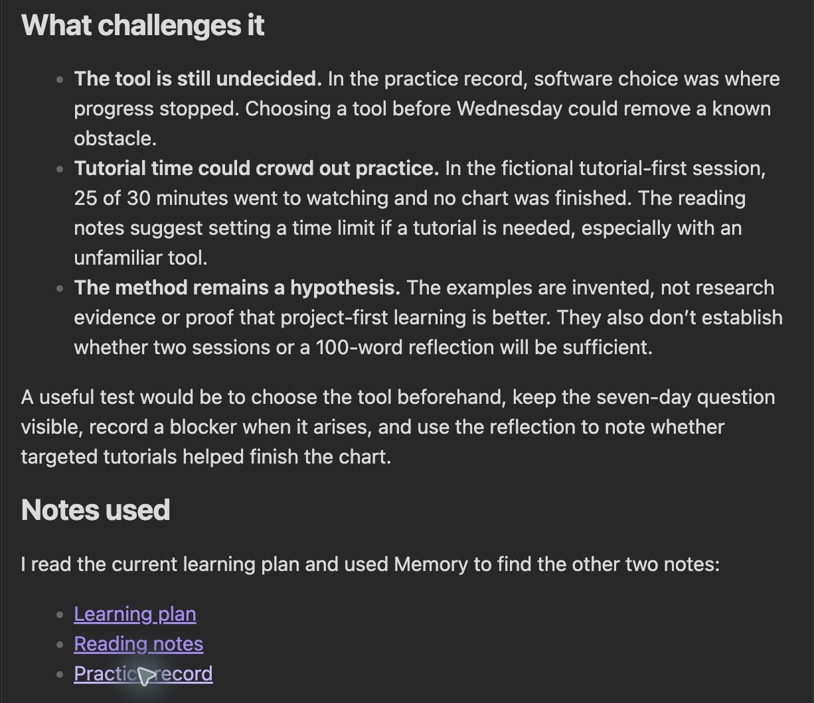
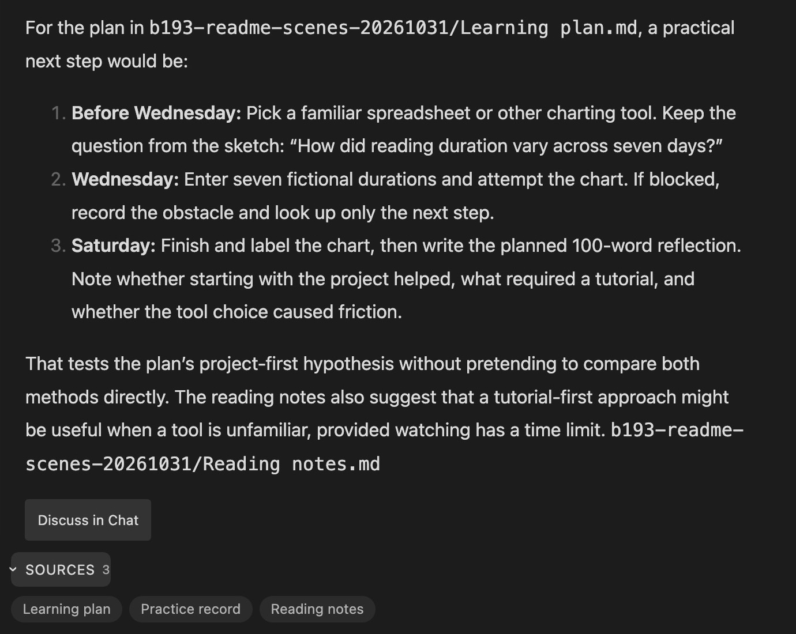
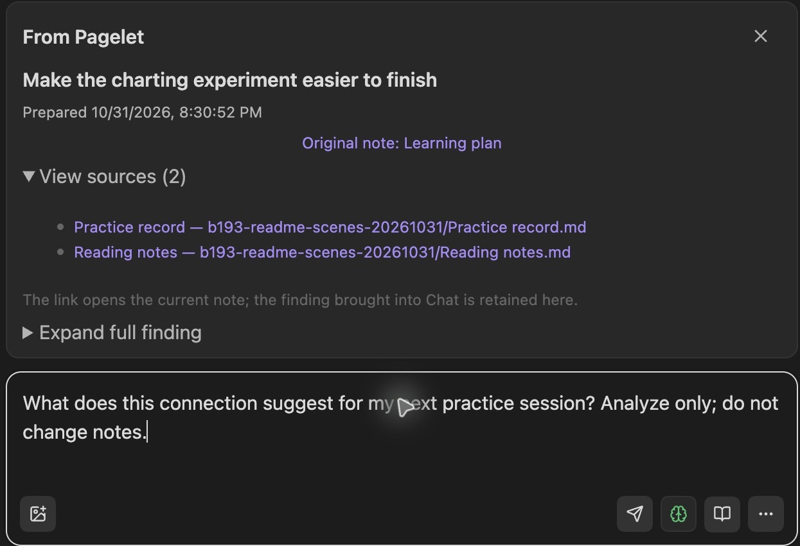

# Personal Assistant for Obsidian

Understand the note in front of you, find useful material you wrote before, and explore connections between your notes.

PA is an open-source Obsidian AI assistant for people who want to reuse their reading, learning, and project notes. Keep your notes in Obsidian, ask questions in Chat, check the material used, and choose what to do next.

**[Try one note](#try-one-note)** · [Explore the workflows](#three-ways-to-use-your-notes)

[All capabilities](#all-capabilities) · [Manual](./Manual.md) · [中文](./README-CN.md)

**In the note: the charting tool is still undecided.**


**In Chat: the decision stays open, with a source link to check.**


[View the note and Chat together](./docs/assets/readme/chat-note-context.jpg)

The two details above come from the same capture. All screenshots on this page are real desktop captures from **master, 31 October 2026**, in Obsidian **1.15.0**, using English UI and [fictional notes](./docs/guides/readme-examples.md). Click an image for full size.

This README follows **current `master`**, prepared for the next stable release, and requires Obsidian **1.11.4 or newer**. Until that release is published, use a build from this checkout for the interface described here; [released versions](https://github.com/edonyzpc/personal-assistant/releases) may have older settings.

## Try one note

### Before connecting an AI service

- **Data:** Chat can send your question and permitted note/tool context to your configured provider. A local Memory index does not mean all processing is local.
- **Background calls:** Memory is enabled by default. Once configured, a first Chat may prepare eligible notes in the background and use embedding credits. Pagelet automatic discovery can also make provider calls when its conditions allow.
- **Control and cost:** Review **Notes & privacy → Notes PA can use** and its exclusions before your first request. They are explicit rules, not automatic detection of all sensitive content. For this first task, turn off **Use memory from my notes** and Pagelet automatic discovery; configure only Chat. Check provider pricing yourself.

[Full data, network, dependency and legal disclosures](./docs/operations/network-and-dependencies.md)

### Install and configure Chat

1. Choose a matching build. Once these changes are released, install **Personal Assistant** by **edonyzpc** through **Settings → Community plugins → Browse** ([official directory](https://obsidian.md/plugins?id=personal-assistant)), or download `main.js`, `manifest.json` and `styles.css` from the [same release](https://github.com/edonyzpc/personal-assistant/releases). During release preparation, build this checkout as described below. Put all three files in `<vault>/<config-dir>/plugins/personal-assistant/`, then enable the plugin; the usual config directory is `.obsidian`.
2. In PA settings, review the data boundary and disable the background features described above for this exercise.
3. Open **AI connection → AI connections → Add default service**. Choose OpenAI, DashScope China/International, or a compatible custom Chat service; enter its API Key and save. Check the **Chat** row and, when needed, the model/API address under **Advanced settings**. New OpenAI connections default to `gpt-6.1-terra`; your account still needs access. Use a model with the tool support required for note context. Image questions need a vision-capable Chat model; embedding and image generation are not required for this task.
4. Open the command palette and run **Personal Assistant: Open PA Agent**. Provider compatibility depends on the endpoint, model and capability; an OpenAI-compatible API label alone is insufficient.

<details>
<summary>Build this checkout before the release is available</summary>

With Node.js 22 LTS and npm 10 or 11, run the following from this repository's root:

```sh
npm ci
npm run build
```

Copy `dist/main.js`, `dist/manifest.json` and `dist/styles.css` together into the plugin folder above, then reload or enable PA. Build the checkout containing these changes; an older release or source revision does not provide the same interface. See [development instructions](./DEVELOPEMENT.md) for local testing.

</details>

### Copy a small, fictional note

Create `Learning plan.md` in an allowed folder and paste:

```markdown
# Learning plan (fictional example)

Goal: make one bar chart this week using fictional data.
Decided: 30 minutes on Wednesday and Saturday; use seven fictional daily
reading durations; write a 100-word reflection afterwards.
Hypothesis to test: starting a small project and checking tutorials when
stuck may suit me.
Still undecided: which charting tool to use.
```

Keep this note open. In Chat, choose **My notes** as the answer source, then ask:

> Based on the current note “Learning plan”, what can I do first, and what do I still need to decide? Separate facts in the note, hypotheses to test, and your suggestions. Analyze only; do not modify the note.

Check that the answer uses the note's goal and schedule, keeps the tool choice undecided, and distinguishes suggestions from recorded facts. Your note should remain unchanged. The model may phrase its answer differently from a demonstration.

If context is missing, keep the Markdown note active, check its exclusions and the Chat source selection. If the request fails, check the saved provider settings, credentials and model tool support. [Chat instructions and troubleshooting](./Manual.md#ai-chat)

**Next time:** keep discussing the current note in Chat; enable and prepare Memory when you need older material; or open Pagelet when you want to explore connections. Each has its own prerequisites—you can choose independently.

## Three ways to use your notes

### 1. Understand what you are reading — Chat

**Input:** an active note and a concrete question. **PA:** reads permitted note context and helps analyze it. **Result:** a response you can compare with the original. **Continue:** ask a follow-up or return to the note.

The first task above is a small example. Chat also supports compatible image input and explicitly authorized note actions. An explicit create, append, edit or property-update request can execute directly; request a preview when you want to inspect a proposed change first. [Action and Undo boundaries](./Manual.md#6-web-search-and-note-actions)

### 2. Bring old notes into a new task — Memory

**Input:** a question plus notes that are in scope and already prepared for Memory. **PA:** searches indexed material to inform the answer. **Result:** relevant material with the sources actually returned. **Check:** open those sources and compare them with the answer.

Using the [fictional example notes](./docs/guides/readme-examples.md), ask:

> Use Memory to find reading notes and practice records relevant to my learning plan. Compare what supports or challenges the plan, and identify the notes you used. Analyze only; do not modify notes.

Memory needs a configured embedding model and preparation on this device. First-use preparation and later background updates can send eligible note text to that provider and incur costs. Turning Memory off cancels preparation; later recovery or manual rebuilds retain their confirmation requirements. [Memory setup and controls](./Manual.md#7-memory-integration)



In this example, Memory returned the learning plan, reading notes and practice record. The answer highlights a previous obstacle—choosing software—and keeps the learning method a hypothesis. Open the sources to check the comparison.

### 3. Discover a connection and keep exploring — Pagelet

**Input:** an active Markdown note. **PA:** looks for supported connections within the permitted material. **Result:** an insight and its sources, when a worthwhile connection is found. **Continue:** open the source, select **Discuss in Chat**, inspect the attached material, and send your own question.

Try **Pagelet: Discover connections**, then ask: “What does this connection suggest for my next practice session? Analyze only; do not change notes.” Opening the Pagelet panel alone does not start discovery. A handoff prepares a conversation and does not send it automatically. Memory can provide leads but is not a universal prerequisite; no new insight can be a normal outcome. [Pagelet guide](./docs/guides/pagelet-user-guide.md)



<details>
<summary>See what Pagelet prepares in Chat</summary>



Inspect the finding and sources, edit the question, then select **Ask**. In the recorded follow-up, Chat analyzed the attached finding and warned that it could not independently reread the notes. Source links let you check the originals yourself; a continuation is not fresh source verification.

</details>

## All capabilities

The capabilities below describe current `master`. Features need their own compatible models and connections; a provider's support for Chat does not imply support for vision, embedding, tools or image generation.

| Your task | Feature / entry | Required setup and status | Details |
| --- | --- | --- | --- |
| Think with a note or image | Chat / Open PA Agent | Available; Chat model, tools for note actions, vision for image questions | [Manual](./Manual.md#ai-chat) |
| Find previous material | Memory from your notes | Available; embedding connection, in-scope notes, device-local preparation; separate profiles retain compatible indexes | [Memory](./Manual.md#7-memory-integration) |
| Keep useful personal context | Personal Memory / AI Memory Extraction | Available when enabled and consent conditions permit; can learn from your messages using Chat credits; inspect, correct or forget it in Memory settings | [Memory controls](./Manual.md#7-memory-integration) |
| Explore connections | Pagelet discovery, sources, Chat handoff | Available; suitable Chat/tool capability; automatic discovery has controls and costs | [Guide](./docs/guides/pagelet-user-guide.md) |
| Generate or edit images | Chat image tasks; featured images | Available with the supported OpenAI or Wan image connection; separate from image input | [Image guide](./docs/guides/multimodal-chat-user-guide.md) |
| Make a shareable card | Share Card | Available; card layout does not require a generation model; remote images may be fetched | [Share Card](./docs/architecture/share-card-architecture.md) |
| Capture and revisit records | Quick Capture, Records Preview | Available; local features, with optional AI processing configured separately | [Manual](./Manual.md#records-in-specific-catalog) |
| Review activity and note structure | Statistics, Callouts, local graph, AI summary | Available; local tools need no model; AI summary needs Chat; desktop graph popovers need Hover Editor | [Manual](./Manual.md) |
| Prepare a Ghost article | Explicit `@blog2ghost` workflow | Available on desktop with Ghost credentials; preparation can save drafts/upload media; first publish in Ghost; checked updates require confirmation | [Workflow](./skills/blog2ghost/SKILL.md) |
| Use a voice model | Voice | Planned; no available voice workflow or promised date | Follow [Issues](https://github.com/edonyzpc/personal-assistant/issues) |

Plugin/theme updates, plugin on/off commands, the old Memos entry and metadata auto-update are not current capabilities. [Historical demonstrations](./docs/guides/historical-demos.md) retain their context.

### Choose connections by task

Save reusable AI connections, choose a **Default AI service**, and let Chat, note retrieval (Memory), and images follow it where supported. Use **Adjust by function** to choose a different saved connection for a task. You can start with Chat and configure the other capabilities when you need them.

Memory keeps separate device-local profiles for retrieval configurations. Changing the embedding model/dimension can require new preparation; compatible existing profiles can be reused, and inactive profiles do not receive paid background maintenance. Switching profiles does not inherently upload or rebuild the whole vault.

Custom Chat uses an OpenAI-compatible Chat Completions interface. OpenAI image generation/editing accepts the official `https://api.openai.com/v1` endpoint; Wan recognizes its supported DashScope endpoints. Custom Chat/embedding compatibility does not provide an image-generation adapter. [Connection setup](./Manual.md#3-configuration) · [Image guide](./docs/guides/multimodal-chat-user-guide.md)

### Mobile VSS validation note

PA is a desktop/mobile plugin; individual capabilities have platform limits. Ghost is desktop-only. Historical SQLite/WASM Memory smoke covers Desktop and iOS; **Android Memory/VSS has not completed physical-device validation**. This README does not imply every provider or image feature works on every platform.

## Keep using PA and help improve it

Use Chat while reading, Memory when looking for past work, and Pagelet when exploring connections. Capture new thoughts with Quick Capture; use sharing or publishing when you have an outcome worth distributing.

[Report an issue or request a feature](https://github.com/edonyzpc/personal-assistant/issues) with **what you wanted to do, where you got stuck, and what would help**. Do not post API keys or private notes.

[Manual](./Manual.md) · [Guides](./docs/guides/README.md) · [BRAT beta testing](./docs/operations/brat-beta-testing.md) · [Development](./DEVELOPEMENT.md) · [Project documentation](./docs/index.md) · [Historical demos](./docs/guides/historical-demos.md)

Client source uses **AGPL-3.0-only** from 2.8.0; historical releases retain their original terms. PA's name, plugin ID, icons and market identity have separate trademark terms. See [LICENSE](./LICENSE), [NOTICE](./NOTICE), [third-party notices](./THIRD_PARTY_NOTICES.md), [trademarks](./TRADEMARKS.md) and [detailed disclosures](./docs/operations/network-and-dependencies.md).

Created by [edony](https://github.com/edonyzpc). Thanks to the upstream projects credited in the third-party notices.
