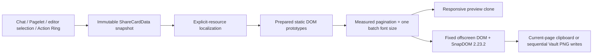

# Share Card Architecture

Updated: 2026-10-16

| Field | Value |
| --- | --- |
| Document type | Current architecture contract |
| Work item | B-124, B-137 |
| Product authority | [DEC-026](../product/decisions/dec-026-local-share-card.md), [DEC-036](../product/decisions/dec-036-share-card-print-styles.md), [PA Share Card Product Spec](../product/specs/pa-share-card-product-spec.md), and [PA Share Card Print Styles Product Spec](../product/specs/pa-share-card-print-styles-product-spec.md) |
| Validation evidence | [Print-style tests](../../__tests__/share-card-print-style.test.ts), [Modal tests](../../__tests__/share-card-modal.test.ts), and [Pagelet and Share Card smoke checklist](../development/validation/pagelet-smoke-checklist.md) |

> [!note] Owner amendment 2026-10-15
> 用户确认分享者署名预览并授权实现：左侧产品品牌保留，右下角默认显示 `by` +
> `32×24` CSS px EZ SVG，自定义名字替换、清空恢复。以下为本次目标技术契约，
> 实现状态与本次证据见 [Share Card Sharer Tracker](../development/active/share-card-sharer/tracker.md)；
> 不以当前契约文字或旧验证结果声明本次已实现。

> [!note] Owner amendment 2026-08-07
> 用户选择方案 A，并明确以当前 `master` 实现作为最终行为基线：短单页内容从
> 字号规则已由 2026-10-06 用户修订取代，见下文 batch-level 决策。保存目录在
> 每次 Modal 打开时优先采用有效的 Vault attachment folder，否则回退 `PA-Cards`；
> 用户可在当前 Modal 中选择已有目录、输入新目录或 Vault 根目录，但该选择不持久化。
> Action Ring 优先采用朝向内容区的内向弧，空间不足时整组降级为紧凑横排或竖排。
> 当前 neutral paper light / warm dark 纸张、纤维纹理、枝叶装饰和品牌视觉一并作为
> 现行设计接受。

本文只描述当前代码必须保持的技术契约，不承担交付状态或历史验证权威。后续实现变化
应先更新 DEC/Product Spec，再同步本文件和对应自动化、运行时验证。

## System Boundary



核心不变量：

> PA 在 capture 前拥有资源权限、完整性和稳定化责任；SnapDOM 只接收固定尺寸、
> 自包含、已稳定的卡片 DOM，不能成为资源加载器。

## Module Ownership

| Module | Responsibility |
| --- | --- |
| `share-card-types.ts` | `ShareCardData`、页面、固定尺寸、输出密度与硬上限 |
| `share-card-source.ts` | 共享选区/笔记来源投影、有效 YAML frontmatter 剥离与 basename 标签 |
| `share-card-markdown.ts` | 将 Markdown 准备为语义块，保留允许的文字与视觉结构 |
| `share-card-resources.ts` | 仅解析显式引用；有界读取远程/Vault 资源并本地化为 data URL；生成完整性报告 |
| `share-card-font.ts` | 注册随包的 Source Han Serif 子集、本地 data URL 字体与引用计数清理 |
| `share-card-assets.ts` | 固定 PA/EZ SVG 几何与本地纸纹、装饰；不在运行时获取远程品牌资源 |
| `share-card-renderer.ts` | 一次性 render/sanitize/stabilize，保存静态 prototype，在统一 clone/renderPage 路径测量适配独立图表并组合 preview/capture DOM |
| `share-card-paginator.ts` | 基于最终卡片 DOM 高度分页，维护 no-loss、顺序、非空页和安全上限 |
| `share-card-export.ts` | 自包含审计、SnapDOM adapter、clipboard、Vault 串行写入和唯一命名 |
| `share-card-modal.ts` | 编排资源、字体、分页、预览、Copy/Save、当前 Modal 的目录/分享者名字、状态与取消生命周期 |
| `plugin.ts`、`plugin/share-card-actions.ts`、Chat 与 Pagelet integration | eligibility、显式入口与对应文件/编辑器接线 |
| `pagelet/pet/PetView.ts` | 四项 Ring 的逻辑顺序、完整本地化名称、内向布局与整组 fallback |

这些职责不得被新的平行 renderer、capture engine 或持久化目录设置绕开。

## Input And Source Projection

所有入口共享一个不可变 `ShareCardData` snapshot：

- Chat 仅分享已完成且可分享的 assistant 回复；生成中、用户消息和中断型 partial
  output fail closed。
- Pagelet 只投影当前可见 findings，不带隐藏 diagnostics、provider metadata 或路径。
- editor selection 的命令和 PA 专属右键菜单共用选区分享入口，仅在 trim 后非空时可
  触发/显示，但 payload 保留原始字符、缩进、空白和 Markdown。菜单从所属 editor/file
  取得选区与资源解析路径，使用相同 `ShareCardModal`，不覆盖第三方图片导出菜单；
  workspace 事件通过 plugin 的 `registerEvent` 管理卸载。
- Action Ring 在点击时读取一次 current editor：非空 selection 优先；否则读取 current
  Markdown note。Note 只剥离 Obsidian 能识别且 YAML 有效的 leading frontmatter，并只显示
  basename；selection 不显示文件名或 Vault path。
- Markdown 笔记菜单（含移动端右上三点）分享菜单对应的 file；只有对应 leaf 的
  MarkdownView 才能提供 selection 或未保存正文，否则从该 file 读取正文。复用 Ring
  的 selection-first、有效 frontmatter 剥离和 basename 投影；非 Markdown/目录不加入口。
  空正文或读取失败提供可恢复提示；卸载后返回的异步读取不能打开新 Modal。

`resourceContext.basePath` 只提供相对资源解析权限，不进入卡片、Notice 或 Pagelet
finding payload。来源准备不调用 provider、不搜索无关 Vault，也不产生 durable write。

## Resource, Markdown And Static DOM Pipeline

每个 Modal 创建独立的资源 session、去重 cache、shared deadline 和 `AbortSignal`：

1. 扫描输入显式引用的 Markdown image、Vault image/note embed、raw image/SVG reference；
   literal code、普通链接和无关 Vault 内容不产生 I/O。
2. Remote image 通过 Obsidian `requestUrl` 直接读取，Vault 引用通过 MetadataCache/Vault API
   解析；不使用 proxy、page crawl、cookie discovery 或 fallback host。
3. 只接受经过 MIME、raster signature 或安全 SVG 检查的静态视觉资源。Whole/heading/block
   note embed 只沿显式 embed 有界递归，并受 count、bytes、depth、deadline、cycle 和
   32 MiB localized-output budget 限制。
4. 获准资源在 Markdown render 前转换为 data URL；失败变为可见 inert placeholder 并进入
   完整性报告，不能被静默删除或冒充完整成功。
5. 语义块进入 prepared renderer 前，按下述脚注合同执行一次本地分享投影。每个语义块
   只执行一次 `MarkdownRenderer`、允许的 Mermaid processor、sanitize、font/image
   readiness 和稳定化。分页 probes、preview 与 export 只 clone inert static prototype，
   不重复执行 processor。

Renderer 移除 script、runtime style、事件处理器、交互控件和外部资源属性。Capture 前再次
递归审计 attribute、computed style 与 pseudo-element 中的资源 URL；除允许的 image data URL
和 SVG fragment 外，发现残余外部 URI 即 fail closed。

## Footnote Share Projection

2026-10-15 用户首次明确脚注位置：正文保留统一编号，脚注正文集中在整组
正文之后继续分页。此前 full-fidelity 选择未规定该位置，宿主按局部渲染生成脚注列表
不能成为隐含产品权威。以下为已批准规则的目标实现设计，状态与证据见当前 Tracker。

- 在当前 Modal 的 prepare 阶段，对同一份分享输入执行一次本地投影；正文按首次引用
  顺序分配编号，同 label 多次引用保持同号。未被引用的定义也保留，排在已引用脚注
  之后，按定义顺序分配剩余编号。正文编号为普通 `[n]` 文字，不使用宿主自动上标。
- 脚注正文提取为普通 Markdown 语义块，按对应编号顺序放到全部正文之后，仅保留
  一份；完整保留段落、列表、强调、代码、链接及显式视觉资源，不把脚注正文压成
  单个不可拆的宿主 `HR/OL` 附件。长脚注继续经过现有 prepared static DOM 与实际
  rendered height 分页，不引入第二套 renderer/paginator 或 export-only 处理。
- 普通链接/图片 reference definitions 仍走原 reference context；脚注定义在投影后
  不再作为不可见 link definition 附到每个引用块尾部。围栏/内联代码等字面量不作为
  脚注解析；没有定义的引用保留可见字面量，重复冲突定义或不能证明完整的结构准确
  失败，不能取首条覆盖、静默删除或把 incomplete 当成成功。普通资源解析与本地化
  边界不扩大，不增加读取或写入。
- 原始笔记及入口 snapshot 保持只读；冻结的本次分享投影成为后续语义块/测量/片段
  source offset 的共同输入，不把重编号或搬移后的坐标冒充原笔记坐标。preview、
  放大、Copy、Save 全部复用同一准备结果，不逐页重编号、重复展开或重新请求资源。

## Pagination And Typography

固定 card surface 为 `540×720` CSS px。分页使用最终卡片 CSS、来源标签占位和实际 DOM
高度，不使用字符数估算；优先语义块边界，超高普通文本只在可证明安全的 Markdown
边界拆分，视觉块保持原子。实现基线原有 50,000 characters / 24 页整批拒绝，已由
[DEC-051](../product/decisions/dec-051-proportionate-confirmation-and-contract-alignment.md)
撤销：目标是完整分页与可取消，不因固定字符数/页数拒绝或截断尾部；真实无法无损
分页或资源失败仍准确报告。B-161 已移除实现门、解耦边界采样并传播取消信号，
长单块切点在同一静态 DOM 中按需细化，源边界与实际文本一致才能生成坐标，不重渲染
全文或跨 DOM 复用旧坐标。分页和序列导出沿当前 AbortSignal 及时停止并释放资源；
原生 54,702 字符/77 页完整导出与移动交互证据见
[B-161](../archive/2026/b161-contract-alignment-validation.md)。

2026-10-15 的窄修接续上述安全拆分契约：明确开闭成对的 `***...***` 和 `___...___`
应由现有 safe fragment plan 保留加粗兼斜体和原始 source offset。分隔符长度本身不能
把可证明安全的三字符开闭组合判为歧义；同时保留真实歧义、不成对分隔符及其他
无法证明安全结构的拒绝。片段为维持格式补回的 markup 不能改变源区间或冒充原始
字符，不重渲染正文来替换源身份。本修订不扩展为完整 CommonMark/HTML parser，
实际修复状态与整篇运行证据见 [当前 Tracker](../development/active/share-card-sharer/tracker.md)。

链接外围的 emphasis 也沿用同一源坐标责任：当 opener 后紧邻完整 inline link，且
link 后紧邻同字符、同长度（1/2/3）的完整 closer run，并满足原始源码的 closing
flanking 条件时，该确切 pair 可以消除括号或标点引起的双向 flanking 歧义。证明只
属于当前递归范围及确切 source offsets；已有同 marker closing owner 时，不让新的
双向 opener 借此抢占其配对。label 内仍独立解析，destination/title 不参与
外层配对。不能把任意 `[`、reference token、错配 run 或 link 后混杂文字当成此证明，
也不根据渲染后的 label 改写源码 flanking。

同一安全拆分责任也覆盖有限的完整配对 `sup` / `span` / `sub` 行内标注：paginator
的 fragment/boundary plan 将完整标注作为不可拆 inline token，切点只能在其周边正文，
保留源 token 与原有 sanitizer 允许的标签/属性；`renderText` 只投影可见标注文字，
不能把 tag 或 title 属性当成正文坐标。Renderer 继续复用静态 DOM 保留对应格式。
闭合不全、错配等负例仍安全失败，不扩成任意 HTML parser；执行证据见同一 Tracker。

字号选择是 batch-level 决策：

- 先用 `24px` 得到完整且通过同一套 no-loss、overflow 与非空页校验的 baseline；多页
  保持该字号，不再缩小文字以减少页数。旧固定页数门按上述 successor 移除。
- Baseline 为单页时依次试 `26px`、`28px`、`30px`、`32px`，保留仍能完整容纳在单页
  的最大值；第一个不再适合或失败的候选终止放大。标题按正文比例保持层级。
- 同一 batch 的全部页面、preview、Copy 和 Save 必须复用一个最终字号；禁止逐页缩放、
  export-only 重分页或混合字号。下述获批独立图表的整体缩放是局部例外，不改变正文、
  脚注或批次字号。

### Independent Diagram Fitting

2026-10-15 用户明确批准独立完整图表整体等比缩小：本轮只准入最终 prepared static
DOM 的单顶层 TABLE，其内部可有嵌套 TABLE 树图；包含外部可见正文的混合块不能
一起缩小，其他 HTML 不因可截屏而自动获得该规则。

Renderer 在同一 prepared DOM clone / `renderPage` 路径测量完整图表宽高，按正文区
可用宽高选择不大于 1 的统一比例，等价于 `min(1, availableWidth / width,
availableHeight / height)`；宽高同时受约束，不单独改变横纵比例。适配后的布局占位
与实际 bounds 必须共同落在正文区，不能仅靠 `overflow: hidden` 裁掉内容后返回 fit。
图内文字随整图同比例缩小，不重排或删除图内节点/关系；例如本次 941px → 585px
约为 62%，图内 24px 文字相应约 15px，外部正文及末尾脚注仍为原批次 24px。

实现责任属于现有 renderer 与 `.pa-share-card` 范围内 CSS。fit、preview、capture 都
经过同一适配路径，不新建图表 renderer，不以 export-only transform 或另外一轮内容
投影补救。不改变 prepared prototype 的内容身份、资源本地化权限或固定 PNG 尺寸。
验证必须检查完整 TABLE/nested 内容的最终 bounds 和节点保留，不能只看父盒 scroll
数值或截图中未见溢出。实现与实际整篇证据仍见当前 Tracker，未验收前不宣称通过。

非代码文字使用随包的 `PA Share Serif`（Source Han Serif-derived WOFF2）及同字号的
device-local serif glyph fallback；代码使用本地 monospace stack。字体从插件字节生成
data URL，必须在测量前就绪。SnapDOM 的 document-wide font discovery 始终关闭，字体
失败不能静默回退后宣称设计成功。

## Current Visual Contract

- Modal 打开时锁定当前 light/dark theme；后续系统主题变化不改变本批卡片。
- Light 为中性灰纸渐变和深灰正文，Dark 为暖黑棕纸和米白正文；两者共享莓红强调色、
  细 divider、枝叶角饰、图形 logo 与 `Personal Assistant` 品牌文字。
- 页脚左侧保留 PA 图形 logo、`Personal Assistant` 与既有 source hint；右侧组依次容纳
  多页页码和分享者署名。默认署名为低强调斜体 `by` + EZ SVG，EZ 为 `32×24` CSS px，
  保持原始比例和字形；Light 用 `#233A34`，Dark 只换为主题可读墨色，不改变几何。
  自定义名字使用卡片本地字体，以纯文字替换 EZ；`by` 为 `11px`，名字为 `12px`，
  页脚文字行高为 `16px`。名字单行、最大可用宽度 `170px`，超长纯文字省略显示，
  不按字符数截断输入。页码、品牌、来源与署名各有空间；测量、预览和捕获使用
  一致页脚预留，不通过另行缩字、裁剪正文或 export-only 排版消除冲突。署名与其他
  footer 元素一并排除 Xerox 文字滤镜。
- 内嵌的纸纤维 raster data URI 在卡面重复铺设：Light 使用 multiply，Dark 使用 screen；
  不读取外部纹理、字体或品牌资源。
- 内容区在留白内垂直居中；多页显示稳定页码。Modal 的缩略图按可用宽高缩放，
  为路径与操作保留空间；极小窗口中操作优先可见。点击预览将同一张已渲染卡片移入
  只读放大层，以原 CSS 尺寸检查并允许滚动，关闭后回到缩略图与原焦点。固定尺寸
  capture DOM 不受 preview/zoom scale 影响。
- 卡片与全部后代冻结 animation/transition，确保 preview 与 PNG 使用同一静态视觉状态。
- 每次 Modal 直接应用 Xerox，不显示印刷样式选择器，不增加持久状态。按
  2026-10-07 用户选定预览，标题使用 `scale 5/1.4`、`-3/-3px` 偏移及 `0.28`
  原位残影；正文使用低频位移 `1.6`、高频位移 `1.25`、复影偏移 `1.3/0.9px`、
  透明度 `0.25`。两套低频频率为 `0.01 0.02`，高频频率分别为标题 `1`、正文
  `0.6`，所有 octave 为 `2`、seed 为 `6`。让无标题卡片也能辨认复印质感，
  同时保留可读性。代码、视觉资源、
  placeholder、footer、品牌、来源、页码、装饰和纸纹不进入文字滤镜。
- 两套文字滤镜在原有复合结果之后，用 `feMorphology(dilate, radius=0.05)`
  扩张墨迹；再以频率 `0.9`、octave `2`、seed `6` 的 turbulence 红色通道作为
  alpha，经线性映射 `slope=8, intercept=1-0.05*12` 生成缺墨 mask，使用
  `feComposite(in)` 留下墨迹，最后零偏移输出。该链与用户选定 HTML 预览一致，
  使用现有 capture 序列化，不改变纸张、批次字号或主题。
- 生产 renderer 在 final card clone 内用 `createElementNS` 建立 card-local 确定性 SVG defs，
  连续 Text siblings 合为 inline run，并在保护元素边界停止递归。Prepared Markdown prototype
  保持无样式，测量、preview 和 exporter 复用；final card clone 一律应用 Xerox。
  每张卡片清理时 defs/wrappers 一并离开，宿主 theme class 与 CSS variables 始终只读。
- SnapDOM 的 SVG `foreignObject` 图片不解析内部 HTML 的 `url(#id)` 滤镜。进入 SnapDOM
  前只把该 export card 的文字 wrapper 引用切为从同张卡片 defs 序列化的本地 SVG data URI；
  完成或失败后恢复片段引用。预览继续使用 card-local defs。转换找不到匹配定义时
  fail closed，避免 PNG 悄悄退回原纸外观；这不改变固定 SnapDOM 版本和 capture options。
  每个文字run使用独立的capture filter id及SVG payload，避免多run共享外部滤镜资源时
  已复现的PNG文字遗漏；仅clone并改根id，primitive、seed、bounds、文字和布局不变。

该视觉是 current implementation contract，不是可配置模板。比例、字体、品牌或主题体系
变化属于产品边界变更，需要先更新产品权威。

## Capture And Export

Production 精确锁定 `@zumer/snapdom@2.23.2`，有效 options 为：

```typescript
{
  scale: 2,
  dpr: 1,
  type: "png",
  useProxy: "",
  embedFonts: false,
  reconcile: false,
  outerShadows: false,
  resolvePicturePlaceholders: false,
  cache: "disabled",
}
```

PA 只通过已审计的 artifact plugin hook 注入唯一的 local data-URL font face。Capture 必须
返回非空 `image/png`，固定输出为 `1080×1440`。SnapDOM rejection、非 PNG、空 Blob 或
自包含审计失败均为可重试 capture failure。

Copy 只处理当前预览页，并在 click task 内把异步 PNG promise 交给 Clipboard API，以保留
WebKit user activation；失败不自动升级为 Vault write。Save 单页保存当前页，多页保存全部
页面，使用 per-Vault queue 串行完成 folder/path selection、capture 与 write，并以 timestamp
batch name、确定性 page suffix 和整批 collision avoidance 防止覆盖。Partial failure 只报告
实际写入的路径数量，不删除已成功文件，也不冒充完整成功。

## Per-Modal Save Destination

目录选择只存在于当前 Modal：

- 打开时读取 Vault `attachmentFolderPath`；非空、非 dot-prefixed 的值作为默认目录，否则
  使用 `PA-Cards`。
- 输入建议列出已有 Vault folders，并把 Vault root 显示为 `/`；用户也可输入尚不存在的
  normalized folder path，Save 时按需创建。
- `AbstractInputSuggest` 仅由用户主动点击或键盘操作目录输入触发展开；Modal 打开及
  程序化初始 focus 不展开。展开时使用输入框的当前几何位置，选择目录或关闭 Modal
  时关闭建议，并在 Modal 关闭时释放本次监听。
- 空输入回退 `PA-Cards`。已有同名 file 占据目标 path 时 fail closed。
- 目录不写入 plugin settings、ledger 或其他 persisted state；重开 Modal 重新计算默认值。

新增持久化默认目录、目录历史或跨设备同步属于新的产品/数据契约，不得由 exporter
或 Modal 自行引入。

## Per-Modal Sharer

名字属于 `ShareCardModal` 当前实例的临时输入，不修改入口的 `ShareCardData` snapshot、
Markdown、插件设置或其他持久状态。每次打开均从空名字开始，trim 后为空就选择 EZ SVG，
否则传递 trim 后的纯文字名字。输入标签、说明与可访问名称采用现有 UI locale。

Renderer 从当前批次的渲染选项组合署名；preview、只读放大与 capture 共用同一 footer
组合，不另建 preview-only 或 export-only 路径。EZ 用 `createElementNS` 和固定属性创建，
名字用 `textContent`，不解析用户 HTML/Markdown，也不引入 runtime style、外部 SVG URL
或新的资源请求。名字变更只更新署名相关呈现，保持正文 prototype、字体、资源 session
和既有完整分页算法的责任边界。

Copy/Save 开始前确定一次当前名字并在整个操作期间禁用输入；多页 Save 使用同一份
名字，不在页间重新读取可变输入。关闭、重开与迟到异步结果继续受现有 Modal operation
token 和取消清理约束，不能让旧署名回写新预览。输入以当前 Modal 生命周期清理，
不新增偏好、名字历史、跨设备同步或全局自定义 logo 能力。

图表适配使 prepared `renderPage` 存在真实 frame await；Modal 只有在 token/host 检查
通过后，才用当前名字同步即将发布卡片的页脚。该同步不重测正文、不重新分页，
避免 pending 翻页期间改名或清空后，预览与共享 export appearance 暂时不一致。

## Action Ring Layout Contract

Ring 的逻辑、DOM 与 focus 顺序固定为 `Capture / Review / Discover / Share`，完整名称随
当前 locale 切换；所有按钮至少 `44×44px`。几何只改变视觉位置，不改变 callback 或
键盘顺序。

- 非 phone 布局根据 Pet corner、visual viewport、Markdown surface、safe-area 和实际按钮
  尺寸，优先尝试朝内容区展开的紧凑 quarter arc。支持 fine pointer hover 时按钮默认
  为仅图标的 44px 目标，hover 或 focus-visible 显示完整文字提示；无 hover 的触控
  设备直接显示完整文字。完整名称始终保留为 button 的 `aria-label`。
- Arc 经 viewport clamp 后发生重叠时，整组切换为紧凑横排；横排仍不适合时整组切换为
  紧凑竖排。禁止部分换行或逐项采用不同策略。
- Phone mobile-toolbar 优先在 Pet 下方或远离边缘的一侧放置完整四标签横排；完整标签发生
  clipping/overlap 时整组改为竖排。Pet 未挂载在 toolbar 时仍使用 phone layout 和当前
  corner 决定方向。
- 每次 resize、visual viewport 变化或 surface constraint 变化都重新测量，并保持全部按钮
  位于可视、安全区域内。

## Completeness And Lifecycle

Modal 聚合全批 resource placeholders/failures、sanitization issue 与 plain-text fallback。
Copy/Save success 只证明传输或写入成功，不能覆盖已有 incomplete warning。Preparing、busy、
warning、retryable error 与 navigation control 都由一个 Modal operation token 约束；导出时
actions 与名字输入 disabled，避免并发操作、跨页署名变化和 stale UI write。

准备失败由 Modal 在既有状态路径收敛：`ShareCardPaginationError` 的已知
`measurement-failed`、`unpageable-content` code 映射为固定的中英本地化可读原因，
不把异常 message/stack 或原始笔记插入 UI；未知错误或 code 使用通用准备失败提示。
类型化原因只改进失败反馈，不把失败转换为成功、跳过内容或自动写入 Vault。

Close 或 plugin unload 会 abort resource session，取消尚未开始的 queue mutation，释放
FontFace reference、Markdown `Component`、static prototype、offscreen host、event listener 和
preview DOM。已经越过明确写入 checkpoint 的单个 Vault write 可能完成，但后续页面必须停止；
late result 不得继续写 UI 或显示成功 Notice。

## Compatibility And Change Control

- Desktop、iOS 与 Android 共享同一资源、render、pagination 和 export core；clipboard
  capability 从 Modal owner window 检测，缺失时仍可显式 Save。
- Share Card 不调用 AI provider、不上传、不新增 analytics、setting 或 ledger。只有显式
  remote image request、显式 Vault resource read、clipboard write 和用户点击 Save 后的 PNG
  create 在边界内。
- 精确 SnapDOM 版本、full-fidelity media、explicit-resource authority、no-proxy、local-only
  font、固定尺寸、字号算法、每 Modal 目录/分享者策略或 incomplete semantics 的任何变化，都需先
  形成新的 owner decision；不能由实现或测试结果静默改写。
- 代码或 DOM/CSS 变化至少运行相关 focused suites、TypeScript、`git diff --check` 与 community
  source scan；跨端可见行为还需更新当前运行时 smoke evidence。历史 beta 或模拟证据不能
  自动证明后续 `master` delta。
