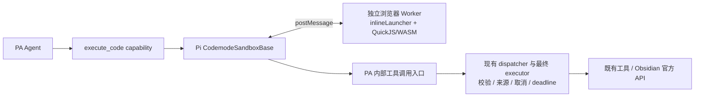

# Pi Codemode 在 PA 中的复用：分析与 MacBook Pro 验证交接

Document status: Archived
Updated: 2026-10-11
Work item: B-170
Authority: 本主题跨设备研究事实和方案演进的历史证据，不作为当前实现或执行状态权威；当前范围见 DEC-061/Product Spec，本轮独立工具验收见最终验证记录。

当前范围见 [DEC-061](../../product/decisions/dec-061-independent-agent-computation.md) 与 [Product Spec](../../product/specs/pa-independent-computation-product-spec.md)，本轮开发测试与设备、模型结果见[最终验证](./b170-independent-computation-validation.md)。[§20](#20-通用计算最小方案草案2026-10-11) 保留设计来源。**用户已确认新增独立通用计算工具：脚本不调用其他 PA 工具，由 Agent 自主选择和组合各项工具；不为某个任务预设流程。** 保留 Pi/QuickJS 技术路线，移除原候选的笔记桥接实施与专项测试。§1–20 原样保留历次研究和设计截点，不作为当前交付状态；其中§1–19的桥接范围及强制移入R10建议已由§20取代，§20的稳定约束已吸收进Product Spec。历史失败不改写为本轮通过，Android仍未验证。

2026-10-11 后续交付授权：用户要求将当前 B-170、B-171 相关文档提交到本地 master，完成后由用户启动后续任务。该授权不包含正式集成、推送、发布或私人 vault 部署，不改写下文各验证阶段当时的授权记录。

2026-10-11 文档修订阶段：用户明确要求按独立计算边界更新 B-170 方案和开发测试计划，复用已有证据，不改正式代码、不提交推送。该阶段未运行模型或部署。

2026-10-11 后续实施授权：用户启动“按照 b-170 方案设计，完成所有的开发测试任务”，并要求等待 B-171 收尾后基于最新代码复核。B-171 已于 `55ef6e43` 收尾；本轮按新基线落实独立工具，仅作必要回归与已授权 test vault 验证，不授予提交、推送、发布或私人 vault 权限。此授权接续 §20 的文档阶段边界，不回写历史验收。

## 1. 接手摘要

用户希望 PA 具备通用的确定性计算能力，处理日期、数值、统计及查询组合，减少模型手算和反复判断；要求优先复用现成实现、兼容 Obsidian 桌面与移动端、避免过度设计。2026-10-10 用户要求将讨论形成详细交接文档，把必要验证转到 MacBook Pro。

当前建议：**主线程复用 Pi `CodemodeSandboxBase`，补浏览器 `VmLauncher`；独立 Web Worker 内复用 `inlineLauncher` 和 QuickJS/WASM；脚本通过 PA 现有工具执行链调用工具。** 浏览器原生 `postMessage` 已足够，不需要 Cloudflare、远程执行服务或 Pi Agent 主循环。

接手时最重要的六件事：

1. **尚无 PA Codemode 实现或运行原型。** 已完成源码、发布包和接口分析；桌面、iOS、Android 的 QuickJS 集成均未实测。
2. **当前 npm `@earendil-works/pi-codemode@1.1.0` 不包含所讨论的 portable/inline 代码。** 源码与发布包不一致，不能直接照源码示例安装导入。
3. 最小复用候选是固定 Pi 提交的有限源码纳入，约 6 个实现模块加类型；另外补浏览器启动器、Worker 入口和 PA 执行链适配。该选型仍待确认。
4. 先在 Mac 验证引擎和生命周期，再接 PA 工具，最后做真实模型对照。前两类无需模型 API 调用，也不需要读取私人 vault。
5. Mac 上 Chrome、Safari 或 Obsidian 桌面通过，分别只证明各自环境；不能替代 iOS Obsidian 的 WKWebView 实机证据。
6. 用户已追加授权将本文及相关索引提交到 master 并推送；本机仍不继续写原型、改生产代码、部署或重新调用模型。Mac 会话按用户届时的验证授权推进；本次文档交付不授予后续生产实施、发布或私人 vault 部署权限。

建议接手顺序：阅读本节 → 核对 §3 输入身份 → 执行 §9 的适用验证 → 用 §10 模板返回证据 → 确认 §11 的产品选择。若只授权验证，成果应停在原型、证据和方案确认，不自动进入生产集成。

## 2. 问题来源与已有性能证据

### 2.1 原始任务与已经完成的查询修正

原 prompt：

> 看一下最近两周我都有哪些笔记记录

用户曾在另一设备看到 **5 分 19 秒**。该设备的原始 trace 未取得，不能把本机结果或原因直接等同于那次运行。

此前查询工具在条件匹配前限制候选集合，可能遗漏第 500 条之后的匹配项，促使模型拆目录、追加查询。用户已明确要求：优先复用 Obsidian 官方 API，按条件返回完整匹配笔记列表，正文按需读取，不让模型分页或拆目录补查。该修正已经提交至本地 master：

`ded0b2a10a116efcb9d1899ce3fdbb0a04ebf856` — `fix(agent): return complete matching note lists`

稳定行为见 [Complete Note Query Product Spec](../../product/specs/pa-complete-note-query-product-spec.md)，原实现与验证见 [B-169 Tracker](../active/complete-note-query/tracker.md)。B-169 Tracker 中的“未部署 anthelion”是该次源码交付的截止快照；用户随后另行授权部署与复测，下表记录后续观察，不能把两个时间点混为一谈。本次不重开已经完成的查询修正，也不修改该任务状态。

### 2.2 本机 anthelion 的前后单次样本

来源：2026-10-10 会话中的实际 Chat UI 测试及本地 `comparison.json` / `timing-summary.json` 摘要。保持配置模型 `glm-5.3`、thinking=true，使用新会话及同一 prompt；配置 provider 为 `qwen`。这是客户端配置身份，不独立证明服务端实际模型。WebSearch、Debug 和来源模式保持一致。

| 指标 | 查询修正前 | 查询修正后 |
| --- | ---: | ---: |
| UI 记录耗时 | 424.540 s | 193.872 s |
| Debug run 耗时 | 424.100 s | 193.431 s |
| 物理模型请求数 | 7 | 3 |
| 模型请求累计时间 | 398.558 s | 183.978 s |
| 工具调用数 / 批次数 | 17 / 6 | 5 / 2 |
| 工具批次占用时间 | 21.706 s | 7.844 s |
| input tokens | 131,599 | 45,581 |
| output tokens | 26,542 | 15,689 |
| reasoning tokens | 24,910 | 14,982 |
| `query_notes` 调用数 | 11 | 1 |

工具批次时间按并发区间计，不把同批多个工具时长直接相加。reasoning 是 provider 上报的细分统计，不与 output 再相加当作额外输出总数。

限制：每个版本只有一次样本；模型路径、provider 负载及缓存可不同。Markdown 清单同为 1,902 篇，查询报告允许范围同为 1,859 篇，但没有冻结前后完整正文快照。修正本身改变了工具 schema/guidance；没有另外改 system prompt。后一次日期参数也不严格正确，因此这些结果说明本次调用链缩短，不能宣称跨设备稳定提速比例或完全等价的答案质量。

### 2.3 第二轮 118 秒的具体观察

修正后第二个物理模型请求：

| 项目 | 观察 |
| --- | --- |
| 请求耗时 | 118.4487 s |
| input / output / reasoning | 15,435 / 10,047 / 9,886 tokens |
| 请求开始到首个模型内容 | 约 3.897 s |
| 首个模型内容之后到请求结束 | 约 114.552 s |
| 期间工具执行 / 重试 | 该请求内无工具执行，也未观察到请求重试 |
| 之后的实际查询范围 | 2026-09-24 至 2027-01-01 |

该轮主要时间在模型持续生成 reasoning，而非本地查询或界面投影。已观察的推理主题包括：转换原始 epoch 时间戳、判断最新笔记日期是否代表“今天”、猜测同步/文件时间的意义，以及选择日期过滤方式。请求没有明确提供当天时间和时区；模型把最新笔记约 10 月 8 日当作参照，而当次运行日期是 10 月 10 日，并选择 2027 年 1 月 1 日作为宽泛上界。

**日期上界被设到 2027 年，不等于已经证实 vault 中存在 2027 年的笔记。** 这里证实的是查询参数及时间参照错误。对模型推理的解释是可见内容的主题归纳，不是逐 token 因果证明；不能据此声称某一规则恰好消耗多少 reasoning tokens。

原始 trace/reasoning 涉及私人笔记信息，不随本文复制。本文保留必要数值和脱敏结论，足以启动新的验证。

### 2.4 短 prompt 为什么仍是较重任务

PA 普通 Chat 会组合全局 system 规则、当前允许的工具 schema、skill 目录、历史和已读取的工具结果。用户短句本身没有被简单改写成长需求，但进入了通用 Agent 工作环境。

已核实的 PA 结构：基础语义工具、按权限/来源导出的能力、逐步加载的 skill、工具结果进入下一轮上下文。存在常驻 action/recovery 领域规则和部分纯输出 schema 的重复声明；这属于可以另行评估的 prompt 成本，不能仅凭字符数量归因 118 秒。

Pi 同样由 system、工具、项目上下文和 skill 目录构成提示词；skill 正文按需读取。关键差别不是“Pi 没有上下文”，而是它提供 Bash 等通用执行能力，并可通过 Codemode 在代码中完成确定性计算与工具组合。**PA 已经有 skill 渐进加载，不需要为了复用 Codemode 再做一套 skill 系统。** 这次候选只增加必要工具说明，不同时重写提示词、调整 thinking 或替换模型；否则后续对照难以解释。

## 3. 已核实输入、证据级别与可迁移性

### 3.1 固定输入

| 输入 | 2026-10-10 调查身份 | 接手要求 |
| --- | --- | --- |
| PA 源码 | `ded0b2a10a116efcb9d1899ce3fdbb0a04ebf856`，文档编写前工作区干净 | 在 Mac 核对 commit 与 dirty diff；不同输入不能直接复用全部结论 |
| anthelion 已安装 `main.js` | SHA-256 `29011532c03165ee247587c457d9897f7e0dab97d30e79f5b2777e5503fb658c`，manifest 仍为 2.10.8 | 只是此前 Linux 安装身份，不说明 Mac 已安装同一构建 |
| Pi 源码 | `c5f5b3282d5e4203c085e59837ba17aeaf2829b5` | 固定该提交重取；不要用持续变化的 main 替代基线 |
| 已发布 Pi 包 | `@earendil-works/pi-codemode@1.1.0` | 检查实际 tarball 与 exports；源码 package 同名同版本不代表内容一致 |
| QuickJS 依赖 | `quickjs-wasi@3.6.2` | 精确固定；Pi VM 使用该依赖的内部 exports 接口，升级需重验 |
| Obsidian 最低版本声明 | 当前 manifest 为 1.11.4，非 desktop-only | 是 PA 声明，不是新执行引擎已兼容所有最低版本环境的证明 |

本机实际读取的发布包：Pi tgz 58,943 bytes，SHA-256 `0676eeaf714297c281c2fe88a6ffdf8c133f4620f6a5a44fc5a5cac3f5cffac0`；QuickJS tgz 568,844 bytes，SHA-256 `f1f4349f19a2d849e33ea0ae9bec2e7062b8839f4eceb17c9051ddbaa2720982`。这些来自发布包字节检查，不是构建或运行成功证据。`quickjs.wasm` 为 637,405 bytes；内联 base64 及 JS 包装还会增加产物大小。

### 3.2 结论分级

| 结论 | 级别 | 证据 / 限制 |
| --- | --- | --- |
| Pi 有无需 Node 内置模块的执行核心 | Confirmed | 固定提交的 execution/inline/vm/protocol 源码 |
| npm 1.1.0 缺少 portable/inline/remote/execution 发布文件 | Confirmed | registry exports 与实际 tarball；不能直接 npm import portable |
| PA 有可复用的内联 Worker/WASM 构建机制 | Confirmed | 当前 SQLite 路径与 esbuild 配置 |
| 浏览器 `VmLauncher` 能接入 Pi 执行核心 | Inference | 接口与消息协议支持；尚未编译、运行该组合 |
| QuickJS 的 Date 默认镜像宿主时区、提供当前时钟 | Confirmed documentation | 精确版本官方 README；PA/各设备的实际值仍需验证 |
| 完整 `Intl` / IANA 时区、任意 npm 模块可用 | Unknown / not promised | 不从“支持 JS”推导完整浏览器或 Node 能力 |
| `Symbol.dispose` 是依赖兼容风险 | Confirmed source / runtime unknown | 发布 JS 包含访问及缺失时抛错；实际目标系统需检测 |
| QuickJS 在 Obsidian iOS 可用且可及时取消 | Unknown | 现有 SQLite 成功不能替代 QuickJS 证据 |
| Codemode 将降低真实 prompt 的 reasoning | Hypothesis | 需要同模型、同 thinking 的新样本；当前无速度承诺 |

Pi 和 QuickJS 相关代码为 MIT；纳入源码时保留版权、许可和来源清单，并走 PA 现有 third-party notices/bundle audit。本文没有执行 vendoring 或安装依赖。

### 3.3 跨设备交接方式

本文、Backlog 和 Discovery 索引通过用户于 2026-10-10 明确授权的 master 提交与推送交接。实际交付 SHA 和推送结果以本次 Git 回执为准；Mac 拉取后核对文档已存在及所需 PA 基线可追溯，不能只凭本地分支名称判断同步成功。本次 Git 授权仅覆盖文档交付，不扩大后续实现或部署范围。

不依赖原主机绝对路径：PA 链接使用仓库相对路径，Pi 使用固定 SHA 的公开链接。原主机临时目录只作追溯线索，Mac 上不存在属正常：

- `/tmp/pa-anthelion-timing-20261010/`：修正前样本，包含私人运行数据。
- `/tmp/pa-anthelion-after-query-20261010/`：修正后对照与安装身份，包含私人运行数据。
- `/tmp/pa-anthelion-round2-analysis-20261010/`：第二轮原始请求及 reasoning，包含私人信息。
- `/tmp/pi-agent-source-20261010/`：固定 Pi 源码，可从公开仓库重新取得。
- `/tmp/pa-prompt-analysis-glm/`、`/tmp/pa-codemode-feasibility-glm-20261010/`：PA 只读源码调查；关键结论已纳入本文。

无需迁移全部临时日志。必须复核历史细节时再选取脱敏证据；不要把原始私人请求、凭据或整个插件配置文件复制进仓库或派工材料。

## 4. 推荐架构与 native 方案比较



模型继续使用现有 JSON function-calling，通过一个候选工具 `execute_code({ code: string })` 提交 JavaScript。计算、JSON 处理、日期运算、排序分组由 VM 完成；笔记查询/读取仍交现有工具。普通查询可以直接调用 `query_notes`，不强制绕一遍代码执行。

| 方案 | 可复用点 | 成本或限制 | 当前建议 |
| --- | --- | --- | --- |
| Obsidian 官方 API | Vault、文件、metadata 等宿主语义 | 公开 API 没有通用受限脚本执行器；编辑器命令/Bases 不是通用 async JS 执行 API | 继续负责笔记业务 |
| 普通 Web Worker 直接执行脚本 | 原生引擎、线程隔离、terminate | 仍有 fetch 等浏览器能力；仅线程隔离不足以限制脚本权限 | 不作为直接执行后端 |
| Worker + SES | 现成原生 JS 隔离库，省去 WASM | 仍需较多工具桥接与生命周期接入；无同等 VM 分配上限；lockdown 只能在独立 Worker realm | 备选，Pi 路线出现实证阻碍时再比较 |
| Worker + Pi QuickJS 核心 | VM、工具桥、输出/错误、取消与中断机制 | WASM 体积、移动兼容、有限源码维护 | 优先验证 |
| Node shell / node:vm | 桌面生态丰富 | 移动端缺 Node；权限与产品边界显著扩大 | 不作为桌面移动统一方案 |

不把 Templater/DataviewJS 的宿主访问能力当作权限沙箱，不向脚本暴露 `app`。Worker 负责界面响应与硬终止，QuickJS 负责能力隔离；两者职责不同。

### 4.1 Pi 最小复用范围

固定提交下的实现闭包：

```text
packages/codemode/src/identifier.ts
packages/codemode/src/runtime/execution.ts
packages/codemode/src/runtime/inline.ts
packages/codemode/src/runtime/vm.ts
packages/codemode/src/runtime/prelude-source.ts
packages/codemode/src/runtime/protocol.ts
```

六个实现模块共约 1,353 行，另加 `types.ts` 和纯 `CodemodeWasmModule` 类型，总量约 1,500 行。运行依赖为固定版 `quickjs-wasi`。Node WASM 文件加载器不能进入浏览器包；type-only 依赖要保持 type-only。

PA 需要的浏览器适配点：

- Host launcher：创建 Worker 后立即返回可停止的 channel；转发消息、error/messageerror，停止时 terminate 并清理监听/URL。
- Worker entry：先准备消息接收与初始化期间的结果暂存，再加载 WASM、创建 inline channel；复用既有 protocol。
- 额外初始化/failure 消息：Inline 中断预算耗尽通过 `events.failure(kind: timeout)` 报告，不能一律降成 crash/sandbox error。
- Worker 专用依赖兼容入口：若需 `Symbol.dispose` shim，保证它先于依赖求值；同文件静态 import 前写一条赋值并不能保证执行顺序。

不需要 `remote.ts`、Cloudflare adapter、Node host/worker 启动器，也不必导入重导出这些入口的整个 barrel。此前讨论过 Remote sandbox + RPC，最终推荐已收敛到更直接的浏览器 `VmLauncher`。

## 5. PA 工具接入与职责边界

### 5.1 必须复用完整执行路径

当前 `CapabilityRegistry.execute()` 与 `prepareAndValidate()` 是不同入口；schema 校验、来源准入和 timeout 不全在 registry 内。直接调用 capability 或仅调用 registry 会遗漏必要边界。

候选接法：从现有 dispatcher 中复用内部 admission/execution 路径，面向已经组装好 Operations/Write Action/task-source 包装的最终 executor，增加一个 Host 内部调用入口。脚本继续使用 Pi 的 `tools.<name>(args)`，不另造一套公开批处理 DSL。

内部入口必须：

1. 每次动态调用都按当前工具许可、schema、run 身份和来源范围重新准入；仅启动时给一个静态 allowlist 不够。
2. 共用已有调用预算、physical attempt 计数、取消和绝对 deadline；第一版内部请求在 Host 顺序执行，避免 `Promise.all` 绕过既有串行工具规则。
3. 排除 `execute_code` 自身，避免递归生成 Worker。不要把所有有注册名的工具都自动开放给脚本。
4. 保留内部调用耗时/结果用于 Debug 与诊断；只把外层代码执行作为一次模型工具调用写入 canonical transcript。不能直接重入会生成独立 ToolMessage 的完整模型轮次入口。
5. 从经过允许范围投影的结构化 observation 交给 VM，不解析 `promptText`，也不传入原始 vault/memory evidence 或 Host 对象。
6. Host 汇总 sourceRecords、Context Used 和必要执行事实；脚本派生结果保留读取依赖。来源被排除、切换或 Forget 后，不能继续把旧派生结果当有效材料。

源码入口见 [dispatcher](../../../src/ai-services/pa-agent-tool-dispatcher.ts)、[最终 runtime 组装](../../../src/ai-services/pa-agent-runtime.ts)、[来源准入](../../../src/ai-services/task-source-executor.ts)、[结果转换](../../../src/ai-services/pa-agent-host-tools.ts)。

### 5.2 推荐首版范围，尚待产品确认

建议开放：通用 JavaScript 计算，以及当前任务允许的只读查询/读取工具。包括 Date/数值计算、数组处理、统计去重、笔记列表筛选和按需读取正文；具体读取范围仍由现有工具及来源约束决定。

写入继续通过当前直接工具执行。原因是脚本的“已写一部分、后来失败、整体重试”会引入真实重复副作用和未知状态传递问题，当前日期/统计需求不需要先解决这类批量写入事务。**这是建议边界，不是用户已批准的永久限制。** 若选择脚本内写入，必须先说明与现有 Operations intent、receipt、Undo 和 `acceptance_unknown` 的衔接。

不引入持久 VM、跨会话变量、脚本库、任意 npm 导入、新权限体系或第二个 Agent 循环。每次新建执行环境，只缓存不含笔记内容的 WASM 资源。不向脚本直接开放 DOM、网络、文件系统、Obsidian app 或凭据。

完整查询要求仍成立：不得把完整列表再偷偷截成 500 条；若真实资源不足，明确报告失败/不完整，不能把截断结果冒称完整。执行资源上限也不能代替产品的查询条件。脚本可以按用户需求聚合，但不得擅自丢掉用户要求的完整列表。

### 5.3 与现有 Command Architecture Contract 的映射

| 决策或行为 | Owner | 事实依据 / 输出 |
| --- | --- | --- |
| “最近两周”语义、created/modified/笔记日期选择、是否需要代码 | Agent | 用户请求与已知上下文；必要歧义由模型处理，不增加关键词路由 |
| 当前时钟、工具许可、来源身份、取消、资源与生命周期 | Host / harness | 实际运行环境与已有控制事实；脚本不能伪造 |
| 日期/数值/JSON 确定性计算 | 代码执行能力 | VM 执行结果、错误和计算预算；不自行判断用户任务完成 |
| 笔记匹配与读取 | 既有工具 / Obsidian API | 完整匹配结果、正文按需、现有 source guard |
| 输出解释、任务完成与恢复选择 | Agent | 可见结果与实际失败，不由 Host 规则替模型决定下一步工具 |

当前 [架构契约](../../architecture/pa-agent-architecture-plan.md#command-architecture-contract) 仍写有默认不提供通用 script 的边界；能力类型中的 `local-script` 只是预留，不代表已实现或获批。若选择生产集成，应显式确认“受限本地计算”范围并同步 owning contract，不能用本文自称 Approved 来绕过该变化。

## 6. 取消、超时与资源方案

| 场景 | 候选机制 | 必须观察的事实 |
| --- | --- | --- |
| 持续同步计算 / `while (true) {}` | Worker 内 Pi interrupt budget；主线程取消或 deadline 时 terminate | UI 可操作，能结束本次计算，下一次调用可运行 |
| 持续 Promise job / `while (true) await null` | Pi VM 的 job-loop 中断检查，加主线程 terminate | 不因微任务不断续接逃过终止 |
| 等待嵌套工具 | 外层 signal → Pi pending call controller → PA 工具 signal | 工具实际收到取消；未 await 的调用随脚本结束被取消 |
| 工具忽略 signal / 结果迟到 | 既有 abort grace 与终态保护 | 如实记录工具未确认结束；迟到结果不改写终态或下次结果 |
| Worker 初始化期间取消 | launcher 立即提供 channel，Host 可直接 terminate | WASM 尚未 ready 时也能结束，不遗留 Worker |
| 卸载/重载 | 终止、pending 清理、监听与 URL 释放 | 不自动重放脚本；重载后的继续沿用显式恢复语义 |
| iOS 后台暂停/恢复 | 保留绝对 deadline，恢复时重新检查 | 不重置预算，不承诺后台定时器始终及时执行 |

两类预算分开：

- **等待/总时限**：PA 当前普通工具默认单次 30 分钟，可由具体能力覆盖。代码执行和子工具都收敛到外层 `outerToolDeadlineAt`，不能每次子调用重开 30 分钟；不把该默认值误记成全任务总时限。
- **计算量**：Pi Inline 默认累计 100,000 次中断检查，跨 await 不重置。它不是 100,000 ms，也不是固定 CPU 秒数；在目标设备测量其实际表现。
- **内存**：Pi 库默认没有适合移动端的显式分配上限。64 MiB 只是原型可用的起测值，最终要由代表性输入确认；QuickJS 分配限制不等于整个 Worker/JSON 复制/浏览器进程内存上限。

Pi 库默认 `timeoutMs=300000`，CLI wrapper 又有自己的 Infinity/256 MiB 选择；PA 应显式配置，不混用这些默认值。`SharedArrayBuffer` 不作为本方案前提。停止 Worker 只结束计算；即使未来允许写入，也不等于撤销已发生的宿主写操作。

## 7. 桌面、移动与打包

复用 [SQLite inline assets](../../../src/vss/sqlite-inline-assets.ts) 与 [esbuild](../../../esbuild.config.mjs) 的 `?worker-source`、lazy binary 机制，保持 `main.js`、manifest、styles 的现有分发形态。不要让 Worker 内部残留 Node import 或运行期拉取 CDN 文件。首次需要代码工具时才初始化；是否缓存编译模块由实际启动成本决定，不先做 Worker 池。

| 环境 | 本文已知 | 未验证项 |
| --- | --- | --- |
| Mac Obsidian / Chromium | 浏览器 Worker/WASM 路线适配其平台能力 | 最终插件加载、交互、取消、卸载、内存及冷启动 |
| Mac Safari | 可用于发现 WebKit API/加载兼容问题 | 不能替代 Obsidian WKWebView 或 iPhone 生命周期 |
| iOS Obsidian | 平台没有 Node；依赖存在 Symbol.dispose 兼容风险 | 目标系统 API、WASM/Blob/CSP、硬终止、前后台与资源释放 |
| Android Obsidian | 同一浏览器方案有可行性 | 实际 WebView 及设备行为；没有设备则保留 NOT TESTED |

`Symbol.dispose` 需要区分四件事：目标环境是否存在符号、依赖何时访问、兼容入口是否先执行、实际资源是否释放。不能只看到符号已定义就判定兼容完成。避免在 Obsidian 主线程 realm 全局打补丁。

源代码中的 Date 行为有官方依据，但 `Intl`、命名时区库、浏览器全部 globals、Node 内置模块均不自动可用。日期验证应覆盖实际设备当前时间、本地偏移、UTC 与跨月/闰年；需要 DST 的产品范围再补对应日期，不能把固定毫秒减法等同于所有日历语义。

## 8. MacBook Pro 接手准备

先记录下列非敏感信息，不扫描或输出密钥：

- Mac 芯片/架构、macOS、Obsidian 应用及安装器版本、浏览器/WebKit 版本；iPhone 验证时另记 iOS/Obsidian 版本。
- PA 实际 repo root、HEAD、dirty diff 和归属；Node 22 / npm 10 或 11。
- Pi 固定 SHA、QuickJS 精确版本、实际包 exports；若发布包已经更新，作为新的输入评估，不静默替换旧基线。
- 实际测试 vault 的完整路径、窗口/进程及已加载插件身份；`vault=test` 这个名字本身不证明隔离。
- 仅在真实模型测试阶段记录 provider 类型、配置模型、thinking、来源模式和 Debug 状态；不复制完整配置文件。

可用的只读起始命令，在实际 PA repo root 中运行：

```bash
git status --short --branch
git rev-parse HEAD
node --version
npm --version
command -v obsidian
```

Pi 源码不存在时，按接手时的研究授权取得公开仓库并切到固定提交；不要假设原 Linux `/tmp` 路径在 Mac 存在。没有必要为了读文档拉取所有依赖。原型工作放临时目录或明确的工作树，保留与生产改动的区别。

真实 Obsidian 验证沿用 [test-vault smoke](../../../.agents/skills/obsidian-test-vault-smoke/SKILL.md)。涉及本次已识别的 iOS 引擎兼容与生命周期时，验证结论需要目标设备证据；通过 Mac 的 Safari Web Inspector 连接 iPhone 时沿用 [iOS real-device smoke](../../../.agents/skills/obsidian-ios-real-device-smoke/SKILL.md)。当前写文档不启动部署或设备操作。

## 9. 分阶段验证与停止条件

以下均为**待执行任务**，没有任何一行已因源码分析而 PASS。先覆盖能推翻方案的关键未知；只有输入变化、失败或未覆盖风险才扩大/重跑。阶段推进按接手时授权，不为每个常规步骤重复询问，也不把验证自动扩大成正式功能交付。

### V0：固定来源与构建可行性

- 核对 Pi/QuickJS 身份、最小依赖闭包、许可证与实际发布 exports。
- 建一个只含执行核心和两个浏览器适配入口的临时原型；复用 PA 的 browser/ES2020 构建方式，检查最终 Worker 是否还有 Node 运行依赖。
- 记录最终 JS/WASM 字节数、初始化时间、是否运行期请求外网、是否需要 shim。
- 通过：精确来源可复现，Worker 与 WASM 可加载，错误可返回。
- 停止：发布包缺模块、Node 泄漏、CSP/资源加载失败时，先解决来源/包装，不接 PA 或模型。

### V1：纯计算与时钟，暂不接工具和模型

| 用例 | 操作 | 通过条件 / 记录 |
| --- | --- | --- |
| 确定性计算 | 固定数组求和、排序、分组，JSON 往返，async/await 与 Promise | 与独立期望一致；不把浮点近似误判成任意精度十进制支持 |
| 当前时钟 | 对比 Host 与 VM 的 Date.now、本地时间与时区偏移 | 时间偏差有解释，未从笔记 mtime 猜今天；记录环境时区 |
| 日历边界 | 固定输入验证两周区间、跨月、闰年；需要 DST 时覆盖该边界 | 记录语义和上下界开闭；不预先强制唯一自然语言解释 |
| 能力隔离 | 检查 VM 中的 app、document、fetch、Node require 等 | 没有意外宿主能力；工具只能经显式桥调用 |

这些用例在浏览器/原型通过，不能单独证明插件集成或模型会正确选用工具。

### V2：取消、超时、错误与资源

| 用例 | 触发 | 必须核对 |
| --- | --- | --- |
| 计算预算 | 同步死循环与持续 Promise job 分别运行 | 预算耗尽归类 timeout；主界面可响应 |
| 用户取消 | 在独立取消用例中确保脚本仍运行，再发取消 | Host channel 已可停止；Worker 停止；下一次简单计算成功 |
| 初始化取消 | WASM/初始化未完成时取消 | 不等待初始化才能清理，不遗留 pending 请求 |
| 短 deadline | 原型配置一个短的测试 deadline | 终止原因保持正确；不修改生产 30 分钟默认来方便测试 |
| 内存/输出边界 | 在临时原型中受控触发 VM 分配和输出限制 | 明确失败，无界面失控或假完整成功；记录实际内存口径 |
| 卸载/反复运行 | 结束、取消、失败后再运行；插件阶段补卸载 | 无遗留 Worker/监听/Blob URL；不靠重启应用才能恢复 |

记录 cancel_requested_at、terminal_at、实际延迟、终态、是否还有被接纳的后续调用、下一次执行结果。中断预算先触发不算用户取消已验证；必要时只在该测试中调整预算以区分两条路径，并保留实际配置。

### V3：接 PA 执行链，用可控工具验证

前提：已授权原型接线；首轮使用固定数据和可控只读工具，不发送私人笔记。

- 合法/非法参数、不存在/未许可的工具、来源被排除：都经过原执行链，失败不触及真实能力。
- 顺序调用及 `Promise.all`：Host 内部串行策略有效，不绕过既有准入和预算；不开放递归代码执行。
- 等待工具时取消、未 await 调用随脚本结束、忽略 signal 的迟到工具：记录实际 signal 与终态，迟到值不污染外层和下次执行。
- 一个外层短 deadline 下连续调用两个延迟工具：第二个只能获得剩余时间，不能重新领取完整预算。
- 运行中来源切换/撤销：每个动态调用受最新有效准入约束，旧来源派生结果不能被继续接受。
- 返回结构化 observation；Host 保留 sourceRecords、Context Used、执行事实。canonical transcript 只有真实外层模型调用的对应结果，不伪造内部模型轮次。

通过标准是复用管线的真实效果，不是 mock 只验证某个方法被调用。出现直接 capability 调用、来源遗漏或终态污染时停在本层修复，不用真实模型重试掩盖接线错误。

### V4：Mac Obsidian 独立 test vault 集成

在获准的集成范围内完成适用的源码检查，再部署当前构建；依 [AGENTS](../../../AGENTS.md#testing-instructions) 复用 enclosing gate。`make deploy` 包含 guards/lint/build/full Jest；已有当前输入有效检查时可用 `make deploy-current`，它只验证构建身份，不能代替测试。

最小实际场景：

1. 核对 vault 路径、可见窗口、已安装并已加载 bundle，reload 后执行纯计算，操作输入/滚动确认响应。
2. 用明确属于本任务的合成笔记验证查询组合：大于 500 篇、阈值后仍命中、关键词完整列表、正文按需读取。复用 B-169 有效证据，只补 Codemode 新桥是否裁剪/丢来源，不无条件重跑旧实现全套。
3. 通过 UI 停止正在计算及等待工具的执行，验证下一次 Chat 可继续；记录错误和内存/资源回收观察。
4. 卸载/重载后不存在旧执行自动重放。清理本任务夹具并恢复临时设置，保留用户已有数据。

本阶段先用确定性输入验证接线；需要证明模型工具选择时再进入 V6。没有原型/候选构建时，不能声称已执行 V4。

### V5：WebKit / 移动端确认

- Mac Safari 可以先跑 V0–V2 的关键原型，定位 Symbol.dispose、Blob、WASM 和终止问题；记录实际版本。
- iOS Obsidian 验证对应构建、依赖加载顺序、纯计算/查询、用户停止，以及切后台/恢复后截止时间和结果处理。Mac 的 mobile simulator 只覆盖通用移动呈现，不覆盖 iOS 引擎。
- 没有 iPhone/连接权限时，标记 iOS NOT TESTED 或 BLOCKED，保留桌面结论；不因此反复排查工具，也不擅自把产品范围改成 desktop-only。
- Android 没有设备证据时保持 NOT TESTED，不从 Mac 或 iOS 推导 Android 已通过。若要作 Android 兼容发布声明，补对应目标验证。

这项真机需求来自已经识别的 WebKit API 与生命周期风险，不是所有 PA 改动都默认增加一轮 iPhone 测试。

### V6：原 prompt 的行为和耗时对照

仅在引擎/桥接通过、且接手时已授权真实模型验证后进行。先用合成 test vault；若要复测 anthelion，核对该设备的用户授权与实际目标。不得将旧主机一次部署授权解释为任意设备/任意 vault 可覆盖安装。

对照要求：

- 相同 prompt、配置模型、thinking、provider、来源模式及可解释的数据快照；记录每次时间、时区、笔记清单变化和缓存统计。当前 Mac 的“最近两周”不应硬编码成历史 2026-09-24 区间。
- 原始基线与 Codemode 候选均新建会话；必要工具 schema/说明变更是候选输入的一部分，不声称 payload 完全相同。其余 system prompt 不同时重构。
- 记录 UI/Debug 总耗时、物理模型请求数、每请求首内容时间/总时长、input/output/reasoning/cached tokens、工具批次时间及脚本初始化/计算/等待分段。脚本子调用不是额外模型轮次。
- 同时检查时间参照、查询字段、起止范围、匹配完整性、正文读取必要性与来源；不能只看速度。
- 接受合理解释或必要澄清，不强制唯一工具顺序或固定调用次数。若模型没用代码但直接正确完成，不能单凭未调用 Codemode 判失败；需要观察通用能力时另给明确计算场景。
- 一组最小对照只支持个案结论。样本噪声大或结果矛盾才追加；不要为了获得更好数字反复采样，也不从单次生成推断稳定 p50/p95。

若日期正确性改善但 reasoning 仍高，分别报告能力是否解决问题、模型是否使用、耗时是否改善，再讨论 prompt；不要边测试边关闭 thinking 或替换模型。

## 10. 验证结果如何交回

沿用已有任务响应/后续获批 Tracker 记录，不再建一套测试平台。每个已执行阶段保留下列最小字段：

| 字段 | 填写要求 |
| --- | --- |
| Scope / case | V0–V6 及具体场景；区分原型、源码测试、模型、实际 app |
| Inputs | PA HEAD + 相关 dirty diff、Pi SHA、QuickJS 版本、原型/构建身份、测试数据 |
| Environment | macOS/芯片、Obsidian/浏览器、目标 vault；移动时写具体系统和设备 |
| Execution | 命令或实际交互、关键配置、开始/结束时间、自然退出码 |
| Observation | 原始预期与实际值、取消/超时原因、是否有迟到接纳或残留资源 |
| Verdict | PASS / FAIL / BLOCKED / NOT TESTED；注明可证明与不能证明的范围 |
| Evidence | 可访问的脱敏日志/结果路径；不只给文字“已通过” |
| Reuse | 哪些已有证据复用，哪些变化会使它失效 |

Mac 结论应回答：是否保留 Pi 方案；首版范围是否接受；哪些兼容问题已实证解决；还有哪些设备/行为未验证；是否具备开始生产实施的依据。日期功能通过不等于总体性能通过，运行原型通过也不等于产品集成完成。

## 11. 待确认事项与退出条件

| 待确认项 | 当前建议 | 决策触发 |
| --- | --- | --- |
| 首版脚本能力范围 | 通用计算 + 已允许的只读工具；写入仍走直接工具 | 开始生产集成前由用户确认 |
| 复用来源 | 固定 Pi SHA 的有限源码纳入，固定 QuickJS；未来可替换官方发布入口 | V0 核对新的发布状况与维护成本后 |
| 脚本输入、错误和内部调用展示 | 保持单一 Agent 工具协议；保留必要 Debug/来源，普通 UI 不暴露内部实现细节 | 原型证明最小接线后定稿 |
| 计算/内存参数 | 复用中断机制和外层 deadline；64 MiB 仅起测值 | V1–V5 代表性数据结果后，不凭猜测固化 |
| 移动范围 | 目标是桌面移动共用实现；未验证保持明确缺口 | 发现实际不兼容时提交证据/替代方案，不静默降为 desktop-only |
| 下一步实施 | 验证与范围确认后，再建立适用 Decision/Spec/执行记录并同步架构 | 明确实施授权后 |

接受方案后按 [Documentation Workflow](../documentation-workflow.md) 进入合适产品链；本文仍是研究依据，最终事实与契约吸收后再处置。延期则保留 Backlog 和具体重启条件；否决则保留必要原因，不把本轮分析写成实现失败。

## 12. 定位与参考资料

### PA 当前源码和规则

| 主题 | 入口 / 搜索符号 |
| --- | --- |
| 系统提示与 skill 目录 | [pa-agent-prompts.ts](../../../src/ai-services/pa-agent-prompts.ts)、[skill-context-provider.ts](../../../src/ai-services/skill-context-provider.ts) |
| runtime 与最终 executor | [pa-agent-runtime.ts](../../../src/ai-services/pa-agent-runtime.ts)，`createWriteActionAwareToolExecutor` / `createTaskSourceConstrainedExecutor` |
| 执行与超时 | [pa-agent-tool-dispatcher.ts](../../../src/ai-services/pa-agent-tool-dispatcher.ts)，`executeSingle` / `createToolInterruptPromise` |
| 结构化结果 | [capability-types.ts](../../../src/ai-services/capability-types.ts)、[pa-agent-types.ts](../../../src/ai-services/pa-agent-types.ts)、[pa-agent-host-tools.ts](../../../src/ai-services/pa-agent-host-tools.ts) |
| transcript | [pa-agent-loop.ts](../../../src/ai-services/pa-agent-loop.ts)，`emitToolResult` |
| Worker/WASM | [sqlite-inline-assets.ts](../../../src/vss/sqlite-inline-assets.ts)、[esbuild.config.mjs](../../../esbuild.config.mjs) |
| 架构责任 | [Command Architecture Contract](../../architecture/pa-agent-architecture-plan.md#command-architecture-contract) |
| 证据与分工 | [GOV-001](../governance/gov-001-agent-managed-project-lifecycle.md#validation-evidence-and-diagnosis)、[GPT-6 / GLM workflow](../workflows/gpt6-glm-delivery-workflow.md) |

### 固定外部来源

- [Pi 固定源码](https://github.com/earendil-works/pi/tree/c5f5b3282d5e4203c085e59837ba17aeaf2829b5/packages/codemode)；[execution.ts](https://github.com/earendil-works/pi/blob/c5f5b3282d5e4203c085e59837ba17aeaf2829b5/packages/codemode/src/runtime/execution.ts)、[inline.ts](https://github.com/earendil-works/pi/blob/c5f5b3282d5e4203c085e59837ba17aeaf2829b5/packages/codemode/src/runtime/inline.ts)、[vm.ts](https://github.com/earendil-works/pi/blob/c5f5b3282d5e4203c085e59837ba17aeaf2829b5/packages/codemode/src/runtime/vm.ts)、[protocol.ts](https://github.com/earendil-works/pi/blob/c5f5b3282d5e4203c085e59837ba17aeaf2829b5/packages/codemode/src/runtime/protocol.ts)。
- [Pi system prompt](https://github.com/earendil-works/pi/blob/c5f5b3282d5e4203c085e59837ba17aeaf2829b5/packages/coding-agent/src/core/system-prompt.ts)；[Pi Codemode 工具接线](https://github.com/earendil-works/pi/blob/c5f5b3282d5e4203c085e59837ba17aeaf2829b5/packages/coding-agent/src/extensions/codemode/execute.ts)。
- [Pi npm 1.1.0 元数据](https://registry.npmjs.org/@earendil-works/pi-codemode/1.1.0)；[QuickJS 3.6.2 元数据](https://registry.npmjs.org/quickjs-wasi/3.6.2)；[QuickJS 精确版本 README](https://raw.githubusercontent.com/vercel-labs/quickjs-wasi/quickjs-wasi@3.6.2/README.md)。
- [Obsidian Mobile development](https://docs.obsidian.md/Plugins/Getting%20started/Mobile%20development)。
- [Worker 可用能力](https://developer.mozilla.org/en-US/docs/Web/API/Web_Workers_API/Functions_and_classes_available_to_workers)；[Worker terminate](https://developer.mozilla.org/en-US/docs/Web/API/Worker/terminate)；[Symbol.dispose 兼容性](https://developer.mozilla.org/en-US/docs/Web/JavaScript/Reference/Global_Objects/Symbol/dispose)；[SES 官方说明](https://docs.endojs.org/modules/ses.html)。

以上外部行为与发布状态均以 2026-10-10 调查为基线；固定源码链接用于复现，未固定的浏览器兼容说明在 Mac 接手时应结合实际版本重新核对。

## 13. MacBook Pro 验证记录（2026-10-10）

### 授权、输入与证据位置

本轮用户授权临时原型、必要测试及核对身份后的独立 test vault 验证；没有正式产品集成、提交、推送或发布授权，不覆盖私人 vault。V0–V2 不调用模型；本轮临时原型由 GPT 执行，没有发起 GLM 派工 API 请求。PA 接线由另一位 GPT 进行只读独立审查。用户另确认 iPhone 已打开 iCloud test vault，仍须在实际操作前核对目标和加载身份。

- 仓库 `/Users/eddie/code/personal-assistant`，起始 HEAD `5c224108cb045bdeaec557369a6bbc81e0634eac`，起始工作区干净；完整查询基线 `ded0b2a10a116efcb9d1899ce3fdbb0a04ebf856` 已包含，生产源码未改。
- MacBook Pro，`Mac17,9` / Apple M5 Pro / arm64；macOS 26.6.2（25G83），Node 22.22.2 / npm 10.9.7。
- Chrome 154.0.8037.98；Safari 26.6.2（21624.5.1.11.3）。Obsidian 1.14.4，installer 1.12.4，Electron 39.7.0 / Chromium 142.0.7444.265。
- 时区 Asia/Singapore，Host offset −480 分钟。桌面 test 注册 ID `d9a8eda5adb9f572`，CLI 和 adapter 实际路径均为 `/Users/eddie/code/personal-assistant/test`。原已加载插件为 2.10.7；CLI debug 无可靠状态查询，保持未改，mobile=false 保持未改。
- Pi 固定源码 SHA 和两个 npm 包的字节数、SHA-256 均与 §3 一致。六个实现模块及 `types.ts` 逐字节保持原样；`wasm.ts` 仅抽取不透明类型，未携带 Node loader，许可保留。
- 本机原始证据根目录 `/private/tmp/pa-b170-20261010/`：`evidence/input-identity.json`、`prototype/source-integrity.json`、`prototype/build-receipt-a.json`、`prototype/build-receipt.json`；原型源码和 MIT 许可在 `prototype/`，PA 临时接线在 `bridge/`。这些路径是本轮本机证据，不是跨机前提。

### V0–V2：Chrome 浏览器原型

采用主线程 `CodemodeSandboxBase` + 浏览器 `VmLauncher`、Worker 内 `inlineLauncher` + QuickJS/WASM，原生 postMessage。Worker channel 不等待初始化即可停止。Worker 独立入口先设置必要的 `Symbol.dispose` 兼容符号，再求值依赖；没有修改主线程 realm。

browser / ES2020 构建：初版 Host bundle 1,028,271 B，Worker 997,564 B，内联 WASM 637,405 B；无 external imports、无 Node 运行导入、无运行时 CDN。原型运行不要求 cross-origin isolation / SharedArrayBuffer。构建检查与同源请求记录支持本次未发生外网加载，单独的 Performance entries 不能证明所有网络行为。

| 风险 / 输入 | 实测结果 | 证据 / 边界 |
| --- | --- | --- |
| 确定性计算、JSON、async/await | PASS，固定数组和分组与独立期望一致 | 首次用例 74 ms；WASM compile 2.30 ms，未隔离浏览器编译缓存，不是严格冷启动基准 |
| 当前时钟、本地/UTC、跨月、闰年 | PASS；VM epoch 落在 Host 起止区间，offset −480，2024 闰日正确 | `Intl` 为 undefined；不承诺完整 IANA 时区；固定日期减 14 个本地日不代表替 Agent 决定自然语言区间 |
| 能力隔离 | PASS；app/document/window/fetch/XMLHttpRequest/WebSocket/process/require/timer/Worker/WebAssembly 未暴露 | VM 能力证据，非完整安全审计 |
| 同步无限循环 | PASS；100,000 polls 实际 10,285 ms，归类 interrupt-budget timeout | 首轮夹具 10,000 ms deadline 抢先触发，保留原 FAIL；仅将该用例 deadline 改为 45,000 ms 补验，Worker 字节不变 |
| 持续 Promise job | PASS；100,000 polls 实际 7,001 ms，归类 interrupt-budget timeout | 轮询次数不是毫秒，两类脚本耗时也不同 |
| 运行中用户取消 | PASS；脚本已通过测试专用空操作握手，再继续同步循环；取消→终态记录 0 ms | 计时精度为毫秒，不能说物理瞬时；预算 1e12，未被预算抢先终止；下一次返回 42 |
| 初始化期间取消 | PASS；受控未 ready 门闩下取消→终态 0 ms | 不等待 WASM ready；是初始化屏障测试，不是任意真实编译时机的穷举 |
| 短 deadline | PASS；120 ms 配置，121 ms 终态，timeout 分类正确 | 仅原型配置，未改生产默认值 |
| 内存与输出 | PASS；64 MiB 分配上限明确 out-of-memory；超过原 Pi 16 MiB 输出上限明确失败 | 输出用例单独给 128 MiB 以区分两条失败路径；两者都不是批准的产品限制或总进程内存上限 |
| 释放与再次执行 | PASS；15 次创建/终止后 Worker、监听、Blob URL 所有权计数均为 0 | 已执行 terminate/remove/revoke，不等于证明浏览器物理内存全部回收；页面可实际输入，Host tick 持续 |

原始首轮 `evidence/20261010T151438130753Z.json`（14 PASS / 1 夹具遮挡），单用例补验 `evidence/20261010T151555749897Z.json`（1 PASS）；时钟独立校验和逐用例耗时见 `prototype/chrome-first-analysis.json`。已通过项未重复运行。**V0–V2 Chrome 引擎门槛通过；这不是 Obsidian、iOS 或模型证据。**

### V3：现有 PA 执行链的隔离接线

临时 `bridge/transform.mjs` 只变换 dispatcher 与 host-tools，其他 PA 源码保持原样，通过 esbuild 原目录解析复用。可审查差异为 `bridge/source-transform.patch`；候选 A runner SHA-256 `41ce039b17ad507d804e06b07f88dcbba8d1bdf36e0794b84d96f4e463797368`。生产树没有安装 Pi 依赖，也没有写入运行时代码。

实际调用路径为同一个 `ToolExecutionDispatcher` → task-source 包装 → Operations 包装 → PA host capability executor → registry/schema → 原有 `query_notes` / `read_note` factory，或可控只读 `probe`。内部入口复用原 buffered batch，显式传入 signal、绝对 deadline、父 ID 和结果回调；串行 Promise 链只排列 VM 发来的请求，不另建工具系统。结构化 observation 在 `projectToolResultForProvider` **之后**通过 Host-only Symbol 携带，不解析 promptText，也不使用原始 observation 绕过投影。内部工具结果归并到一个外层结果；canonical 回调只收到外层，子调用不伪造模型消息。

Chrome 当前收据 `bridge/evidence/20261010T152250348865Z.json` 为 **15/15 断言通过**。较早收据保留，但其 canonical 回调和 deadline 身份断言较弱，后者为该接缝的有效证据。变换源码在仓库完整声明上下文中类型检查为 0 diagnostics；最初漏加载仓库声明的类型检查错误已保留并归为夹具配置问题。

| 行为 | 已证实范围 | 限制 |
| --- | --- | --- |
| 参数/许可/来源 | schema 错误、禁止/未知工具、排除路径在能力执行前被拒绝；脚本无递归 execute_code 入口 | 受控 live allowlist 与 registry；内部入口尚未传真实 AgentControl 的 toolMode/controlSnapshot |
| 结构化结果与计数 | 真实 provider 投影值进入 VM；Promise.all 的 Host 实际最大并发为 1；子调用共享 dispatcher 的调用数/物理执行数 | 不是模型 transcript 或 Debug 父子显示验收 |
| 取消 | source checkpoint、prepareBatch、等待工具均收到中断；前两者未开始能力执行；取消后可再次运行 | Host 必须传播 signal；终止 Worker 本身不保证工具停止 |
| 迟到结果 | 忽略 signal 的受控工具在取消后实际完成；旧结果不改终态或下一次执行，保留 abort_timeout 事实 | 没有写工具，不能推导任何写入回滚能力 |
| deadline | 两个延迟子工具共用外层同一绝对截止时间；排队/准备消耗原预算，没有续领完整超时 | 桌面收据暴露下述内部原因误分类；metadata.timeoutMs=5000 是能力配置，不是剩余预算 |
| 来源撤销 | 在受控 source state/epoch 撤销后，先前读取的派生值被拒收；脚本不能伪造 Host sourceRecords/Context Used | 未替代实际 runtime 的 Forget、历史再准入和 attachment/notes observation epoch |
| 完整查询 | 601 项穿过现有查询、结构化投影和 VM，末项及来源保留；正文按需读取 | 大于 601 的极端输出和模型上下文压力未测；不得以此重新引入候选截断 |

**独立审查发现 P2：内部超时原因有竞态。** `bridge/src/dispatcher.ts` 的 scope signal listener 把所有父级 abort 统一记成 `aborted`。桌面 `inherited-deadline-two-delayed-tools` 外层在 451 ms 正确返回 `tool_timeout`，两个子调用共享 deadline `1791646271456`；第二个子调用截止后 1 ms 收到中断，却被记为 `aborted / user_abort / stoppedBy=aborted`。Chrome 同输入记录 tool_timeout，说明原因取决于父子计时器顺序。原断言只检查停止和外层原因，故 15/15 不足以证明内部原因正确。保留原始证据，不修改验收口径掩盖问题；生产前必须传播父级中断原因并补一个针对该竞态的回归，不能仅凭 signal.aborted 推断“用户取消”。

**V3 判断：执行链复用可行，阶段语义门槛未全部通过。** 缺口还包括：真实 `PaAgentRuntime.callLineageById` / `sourceRun.prepareLineageAdmission` 不认识内部调用身份；原 runtime 的 source-free 闭集不消费本原型 `hostLineage`，纯计算/零匹配不能直接冒充安全来源；Chat 的 Context Used 持久化、历史与 Forget 再准入、Debug parentage、真实控制模式变化尚未接线。Host 字段归并通过不等于这些产品语义通过。独立只读审查复核了源码与原始收据，未推翻上述限定范围内的其他结果。

### V4：Mac Obsidian 实际应用

先对未修改的 PA 基线执行 `make deploy`：platform guards、lint、生产 build/tsc 通过；完整 Jest 385 suites 中 384 通过，唯一失败为 Ghost HTTP 夹具无法监听本机端口（EPERM，45 个失败断言，非产品行为）。放开该项本机端口权限后，原 `ghost-publishing-client.test.ts` **53/53** 通过。复用其他 384 套件，不重复完整 gate。随后 `make deploy-current` 校验并复制，CLI 重载 PA；这不是声称曾有一轮完整全绿运行。日志见 `evidence/desktop-deploy.log`、`ghost-suite-unrestricted.log`、`desktop-deploy-current.log`。社区 DOM 扫描无命中（exit 1）。

已加载 PA 2.10.8，main SHA-256 `29011532c03165ee247587c457d9897f7e0dab97d30e79f5b2777e5503fb658c`，加载时刻 `2026-10-10T15:24:20.172Z`，无 identity blocker。原型通过**官方 Plugin loader** 的临时 companion 加载冻结 engine/bridge，避免 CLI 的 Node require 无法解析 obsidian API；companion main SHA-256 `708fe397d381a0ce234b3a32971655636c1d5df5499d7dd7d9a6b3f7e8f55320`。companion 为独立测试资产，不是 PA 正式功能或发布布局。

| 真实应用操作 | 结果 | 原始证据（`evidence/`） |
| --- | --- | --- |
| Modal 内纯计算、async、能力隔离 | 3 项通过，211 ms | `desktop-ui-a.json` |
| 同步循环中输入文字，再点击 Stop | UI 可输入；运行握手后取消；取消至终态记录 0 ms；owned resources=0 | `desktop-ui-a.json` |
| 等待实际 PA 只读 probe 时点击 Stop | 宿主 receivedAbort=true；取消至终态 1 ms；资源归零 | `desktop-ui-a.json` |
| 在 Obsidian API 环境运行桥接矩阵 | 15/15 原断言通过；包含上述审查发现的原因误分类 | `desktop-bridge-a.json` |
| 运行中经 Obsidian 生命周期卸载 companion | disposed=true，取消 1 ms，累计 created=stopped=19，三类 owned resources=0 | `desktop-unload-a.json` |
| 卸载重载后再次执行 | 3 项计算检查通过，230 ms | `desktop-after-reload-a.json` |
| 真实 vault 的 601 篇合成笔记 | 一次 query 返回 601 项；末项 note-600 和来源保留；cachedRead 为 0；随后指定 read_note 恰读 1 篇 | `desktop-real-fixtures-a.json`、`fixture-manifest.json` |

真实夹具仅位于 `test/B-170-20261010/fixtures/`，Host adapter 限定这个目录，不向模型发送内容；临时关闭 Memory 自动处理，保留并恢复原设置。夹具按 SHA-256 清单核对后清理。桌面截图 `desktop-prototype.png` 证明实际面板；截图背景是既有 B-168 合成历史，不能当成 B-170 Chat 执行证据。

**V4 判断：桌面 Worker/WASM、原型 UI、既有工具链与完整查询可运行；不是完整 PA Chat 接线验收。** 未测试系统睡眠/恢复、长期内存压力、所有 Obsidian 旧版本和所有只读能力，不据此宣称全平台可用。

### V5：Mac WebKit 与 iPhone

Mac Safari 26.6.2 在 `http://127.0.0.1:8170/public/` 实际点击运行，**15/15 通过**；原始收据 `evidence/20261010T152810075968Z.json`。100,000 polls 的同步循环为 3,540 ms、持续 Promise job 为 3,192 ms，再次证实它不是时间单位。Safari 主 realm 的 Symbol.dispose 在前后均为 undefined，Worker 内 shim 允许加载，主 realm 未被污染。Host deadline 120 ms 实测 121 ms。输入框在 suite 运行期间可用。这里只是 Mac WebKit 原型，不是 iOS。

iOS 目标是用户确认的 **Edony iPhone 15 / Safari 设备列表报告 iOS 26.6.2**。Mirroring 实际连通；初始不是已确认的 test 页面，经用户切换后看到既有合成测试笔记。首次 Inspector 缺少可检查目标；用户开启 Web Inspector 并连接后，成功附加 `Obsidian — localhost`。首次真实粘贴提交的身份命令返回 vault=`test`、body 含 is-mobile/is-ios/is-phone、Obsidian UA 1.14.4、PA 2.9.2。UA 内 iOS 18_7 是页面报告值，不替代设备列表系统版本；本次误把异步 build identity 未 await 后序列化为 `{}`，该字段**不构成加载身份验证**。

Mac iCloud `Documents/test` 路径非 symlink，现有资产已备份；`make deploy-icloud-current` 成功，四个文件与 dist 完全一致。临时 companion、唯一 marker、批次 runner 均已写入该 test 路径并记录哈希（`evidence/ios-deploy-identity.json`）。第二次真实 Console 提交返回：`The file “ios-probe.js” couldn’t be opened because there is no such file.` 批次尚未读入，因此未执行插件重载、marker 比对、Worker 或工具检查；**不能证明 Mac 写入已同步到该 iPhone，也不能证明设备上的同名 test 就是已标记目录**。

依据实机技能“两次提交后报告 partial/BLOCKED”的边界停止，本轮没有第三次 Console 提交或反复重载。设备阶段为 **BLOCKED（同步/目标 marker 与候选加载身份未闭合）**，不是 QuickJS/WASM 不兼容。Mac 本地 iCloud 测试插件恢复为原备份，临时文件清理，见 `evidence/ios-cleanup.json`；恢复到 iPhone 的同步结果同样未验证。设备仍留在用户选定 test；没有操作私人 vault 安装。后续只需先解决文件同步与 marker，然后完成候选加载身份和受影响实机检查，不重复 Chrome/Safari 整轮。

**兼容结论：Mac Obsidian 桌面原型通过；Mac Safari 原型通过；iOS 原型未运行；Android 未测试。** 无 mobile simulator 结果冒充实机。

### V6：模型证据门槛与样本

**NOT RUN。** V3 的内部终止原因缺陷、真实 runtime 来源/控制接线和 V4 Chat 语义验收尚未完成，按用户规定不进入模型阶段。原 prompt 保留为“看一下最近两周我都有哪些笔记记录”；本轮模型请求数 **0**，耗时、reasoning tokens、答案正确性均 **N/A**，不是零 token 的成功答案。provider/model/thinking/system prompt 未变更，没有重放 anthelion 数据。§2 的历史样本仅复用为问题背景，不与这次 601 条合成夹具计算等价提速比例。未观察到“脚本减少物理模型轮数”或“日期答案更准”的实际模型效果。

### 采用建议、最小范围和待确认选择

**技术路线建议采用作为后续候选；当前原型直接生产纳入为 NO-GO。** 浏览器原生 Worker + Pi/QuickJS 组合没有发现必须更换技术路线的障碍，已有机制也足以承接动态只读调用；阻断主要在 PA 语义接缝与未闭合的设备证据。此结论不是批准实施。

| 假设 | 判定 |
| --- | --- |
| Pi 源码可在独立浏览器 Worker 复用，不需要 Pi Agent/Node/远端沙箱 | 已验证，限固定来源和上述环境 |
| npm 1.1.0 可以直接导入 portable/inline | 被推翻，固定源码闭包仍必要 |
| 日期基础运算无需模型手算 | 引擎层已验证；Intl/IANA 时区和自然语言区间不是已提供能力 |
| 原生 Worker 终止可保持宿主交互并重新执行 | 已验证；不等于工具已停止或进程内存已全回收 |
| 内部工具可完整沿用所有既有执行语义 | 部分成立；deadline 原因竞态、真实来源/控制/历史仍有缺口 |
| 不会恢复完整查询截断 | 601 项范围内已验证，未改原查询契约 |
| 共享桌面/iOS 实现和真实模型提速 | 仍未知，不能从桌面或 Safari 推定 |

建议最小生产范围仍是**通用计算 + 经过验证且当前允许的只读工具**；先覆盖 query_notes/read_note，其他已允许只读工具按各自投影/来源边界验证后加入。写入继续走现有直接工具；不纳入脚本写入、shell、网络全局、任意 npm、持久执行或另一个调度框架。

必要调整及责任归属：

1. **Dispatcher 负责执行事实**：同一 dispatcher 内的 child context 应继承父 signal 的真实原因、绝对 deadline、当前 toolMode/controlSnapshot；每个准备和执行边界检查现有准入，不重新授予预算。记录配置超时、有效 deadline 和实际耗时的不同含义。
2. **现有 runtime/source owner 负责来源**：把 child IDs、来源依赖和纯计算/零匹配 Host 收据接入原 lineage/admission；验证实际 Forget/历史重放/来源模式变化。不可让 VM 返回值自称“无来源”，或把 unknown 降格为安全。
3. **Host/Chat 负责结果**：保留投影后结构化数据，归并来源、Context Used、Debug 父子与执行事实；仅外层形成真实模型工具消息，随后验证实际 Chat 展示和持久化。上述责任不能由另一个 harness 永久替代。
4. **Worker launcher 负责隔离与资源**：每次有明确生命周期、无 ready 等待依赖的停止、监听/URL/Worker 清理；保持 Worker 内 Symbol.dispose shim 的求值顺序。内联 WASM/Worker 可继续兼容现有三文件发布形态；正式 bundle 增量和安装链仍需测量，临时 companion 的重复 PA 模块大小不能当成正式增量。
5. **后续验证仅补缺口**：父 timeout 原因竞态回归 → 实际 Chat 来源/控制验收 → 解决 iCloud 同步后的 iPhone 候选身份/行为 → 达到 V6 门槛后用相同 provider/model/thinking 做最小对照。只有新增失败或输入改变才重验。

仍需用户确认的产品选择：是否接受固定 Pi 源码闭包的维护/许可责任；是否确认上述计算+只读首版范围；移动证据补齐前如何安排支持/试验范围（建议不发布未经验证的平台兼容承诺）；脚本错误/内部调用在普通 Chat 与 Debug 的最小展示；资源限制的产品口径。**64 MiB、100,000 polls、16 MiB 输出均不是本轮批准的产品限制**。本地日期基础能力可以使用；跨时区能力、最近两周的边界和截点应由既有日期契约/Host 输入约束，不能默认脚本自带完整 Intl。

### 收尾与证据保留

临时浏览器页面和两个本机服务已关闭；桌面 companion 禁用并清理，启用插件列表与原值逐项一致；临时 Memory 设置恢复；601 篇夹具按哈希清理。桌面 test 保留已验证的 PA 2.10.8 基线，原 2.10.7 资产备份保留；iCloud test 已恢复原资产，未覆盖 anthelion。没有提交、推送、发布，也没有开始正式功能开发。

本机可迁移证据包保留在仓库忽略目录 `tmp/b170-evidence-20261010.tar.gz`，包含本轮原型源码、固定上游包与许可、输入哈希、构建记录、临时差异、原始收据、失败日志和截图；展开为本节使用的相对路径。环境依赖路径需在其他机器重绑定，不承诺脚本不经适配直接跨机运行。索引和包 SHA-256 在 `tmp/b170-evidence-20261010.sha256`。证据包无 provider 凭据、私人笔记或 PA 设置全文。研究结论留在本文，Discovery 继续 Exploring，停在方案确认处。

## 14. 后续补验（2026-10-10–11）

用户追加授权：先修复超时原因，在隔离候选中完成真实 Chat 的来源、取消及 Context Used 接线，通过后仅做最小真实模型对照；另由 subagent 排查 iPhone 同步。仍没有正式集成、提交、推送、发布或私人 vault 安装授权。

### 初始输入与历史检查点

- 主仓库仍为 `5c224108cb045bdeaec557369a6bbc81e0634eac`，仅保留上一轮三份研究文档修改。候选在独立未提交工作树 `/Users/eddie/.codex/worktrees/b170-validation/personal-assistant`；固定源码、许可和原型 Worker 从上一轮本机证据复制，未安装 Pi npm 包。
- Worker 997,564 B，SHA-256 `7e74877d0140b2509de2356d71217e3431773e968db9dd4c25c70445782cce1d`，与上一轮经过 Chrome/Safari 验证的 Worker 逐字节一致。收据 `/private/tmp/pa-b170-followup-20261010/worker-reuse-identity.json`。继续复用引擎矩阵，不能将此身份校验记为新增应用验证。
- GLM writer 使用本机既有 `pa-glm` / ZAI responses / `glm-5.3` / `max`；GPT 负责设计、独立验收和设备操作。一次 `--ignore-user-config` scratch 调用未保留 provider profile，**不能计作 GLM 工具预检**；显式指定 ZAI 的同类启动在请求前报 `Model provider ZAI not found`，没有源码写入。移除该参数后在固定 profile 下的真实读写测试工具调用可追溯，未变更模型配置。此处是编码 worker，不是 V6 的 PA 模型样本。
- 超时回归经夹具等待条件和时钟修正后，取得 **2 个目标失败 / 1 个表面通过**：父 `tool_timeout` 与父 `wall_clock_exceeded` 都被子调用错误归类为 `user_abort`。父子绝对 deadline 同为 10 ms，子调用配置 100 ms 没有续领预算。独立复核随后发现，用户取消用例仅把 `options.signal` 用于 `isAborted`，未传入 dispatcher 的 `signal`，故其绿灯不能证明用户取消优先及迟到结果保护；需修正夹具后补验。两个目标超时失败仍有效，较早夹具错误不算产品失败。不可变副本为 `timeout-repro/accepted-target-red.log` 与 `accepted-target-red.test.ts`，SHA-256 分别为 `b244c4288446a787f94dd6550bf3619eb641e80c903373b4b1084553267f1f5b`、`85a3d8fa28f32e6b64fc8849e410163bde0a497a84ec7a68414049ef35d8466d`。候选修复与 Chat 接线尚在进行，不能提前记为通过。
- 桌面 test 当前仍加载 §13 的基线 main SHA `29011532c03165ee247587c457d9897f7e0dab97d30e79f5b2777e5503fb658c`；四个资产已备份在 `desktop-baseline-assets/`。只新增 `test/B-170-chat-20261011/fixtures/` 的 8 篇合成笔记，实体文件与 Obsidian 中的 ctime/mtime 均已核对，清单在 `fixture-manifest.json`。测试 Host 将限定这个目录；原配置 `qwen / deepseek-v4-pro / thinking=true`，Memory/Web/Operations 关闭。此时尚未调用 PA 模型。

### 候选接线的已确认问题与验证边界

- 修正用户取消夹具，改由真实 `executeChild` 闭包进入同一 dispatcher 后，三项回归通过：父工具超时、父总时限、用户先取消后越过 deadline 并释放迟到结果。父子共享绝对 deadline，监听释放使用同一函数引用。不可变记录为 `timeout-repro/dispatcher-green.log`（SHA-256 `f2f8c3b380255fe6c604240ddf169eb9a8bd20101004f8eee1260db1029e55c6`）及对应测试副本（`73ee4adcc725342d91ce28c5b73a1f3b708e75f0ec370f262d53b4edf88dc623`）。这只证明 dispatcher 接缝，尚不能证明完整 Pi 取消链。
- 独立检查发现两个 Pi 接线问题：忽略 Pi 的 per-call signal 会让脚本结束后的未 await 宿主调用继续排队；接上该 signal 后，Pi 较早注册的父监听会先对 pending call 无原因 `abort()`，仍可能把父 timeout 错记为用户取消。修正须同时观察父 signal 的当前终止原因，并保持首次终止事实；补验须覆盖 Pi 的真实监听顺序。
- 来源检查发现 `query_notes` 与同路径 `read_note` 不能仅按路径 `dedupKey` 合并：后一次正文读取的 `whole_file` 修订也是实际来源事实。候选须保留该记录，沿用现有聚合规则；Context Used 可见不等于底层来源事实完整。
- R4 候选类型检查已通过。仅供来源追溯、未被 Host 导入的 Worker 上游 `.ts` 快照保留原字节并改为不参与编译的 `.ts.txt`，路径变更记录在候选 `SOURCES.md`；没有给主项目安装依赖，没有用伪声明掩盖缺失模块，内嵌 Worker 沿用原固定资产。
- 本地固定 SSE 与 Chat 观察器已准备，尚未执行。固定响应、模拟 usage、ChatService 耗时和真实 provider 样本将分别记录；真实模型指标使用物理 attempt ledger，并按 attempt/purpose/updateKey 处理累计 usage，缺失 reasoning 记未知而非零。

以下为进入真实应用前的历史检查点，后续结果见下文；失败日志不删除或改写为通过：

- R5 `integration/runtime-final-v1.log` 的 9 项通过，覆盖实际 ChatService/Runtime、固定 provider 响应与模拟 sandbox 的接线：默认关闭、纯计算、结构化 query/read、完整来源修订与 Context Used/历史、伪造 VM 来源不采信、零匹配依赖、下一轮 Web 过滤、schema 拒绝、取消后再次计算、附件失效准入。取消夹具等待发生在实际 capability 准入前，不能称作已运行宿主工具的迟到结果验证；后者由 dispatcher 回归及待执行的真实应用 gate 覆盖。
- R5 `integration/r1-timeout-final-v2.log` 4/4 通过，新增成功完成后监听和定时器释放检查；用户先取消仍不会被后来的 deadline 覆盖。
- R6 `integration/child-queue-final-v2.log` 3/3 通过。使用真实 `CodemodeSandboxBase` 和可控 `VmLauncher`，验证 Pi 较早的无原因 abort 不覆盖父原因；自然结束取消已启动子调用并阻止第二个排队调用。自然结束原先也会持久化为 `user_abort`，现通过 Host 的 `scope_cancelled` 保留区别，测试经 `createPaAgentPersistedTurn` 核对保存值。独立源码复核输入：dispatcher `fa0611ec9c6966d180e1eb16f87ab3ce6e02ec20ea2ea5fbde90ce1de8b67d7c`、queue `9a86672fbaec30480acc86e54a019e375bf0f0e0811e4e2154ae65574929272f`。
- R6 `tsc-final-v3.log` exit 0。收敛无界测试等待时，两个夹具出现新失败：100 次 `setImmediate` 不代表 100 ms，取消诊断实际约 41 ms 就提前判超时，且失败后未清理 pending run。此为新夹具错误，不能覆盖原行为断言或算产品失败；修订为真实时间界限和失败清理，最终门禁尚待完成。源码 lint 的输入前后哈希一致，仅发现两个无用类型导入（`source-lint/receipt.json`），未发现其他 lint 错误。
- Chat 观察器已在原基线执行零请求预检并恢复，确认实际 host 仅能读取清单中的 8 篇合成笔记；`observer-scope-preflight.txt` 与 `observer-scope-restored.txt` 记录隔离和恢复。固定 SSE、真实候选 Worker 和模型对照尚未执行。

### R7 冻结门禁与真实 Chat

R7 修正测试的真实时间等待及失败清理，移除两个未使用导入。四个 B-170 聚焦 suite **19/19** 通过，`tsc` 和 diff check 通过。组合 Jest 日志有 delayed-exit 提示但进程自然 exit 0；针对 runtime 的 `--detectOpenHandles` 9/9 通过且没有 open handle 报告，不为同一无未决问题重复诊断。原始记录为 `integration/b170-all-focused-final.log`、`runtime-open-handles.log`、`tsc-final-v4.log`。

GPT 对冻结输入执行 lint、生产 build、完整 test:all、diff check 和 DOM 扫描：**389 suites / 9335 tests 全部通过**；扫描空结果 exit 1。954 个输入文件的前后 SHA-256 一致。证据 `frozen-gate/{inputs,results,input-stability}.json` 及各日志。这一完整门禁绑定 R7，不能挪用为后续改动的一轮完整全绿。

核对 repo-local test adapter 路径及四个原资产哈希后，使用既有 `deploy-current` 部署隔离候选并重载。R7 main 为 9,226,312 B，SHA-256 `1871d0682d14cc634d5bbcdea3dd295468c4d4cf9e4bb1d45f49a21ac3174574`，实际加载时刻 `2026-10-10T17:22:05.960Z`、identity blocker=null。未部署私人 vault 或 iCloud。临时 Host opt-in 只存在当前 ChatService 内存中，观察器限定 8 篇合成笔记、禁止写入并隔离其他 Memory/当前笔记入口，没有保存产品设置。

| 真实 Chat 输入 / 操作 | R7 结果 | 证据 |
| --- | --- | --- |
| 本地固定 SSE 调用 execute_code；Worker 中 query_notes 全部 8 篇，再 read_note 读书摘录 | 完整列表 exact/complete；正文按需读取；17 条 sourceRecords 含同路径 metadata 与 whole_file 修订；两个原始 child evidence；canonical 仅外层工具结果 | `desktop-fixed-read.json`、`desktop-fixed-read-history.json`、`fixed-chat-read-v1-request-1.json` |
| 下一轮 UI 切到 Web sources | 实际请求不含旧笔记 sentinel、合成路径及派生回答 | `desktop-web-verdict.json`、`fixed-chat-web-v1-request-0.json` |
| 实际只读能力已执行，故意挂住返回，再点 Stop；之后释放迟到结果 | signal 到达；外层 user_abort；只发生一次固定 HTTP 请求；迟到正文不进入 canonical/history/后续答案 | `desktop-fixed-cancel.json`、`desktop-fixed-cancel-history.json` |
| 取消后新 Chat 再计算 6×7 | 新 Worker 返回 42 | `desktop-fixed-recovery.json`、`fixed-chat-recovery-v1-request-1.json` |
| 经 History 重开原 read 会话并展开 thinking | Context Used 可见，原历史保留来源 | `desktop-history-context-used.png` |

Context Used 的 UI 聚合沿用既有 `formatters.ts` 的 category/label 合并及 6-source 摘要，history memoryMetadata 保留 8 个来源；这不等于查询返回截断。非阻断诊断差异：outer metadata 的 sourceRecordCount/contextUsedCount 在归并前计算，仍显示 0/1，实际数组为 17/2；当前消费者使用数组，采用前应对齐诊断计数。不要把固定 SSE 的模拟 usage 或本地 Chat 耗时计入 V6。

真实 Stop 还暴露了一个必须补修的执行事实问题：child `read_note` 被记录为 `policy_rejected / task_source_scope_expired / preflightOnly=true`，虽然它已经执行并收到 abort。原因是既有并行只读收尾在 readGuard 失效时覆盖所有非 budget 终态，而 sourceRun 的 current 又包含 `!signal.aborted`；Stop 本身就使 guard 失效。这段优先级逻辑也存在原基线，不是用户真的修改来源。外层、信号传递与迟到隔离通过，不能据此声称 child 执行事实也通过。R8 仅修这个收尾边界并补相应回归，保留原失败证据；已取得的正常查询/历史/Web/恢复证据继续复用。

### R8：实际 Stop 的执行事实补验

R8 只修改候选 dispatcher 和 `b170-codemode-timeout.test.ts`。并行收尾在真实 cancellation 已生效且结果已是既有中断终态时保留事实；success 和单独来源撤销仍拒绝，不恢复来源正文。目标回归先取得 1 FAIL / 4 PASS，再修复；最终 B-170 四 suite **21/21**、既有 preflight **35/35**、选中的既有 source guard **2/2** 通过，tsc exit 0。源码独立复核通过。日志为 `integration/r8-*.log`；dispatcher SHA-256 `4a5d5bdeb2be13589fce79bea93346e4d7ceda989ae9b9fbe5772a604163e2af`。其他 952 个冻结输入文件不变，复用 R7 未受影响检查；不宣称 R8 重跑过完整 389 suite。

GPT 的 R8 lint/build/diff check/DOM 扫描通过，输入前后未变（`r8-build-gate/`）。原目标仍匹配 R7 四资产后更新并重载：main SHA-256 **`c01ed5b37745a278bd8e0e99fb8d85d006a9742fafd712a53ff6f45dd6de3c42`**，实际加载 `2026-10-10T17:36:56.136Z`，blocker=null。

仅重做失败的实际 Stop：能力已执行后点击 UI Stop，child 为 **abort_timeout / user_abort、preflightOnly=false、executionElapsedMs=17858、grace=2000ms**；outer 为 aborted/user_abort。外层结束后 **7,556 ms** 才释放故意不合作的宿主结果；它未进入 canonical、历史、Context Used 或后续答案，本地固定 provider 只收到一次请求。取消历史显示 Generation cancelled。`desktop-fixed-cancel-r8.json`、`desktop-fixed-cancel-r8-history.json` 与独立报告 `desktop-independent-verdict.md` 支持此结论。迟到正文仅在原取消 run 的 Debug 观察中保留，不能说宿主工具在 Worker 终止瞬间也停止。R7 原失败收据仍保留。**本项真实接线门槛通过，随后才运行候选模型臂。**

持久化边界仍须明确：既有 Chat 在 Stop 后立即将 turn 标为 cancelled，并停止接收普通 tool 更新；保存的 executionSummary 因而仍可能含 active 工具步骤。真实 lifecycle/Debug 中的 child 终态已正确，但 **Chat history 没有保存全部 child 的 user_abort/abort_timeout 细节**。该行为来自未修改的 chat-view.ts，不是候选吞掉事件；本轮沿用而没有重构 UI。正式采用前应让同一已取消 run 的有限终态事实修正历史摘要，同时继续拒收正文、来源与 Context Used；不能把“取消态持久化通过”扩大为“历史执行事实完整通过”。

### V6 最小真实模型对照

真实基线请求已经发出时，独立复核发现上述 child 终态误分类，因此保留该请求完成，不中断后重采样；候选模型臂在 R8 修复和真实 Stop 补验通过后执行。基线功能开关关闭，R7 main 身份如上；原配置 `qwen / deepseek-v4-pro / thinking=true`，原 prompt 逐字为“看一下最近两周我都有哪些笔记记录”，各自独立新 Chat，My notes，仅 8 篇合成笔记。

开始时刻 `2026-10-11 01:29:37.732 +08:00`。ChatService entry→return **53,499 ms**，**5 次物理模型调用**（5 个唯一 http_dispatch 与完整 attempt usage 一致），**reasoning 1,310 tokens**（453+368+105+69+315）。均为真实模型 kind=model，未混入固定 SSE 样本；不是 UI 端到端延时。原始收据 `desktop-model-baseline.json`、历史 `desktop-model-baseline-history.json`，离线指标 `model-metrics-baseline.json`。

正确性**未通过（日期范围，多列 1 篇）**：模型先查询 2025-03-04～03-19 得零，随后自行将最近两周锚到最新笔记 2026-10-10，最终列出 7 篇，包含应排除的 09-26「旧周复盘」。当前真实日期为 10-11，应有的 6 篇均覆盖；09-20「旧版旅行草稿」仅被明确说明排除，不算误纳入。第二次 query 的参数为 `[09-26T00:00+08, 10-12T00:00+08)`，工具完整返回对应 7 条 exact matches，scanned/evaluated=8、completeCandidateSet/projectionComplete=true。**这是模型给错时间范围，不是完整查询被截断。** 该错误无需为得到更好数字重跑。

候选一次样本完成于 R8 实际构建：**28,770 ms、2 次物理模型调用、974 reasoning tokens**（516+458，complete usage）。两次请求均提供 execute_code，但模型只调用 `list_recent_notes` 与直接 `query_notes`，**没有执行 Codemode**。它查询 2025-07-04～07-19 得零后，依据包含全部 8 项的 recent list 作答；文字称 09-27～10-11，却仍列入 09-26「旧周复盘」，正确性同样未通过。未读正文、提出可继续读取的问题本身不构成失败。

| 单次样本 | ChatService 耗时 | 物理模型调用 | reasoning tokens | 日期正确性 | execute_code |
| --- | ---: | ---: | ---: | --- | --- |
| R7 开关关闭基线 | 53.499 s | 5 | 1,310 | 未通过，多列 1；应匹配 6 篇全覆盖 | 未提供 |
| R8 开关开启候选 | 28.770 s | 2 | 974 | 未通过，多列 1；应匹配 6 篇全覆盖 | 已提供，未使用 |

provider/model/thinking、temperature、maxTokens 相同。未重构 system prompt；候选只在既有自动 planner_guidance 目录新增 execute_code 一行，移除该行后系统正文逐字相同；既有 26 个工具定义及顺序相同，候选新增第 27 个。因此系统消息 SHA **不同**，不能写成完全相同输入。两臂构建亦不同，增量仅为上述取消收尾修复和回归；正常成功路径基线复用，不再为同一无关变更重采样。

这只是固定顺序、每臂一次、8 篇合成数据的行为观察；Worker 先前已做夹具检查，没有严格隔离冷缓存。**不能归因 Codemode 提速，不能计算与历史 anthelion 等价的提速比例，也没有证据证明增加该工具就能改善日期正确性。** 不为更好数字追加请求。来源为 `desktop-model-{baseline,candidate}.json`、对应历史、`model-metrics-pair.json` 和 `model-independent-verdict.md`；离线 parser 按唯一物理 attempt 和 cumulative/delta usage 处理，缺失值记未知而不是零。

### iPhone 同步排查已收口

旧 `ios-probe.js` 就在这台 Mac 的 `/private/tmp/pa-b170-20261010/ios-probe.js`，并已包含在上一轮证据包中；不需要去 Mac mini 查找。此前失败后清理过 iCloud 副本，不能把现在缺少副本推断成源码只存在另一台机器。

新建 `identity.md` 的唯一 UUID `11349809-6dbb-4580-9db5-eeb7c7f5861d` 已在 iPhone Obsidian 实际打开并核对，证实手机 test 与本机 iCloud test 同源。两份合成 `.md` / `.js` 文件的本地 xattrs 相同，Foundation 均识别为 iCloud 文件；API 没有返回上传及手机下载状态，不能由 Markdown 已显示推定 JavaScript 已下载。USB 枚举确认 Apple iPhone、480 Mb/s；Safari 设备列表报告 Edony iPhone 15 / iOS 26.6.2，实机 Web Inspector 开关已观察为开启。

一次重新附加后，Safari 从“Enable Web Inspector on Device”变为“Connecting”，最终为 **No inspectable contents**。本轮没有 Console 提交，没有候选部署，没有取得新的 Obsidian/PA 加载身份；iOS 兼容性仍未验证。[实机 skill](../../../.agents/skills/obsidian-ios-real-device-smoke/SKILL.md) 要求：“Allow one unlock/reconnect/reattach sequence, or about three minutes, when a device or Inspector prerequisite is missing. Then report BLOCKED”。本轮按该界限停止同因 GUI 重试，继续独立桌面工作。

本轮 Safari 开发功能已恢复关闭并观察 `Value=0`；两份合成 iCloud 文件按原哈希核对、备份后删除，空自建目录移除，手机删除同步未验证。实机最后留在 test，未动插件或私人 vault。证据位于 `/private/tmp/pa-b170-followup-20261010/ios/`，含设备、USB、iCloud 属性和清理收据。

### 最终建议与尚待确认的范围

**建议保留 Pi/QuickJS 技术路线，但暂缓正式生产采用；本轮验证在方案确认处结束。** 固定源码闭包、浏览器 Worker 及同一 PA 执行链复用已经可行，原 timeout 原因竞态和真实 Stop 的子调用误分类已在候选修正。阻碍正式采用的不是已证实的桌面引擎不兼容，而是取消历史诊断仍不完整、可复现来源维护/产品范围尚未定稿、iOS 无运行证据，以及本次模型根本未使用脚本，收益没有验证。

| 假设 | 本轮最终判断 |
| --- | --- |
| 固定 Pi 源码可复用为原生浏览器 Worker + QuickJS/WASM | 已验证；复用 V0–V2 和 Safari 字节相同的 Worker，不重复矩阵 |
| npm 1.1.0 的发布入口足以直接接入 | 被推翻；源码接口不能写成已发布能力 |
| 可沿用 PA 参数准入、来源、控制、绝对 deadline、结构化投影 | 已验证到本次只读工具及 source/attachment/control 回归范围；没有另建工具系统 |
| 取消即终止宿主工具 / 撤销效果 | 不成立；真实迟到宿主结果已观测，没有写入或回滚试验 |
| 正常 query/read 的来源、Context Used 和完整列表可保留 | 已验证；601 结果旧证据有效，新 Chat 保存 8 条列表及正文修订；UI 摘要上限不等于列表截断 |
| 所有取消执行事实均已进入 Chat history | 未成立；runtime/Debug 终态正确，历史摘要仍沿用既有取消快照 |
| Mac 桌面可运行该候选 | 已验证到 Obsidian 1.14.4 及指定构建；不承诺所有旧版本/长时压力场景 |
| Mac Safari 通过即可推定 iOS/Android | 不成立；iOS Inspector 阻塞，未运行；Android 未测 |
| 原问题会自然使用脚本并变快/更正确 | 尚未验证；候选没有调用脚本，两臂日期答案都失败 |

若用户决定继续，建议最小生产实施仍为**通用计算 + 当前已允许的 query_notes/read_note**，写入保持原直接链，不加入任意 npm、shell、脚本网络/写入或持久平台。需要先确认：

1. 是否接受固定 Pi 源码纳入及 QuickJS/WASM 的维护、许可和升级责任；整理候选 SOURCES 中仍指向旧临时目录的构建说明为真实可复现流水线。三文件内联打包可行，候选增加约 1 MiB main.js；这不是最终优化或发行预算。
2. 是否接受此计算+两种只读工具的首版范围，以及默认/试验启用方式。当前临时 Host opt-in 不是产品设置或已批准权限。
3. 移动证据缺口如何处理。建议先取得可附加 Inspector 的 iPhone 环境再验证同一候选，不默认降为 desktop-only，也不承诺 Android。
4. 普通 Chat 与 Debug 的最小显示：归并后重算 source/context 诊断计数；取消后仅允许同 run 的终态事实修正历史摘要，拒绝迟到正文/来源。当前历史快照缺口不得随生产纳入带过去。
5. 资源与日期口径：64 MiB、100,000 interrupts、120 s 和代码/输出上限都只是候选参数；QuickJS 限制不等于整个 Worker/宿主进程限制。脚本日期基础运算可用，但自然语言时间锚点/区间仍需明确 Host/既有日期契约，不能认为有 Date 就自动正确；本轮不同时改 prompt。

### 本轮恢复与可追溯交付

6 个本轮 Chat 已备份后按精确 ID 清理，8 篇合成笔记及 15 个 receipt 文件按清单/哈希清理；原会话 `af26cbd5-e9f4-499c-8634-dd4e8ddd6c44` 和 Web sources 已恢复并在真实 UI 观察。临时 Host 观察器/开关已撤下、本机固定响应服务已退出；原 provider/model/thinking 和 debug=false 恢复。test 插件四资产回到原基线，实际重载 SHA `29011532c03165ee247587c457d9897f7e0dab97d30e79f5b2777e5503fb658c`、加载时刻 `2026-10-10T17:41:34.091Z`、blocker=null。证据为 `desktop-cleanup.json`、`desktop-chat-cleanup.txt`、`desktop-restored-loaded.txt`。

隔离候选保持未提交供审查；没有调用会创建 Git 快照的 worktree archive。主仓库仍只有三份研究文档修改，没有正式功能源码集成、提交、推送、发布或私人 vault 变更。可迁移补验证据包为仓库忽略目录 `tmp/b170-followup-evidence-20261011.tar.gz`，包含候选变更/源码快照、许可、实际构建、不可变原始失败与成功记录、截图及模型计量；校验见同名 `.sha256`。它不含凭据、私人笔记或设置全文。Discovery 仍为 Exploring，下一步是用户的方案与范围决定。

本轮文档检查、既有文档契约 **2 suites / 57 tests** 和 diff check 通过。相关日志随补验证据包保留；这不扩大为生产功能或移动验收。

## 15. iPhone 实机补验（2026-10-11）

### 输入、身份与执行边界

用户确认本机 Safari 已连接并保留 Inspector 后，成功附加 **Edony iPhone 15 → Obsidian → localhost**。身份探针通过真实粘贴和 Return 提交，确认 vault=`test`、adapter basePath=`Documents/test`、isIOS=true、Obsidian UA **1.14.4**。Safari 设备列表报告 **iOS 26.6.2**；UA 的 `iPhone OS 18_7` 仍仅作为页面报告保存，不混同系统版本。手机及 Host 时区为 Asia/Singapore，offset=-480。

本机目录仍为 `~/Library/Mobile Documents/iCloud~md~obsidian/Documents/test`，新任务目录 `B-170-ios-20261011`、唯一标记 `63344c66-7762-4f39-9d00-d3d2e0a1a905`。脚本在手机核对标记、runner 字节与哈希、候选四资产、原资产恢复副本及原设置哈希后才改变插件状态。仅使用三篇指定的合成 Markdown；没有读取私人 vault。旧 ios-probe.js 仍在本 Mac，不需要从 Mac mini 取回。

R8 候选来源和输入未变，复用 §14 门禁及桌面交互；通过 `make deploy-icloud-current` 核对并复制四资产，本机字节均匹配。手机重载得到不同插件实例，**实际 main SHA 为 `c01ed5b37745a278bd8e0e99fb8d85d006a9742fafd712a53ff6f45dd6de3c42`**，加载 `2026-10-11T01:19:28.823Z`，blocker=null。Obsidian 已缓存的插件 manifest 对象仍报 2.9.2，因此版本标签不用于证明候选身份；候选安装文件与实际 main 哈希分别留证。

单次完整 runner 为 37,247 B、SHA `d90084ca2f1cb200ac72cf8e162726fbed9373ce9660eee7be6a5717e9b7deb2`。纯引擎 bundle 为 1,029,702 B、SHA `3bbae89cda926c701381e21382b5397b94c4f67021ba5caa31d477ddb74188e0`，其 Worker 与此前 Chrome/Safari/R8 相同（997,564 B、SHA `7e74877d0140b2509de2356d71217e3431773e968db9dd4c25c70445782cce1d`）；Pi/QuickJS 版本沿用 §13。

临时设备 runner/helper 由 GPT 准备并做语法、离线恢复检查，另一 GPT 独立检查隔离与恢复边界；不是新的生产实现。运行时通过真实 ChatService、PA dispatcher 和 Worker，固定响应在页面内生成，`native / global-fetch` 实测；临时 dummy token 和 `.invalid` endpoint 不持久化，未知 fetch 拒绝。没有真实模型/provider 请求。这里**不验证官方 provider 的 iOS buffered/requestUrl 传输**，也不把临时测试面板 Stop 当作正式 Chat Stop/history 的设备验收。

### 纯引擎：8/8 通过

| 实机检查 | 实际结果 |
| --- | --- |
| 加载、确定性计算、JSON、async/await | 104 ms；求和 14、排序/分组/中文 JSON 与期望一致 |
| 日期、时区、跨月、闰年 | 108 ms；Host/VM 时钟区间、UTC+8 与闰日正确；QuickJS `Intl` 为 undefined，未扩大为任意时区能力 |
| 同步死循环 | 4,424 ms 后触发 100,000 interrupt 检查预算；45 s 外层 guard 没有遮挡原因 |
| 持续 Promise job | 3,185 ms 后触发相同检查次数预算 |
| 正在计算时取消 | 已取得脚本开始握手；取消后终止，记录分辨率下延迟 0 ms，不宣称数学意义的零延迟 |
| 初始化期间取消 | 9 ms；初始化已进入、ready 前终止，不必等待 WASM 初始化完成 |
| 120 ms Host deadline | 121 ms，timeout；不是把 interrupt 次数当毫秒 |
| 取消后再执行 | 134 ms，真实 VM 返回 42 |

每项结束 workers/listeners/blobUrls 均为 0，累计 created=stopped=8。Worker 内局部 Symbol.dispose shim 有效；主 realm 前后均 undefined，未被污染。64 MiB 仍是起测值，不是产品限制；本轮未在手机重放高内存/大输出压力矩阵。原始八份收据和 `ios-pure-1791681569083-summary.json` 保留。

### PA 链与手机交互：部分通过

| 检查 | 观察与结论 | 原始证据 |
| --- | --- | --- |
| 首轮 query_notes → read_note | 271 ms 内来源已失效；query 内部调用在准入处 `policy_rejected / source_run_changed / preflightOnly=true`，能力执行记录 children=[]，read_note 未启动；外层 `task_source_scope_expired`。**正常完整列表、来源和 Context Used 投影未通过本轮 iOS 验证** | `ios-runtime-1791681577477-1-query-read-terminal.json` |
| 实际读取后在手机测试面板点击 Stop | read_note 已返回 ok 后被夹具挂住；父子 absolute deadline 相同。Stop 后 child signal +1 ms；child `abort_timeout / user_abort`、2 s grace，outer `aborted / user_abort`；仅一次固定响应请求，无最终答案 | `ios-runtime-1791681592885-2-cancel-{entered,terminal,late}.json` |
| 取消后释放不合作宿主结果 | terminal 后 31 ms 释放，releasedAfterAbort=true。late 收据只新增实际结果 Debug 事实，canonical lifecycle 不再增加，没有后续请求、正文或 Context Used 被接纳。没有声称 Worker 终止时宿主也已停止 | 同上 terminal/late 两份不可变收据 |
| 取消后新运行 | execute_code 的真实 toolResult 为 success/succeeded、observation.value=42，99 ms；不是根据固定回答中的“42”判成功 | `ios-runtime-1791681607310-3-recover-terminal.json` |
| Home → 返回前台 | visibility hidden=`1791681643672`，visible=`1791681651723`，仅 **8,051 ms**；虽然操作窗口跨过 30 s，应用已提前恢复可见，不能把等待的总墙钟算作后台持续时间 | `ios-runtime-1791681639512-4-background-{entered,terminal,late}.json` |
| 后台 deadline / 第二子调用剩余预算 | 测试实例 timeout=30,000 ms、deadline=`1791681669532`；实际 run 在 `1791681651863` 结束，还剩 17,669 ms。读取后恢复可见触发释放时 signal 未 abort，但 child 收尾被来源守卫拒绝，outer recoverable_error/b170Completed=false；脚本因此没有调度后续 query。**跨 deadline、过期后迟到隔离及第二调用剩余预算未覆盖** | 同上；固定 SSE 最终声称 COMPLETE 不构成脚本成功 |
| 前后台运行后再计算 | 第二次新 execute_code 的真实 observation.value 仍为 42 | `ios-runtime-1791681652011-5-recover-terminal.json` |

首轮来源失效**不是 QuickJS 加载失败或 deadline 超时**。静态复核发现一个具体的 helper 初始化竞争路径：`activeChatView()` 打开 Chat 后，`onOpen()` 异步恢复历史，恢复可经 `invalidateActiveTurn → chatService.resetContext` 改变 contextEpoch；本次直接调用 ChatService，没有进入正式 UI 的 isGenerating 状态。原收据没有记录 reset 调用栈或 epoch，因此这仍是假设，不能断言候选本身有缺陷，也不能说问题已修好。前后台返回时的来源失效同样没有充分根因证据。一次 `capacitor://localhost` fetch 在首轮被离线守卫阻断；不能凭时间相近认定它造成失效，也不能把累计 blockedFetch 列表解读为后续每轮都新发生一次。

另一个实际诊断差异是后台案例的 child 收尾标记 preflightOnly=true、外层 executionState=not_started，而独立 wrapper 已记录 read_note 实际执行并返回 ok。**来源结果检查拒绝不等于能力未执行**；应保留两者事实。此处没有用户 Stop，不能套用 §14 R8 仅针对取消的修复结论。正式采用前，执行事实修正还需覆盖该来源失效收尾，不能仅修取消历史显示；本轮没有扩大生产改动。

下一次设备补验应只补两处：在既有 Chat 初始化完成、来源身份稳定后验证正常 query/read 与 Context Used；确保真实 hidden 区间跨过同一绝对 deadline 后返回，验证过期结果与剩余预算。不能通过强制 isCurrent=true 或重置预算获得 PASS。无需重跑已通过的八项、取消与恢复，也不需要新模型样本。

本轮 Console 共两次真实提交（身份探针、完整 runner），随后均由手机触碰执行。运行后 Inspector 曾失去可检查目标，但手机 runner 继续并写出收据；没有重复提交未知状态命令。[实机 skill](../../../.agents/skills/obsidian-ios-real-device-smoke/SKILL.md) 的界限为 “Allow at most two execution attempts before reporting partial evidence or BLOCKED”；因此本轮保留上述部分证据，不追加第三次 Console 调用来重做失败项。

### 恢复、证据与建议

点击“完成并恢复插件”后，实际加载回原 main SHA `23bcd4e371e0f8354b731ef5b78558242dc681bed0f7042bfe312429a5df37ac`，PA 2.9.2、加载 `2026-10-11T01:21:19.401Z`、blocker=null。手机四资产和 data.json 均与原字节匹配，本机同步副本随后也全部匹配。Host/fetch/instrumentation 恢复，临时 Chat leaf 和面板移除，手机回到原合成笔记；没有修改私人 vault。设置原文只作隔离恢复备份，不进入证据包，收据仅保留哈希。

原始证据在 `/private/tmp/pa-b170-ios-recheck-20261011/`；关键为 `input-identity.json`、`runner-identity.json`、`deployed-assets.json`、`device-receipts/`、`test-root-snapshot/`、`local-restoration.json` 和独立判读 `independent-verdict.md`。31 个本轮文件逐项备份并核对哈希后清理，空任务目录移除；手机删除同步未另行验证。`cleanup-manifest.json` / `cleanup-receipt.json` 保留范围。可迁移包为忽略目录 `tmp/b170-ios-evidence-20261011.tar.gz`，校验见同名 `.sha256`，不含设置原文；候选源码/许可沿用 §14 证据包并在 provenance 中引用。文档检查、既有文档契约 2 suites / 57 tests、diff check 通过。

**结论更新：Mac 桌面结论不变；iOS 从“未运行/Inspector 阻塞”推进到“同一构建的引擎与只读取消部分通过”，仍不能标为 iOS 整体通过。Android 仍未测。** iOS 不再是完全没有引擎证据，但正常来源投影与后台跨 deadline 仍待补齐。§14 的最小生产范围、取消历史诊断、固定源码维护、资源与日期产品选择继续有效；仍建议暂缓正式采用，停在方案确认处。本轮未追加模型对照，未正式集成、提交、推送或发布。

## 16. 绝对 deadline 补验（2026-10-11）

本轮响应“继续完善验证”，只补 §15 失败与未覆盖项。主仓库 HEAD 仍为 `5c224108cb045bdeaec557369a6bbc81e0634eac`，完整查询基线仍为其祖先；主仓库仅更新本 Brief、Discovery 索引和 Backlog。隔离候选仍在 `/Users/eddie/.codex/worktrees/b170-validation/personal-assistant`，保留既有未提交原型。Pi 来源、QuickJS、Worker 字节、三文件内联布局及允许的只读工具范围未变。

### 新确认的失败与候选修正

确定性回归经真实 CapabilityRegistry → adapter → Operations → task-source → dispatcher，使用受控合成读取，不直接绕过执行链调用 capability。deadline=100；只把系统时钟移到 101，不执行排队的 timer callback，再释放读取结果。R8 实际接纳为 success，正文、1 条 source record 和 1 项 Context Used 进入结果，并清掉尚未触发的超时 timer。来源 guard 在前后均有效，因此这不是来源撤销或 QuickJS 失败。原始 RED、输入源码和哈希保留在 `deadline-race/`；**这是延迟 timer 顺序的确定性证明，不是手机后台调度的实测**。

R9 由配置的 `pa-glm` / ZAI / `glm-5.3` worker 修正，GPT 独立验收。在既有 interrupt owner 增加绝对期限 checkpoint，覆盖来源准备、批次准备、能力执行前及结果返回后的准入；继续复用原 finish、带原因的 AbortSignal、清理与子调用绝对 deadline，不新增调度框架。已有中断原因优先保留；尚未中断但期限已过时，选择较早的 tool/wall-clock deadline，同刻沿用 tool 优先。迟到成功和拒绝结果均不能借 timer 尚未运行进入正常结果接纳路径。

| 输入或检查 | 本轮证据与界限 |
| --- | --- |
| R9 dispatcher | SHA `8f3372c5499d634aac8adb55027b2fb86dcb51c972ea710f9f41917e3775e884`；相对 RED 源码 +32/-8 行 |
| R9 main.js | 9,226,912 B；SHA `e55e94ab874be7704e3dda267bd6d94f3a5ebbd558ef39465f93e4e188864470`；仅构建，未部署观察 |
| 结果恢复、取消第一原因、wall-clock 超时及既有接线 | 8 suites / 72 tests 通过，自然 exit 0；晚到正文/source/Context Used 剥离断言保留 |
| 原直接工具执行链的同类风险 | `pa-agent-loop.test.ts` 定向 10 tests 通过，其余 123 未选；覆盖准备、超时、取消、并行迟到及来源失效，不算全套通过 |
| 类型、lint、build、差异和 DOM 扫描 | 通过；955 项源/测试/配置输入在父级验证前后哈希不变。复用此前未受影响的证据，不重跑整个历史矩阵 |
| 独立审查 | 未发现此次差量阻断缺陷；双期限同时逾期、准备阶段恢复主要由源码审查支持，不能写成新的实机覆盖 |

第一次类型检查发现新增合成 capability 的自定义名称不符合 `ChatToolName`；只改为合法 `read_note`，未弱化原正文/来源/Context Used 断言，最终冻结输入的类型与聚焦测试通过。中间失败和后续日志均保留。Jest 组合仍有既有的延迟退出提示，最终自然 exit 0；不能据此声称整个运行时所有资源均已证明无泄漏。

### iPhone 补验接线与当前设备边界

临时 helper 改用正式 `pa.createChatService()` 工厂产生独立实例，避免打开 Chat 时的异步历史恢复影响本次验证实例。真实 `captureTaskSourceConfiguration` 原样返回，`isCurrent` 只观察并返回原值；没有强制来源有效。此修改提供了可控接线，**尚未在手机证明 §15 的来源失效根因已经消除**。

新 runner 仅准备两项：正常 query_notes → read_note；以及父期限 8 秒、第一查询消耗约 2.5 秒后第二读取继承剩余预算，并在实际恢复可见时立即释放宿主结果。通过条件必须为同一连续区间 `第二读取进入 ≤ hidden < deadline < 紧随 visible`，不拼接多段前后台，不把停留总时长或固定 SSE 最终文本当作成功。只限新目录下 3 篇合成笔记；本次 native/global-fetch 管线由页面固定 SSE 截获，其余 fetch 拒绝，仅放行本地 capacitor GET/HEAD。这不是整个 Obsidian 所有网络 API 的防火墙，也不验证官方 provider 的 iOS buffered/requestUrl 传输。

独立审查修正了 fetch 的 URL 对象误判和后台区间配对判据；离线网络输入、安装/恢复及语法检查通过。冻结 runner 为 36,239 B、SHA `16164c9a8322d261b876b1406b3cb21217350ef15ffcb0b3f188e672d809c8ad`，只在本机临时目录准备，尚未同步或执行。

本轮 Safari 先显示 Enable Web Inspector on device，后续列表仅剩本机；iPhone Mirroring 显示手机正在使用、连接已结束。未取得新的可检查 Obsidian 页面，**Console 提交 0 次、候选部署 0 次**。iCloud test 原 main、两份 manifest、styles 和 data.json 哈希均与 §15 恢复身份一致。不能把离线 helper 检查或 R9 本地回归补记成手机 PASS。待恢复真实 Inspector 与镜像连接后，仅运行上述两项；R8 八项引擎、取消与恢复不重放，Android 仍未测。

### 尚需调整的执行事实与交付

独立只读复核定位了 §15 的诊断误标：dispatcher 的执行后来源拒绝与并行末次检查复用“未准入”拒绝；候选 runtime 的 `b170RunBinding.acceptResult` 又把所有 VM 失败归为 not_started。正文仍被拒绝，但执行身份/耗时及实际已开始的事实可能被覆盖。正式采用前必须区分执行前拒绝与执行后观察失效，在剥离正文、来源、Context Used 的同时保留有限执行事实，并继续保留 Stop 的第一原因。这属于既有事实语义的必要修正，不是可选的产品取舍；本轮没有把它与 R9 超时修正合并宣称通过，也没有扩大成正式功能开发。

新增证据在 `/private/tmp/pa-b170-ios-followup-20261011/`：`deadline-race/` 保留原始失败，`integration-r9/` 保留 GLM 原始执行与自查，`r9-build-gate/` 保留父级检查和冻结输入，`candidate-r9/` 保留新构建/差量，`device-preflight-blocked.json` 记录设备缺口。可迁移包为忽略目录 `tmp/b170-ios-followup-evidence-20261011.tar.gz`，校验见同名 `.sha256`；固定源码闭包与许可仍引用 §14 包。本轮没有 PA 真实模型调用或 V6 重采样，编码 worker 的模型调用不属于性能对照。

**建议不变：技术路线可继续，正式生产采用暂缓。** R9 关闭了一个真实 deadline 接纳缺陷，但没有自动补齐 iOS 来源投影、真实后台恢复、来源失效执行事实、取消历史诊断或模型收益。最小候选仍为通用计算 + 当前允许的 query_notes/read_note；固定源码维护、启用方式、移动支持范围、资源限制和日期口径仍须方案确认。本轮不正式集成、提交、推送或发布，不改私人 vault。

## 17. R9 iPhone 来源与超时补验（2026-10-11）

本轮在用户保留的 `Edony iPhone 15 → Obsidian → localhost` Inspector 上继续。主仓库、隔离候选和 §16 的 955 项冻结输入均未变；复用相同 R9 main SHA `e55e94ab874be7704e3dda267bd6d94f3a5ebbd558ef39465f93e4e188864470`，没有重跑已通过的引擎、取消、恢复计算或真实模型。

### 同步前置失败与用户重试

首次 `make deploy-icloud-current` 后本机四资产匹配，但手机两次 Console 均未执行 runner：先报 `ios-probe.js` 不存在；后续逐一核对显示新目录全部 9 个文件缺失、手机四个插件资产仍为原 2.9.2，原设置哈希通过。第二次的 90 秒判断发生在每批原生读取后，期间曾切到 Files，因此不是严格墙钟上限，也不是 runtime 后台证据。该终态只保留了展开 Console 的可见转录，不能称作原始设备 JSON。Mac 本地 iCloud 状态字段没有提供上传完成或上传错误证据，根因未定。

本机安装恢复后保留九个隔离输入，避免删除再创建同一同步目录。用户随后明确要求“再试一下 iOS”；新轮第一提交在手机取得 **9/9 文件长度与哈希匹配**，保存原始 `sync-retry-device-1791685298261.json`。再次部署同一 R9 后，第二提交在手机核对全部 14 项输入，337 ms 后进入 runner。候选实际新实例加载于 `2026-10-11T02:22:14.201Z`，loaded main 与 R9 完全匹配、blocker=null；不能把插件对象仍显示的 2.9.2 版本字符串当作候选身份依据。

### 真实运行结果与界限

| 检查 | 实际观察 | 判定 |
| --- | --- | --- |
| 正常完整查询与按需读取 | `1791685334466-1-query-read`，225 ms；真实 query_notes → read_note。列表一次返回三篇，`exact / complete`，仅 path/title；只读取 note-01 完整正文，没有 note-02/03 正文 | PASS；合成三篇，不替代此前 601 项完整列表证据 |
| 来源与 Context Used | 正式外层结果包含完整三项列表与正文，7 条来源记录（3 metadata、3 dependency、1 vault_read）及 2 条 Context Used；最终合并投影保留三路径。真实来源 guard 为 current，contextEpoch=1 保持到终态 | PASS；正式 createChatService 工厂与固定页面 SSE，非 iPhone Chat UI/历史持久化或真实 provider 验收 |
| deadline 继承 | `1791685377063-2-background`；父 D=`1791685385097`，第二读取入场仅余 5,416 ms，实际读取后 gate 处余 5,409 ms；没有重领 8 秒 | PASS |
| 前台超时与迟到结果 | 外层于 D+4 ms 为 `tool_timeout / failed`；迟到释放 D+149 ms、整次终态后 27 ms。前后请求数 2、生命周期事件 26、Context Metadata 0 及终态不变；只有 Debug 新增实际读取事实 | PASS；迟到正文/source 不进入正式结果、后续请求或 Context Used，固定最终文本不作成功依据 |
| 真实后台跨截止时间 | 本次运行 visibility 只有 visible；第二读取提示已出现，但自动操作切 Home 前 8 秒期限已结束 | NOT COVERED；夹具交互时序不足，不是 iOS 后台运行失败，也不证明恢复 checkpoint 生效 |
| 内部执行事实分类 | read_note 已于 `1791685379688` 真实读出正文，但正式子事件却为 `policy_rejected / task_source_scope_expired / preflightOnly:true`；Debug 仍记录实际执行 | 已确认缺陷；对应 §16 执行事实问题，不能宣称内部超时分类全部正确 |

两项均通过 PA ChatService → runtime → registry/Operations → task-source → dispatcher → Worker 路径；没有直接绕过 capability 准入。固定 SSE 的两次请求是本地夹具交互，真实模型调用为 0，不计入 V6 或速度对照。本轮没有证明官方 iOS requestUrl/buffered 传输、真实 Chat UI 历史、Android 或后台恢复兼容性。

### 恢复、证据和唯一剩余设备用例

手机实际点击恢复，Inspector 确认原 main SHA `23bcd4e371e0f8354b731ef5b78558242dc681bed0f7042bfe312429a5df37ac`、加载时间 `2026-10-11T02:24:21.958Z`，四资产及设置匹配，临时面板关闭并回到原合成笔记。恢复收据和文件回传本机有延迟；只在确认本机资产为已知候选或原版、设置为原值或本轮临时值后恢复原五文件并逐一核对，没有覆盖其他设置变化。最终恢复原始收据已同步并保存为 `retry-1791685298261/device-restoration-final.json`，确认独立 service 已 dispose、runtime 已恢复；它记录的是手机先前恢复，不能当作本机恢复后的第二次设备复核。设置原文恢复副本已删除，不进入证据包；独立 test 目录保留等待后续唯一设备用例，不动私人 vault。

新增证据目录为 `/private/tmp/pa-b170-ios-r9-device-20261011/`，首轮 `attempts.json`、`console-terminal-transcription.json` 与恢复记录保留同步失败；`retry-1791685298261/device-receipts/` 保留实际运行的原始 JSON 和独立命名快照，未覆盖先前收据。可迁移包为忽略目录 `tmp/b170-ios-r9-device-evidence-20261011.tar.gz`，校验见同名 `.sha256`；候选源码、许可和自动化回归仍引用 §14、§16 的原证据。

为只补上述未覆盖时序，临时背景专用 helper 已准备在 `/private/tmp/pa-b170-ios-background-only-20261011/`：父期限 30 秒，第一查询仍消耗约 2.5 秒，提示在主屏停留至少 35 秒；删除已通过的正常 query-read 自动运行。严格判据仍为同一连续区间 `第二读取进入 ≤ hidden < D < 紧随 visible`，安装恢复和来源 guard 不变。这是测试输入调整，不是产品超时或资源限制决策；尚未组装部署或执行，不计作后台 PASS。

本次正常来源证据已补齐；采用建议仍为保留技术路线、暂缓生产集成。正式实施前仍需修正已执行事实的误分类、取消历史诊断，以及补足上述后台恢复证据或由用户明确决定移动端支持边界。固定源码维护、启用方式、计算加只读范围、资源及日期口径继续停在方案确认处；不为改善性能数字追加模型样本。

## 18. iPhone 连续后台跨截止时间补验（2026-10-11）

用户本轮只授权使用已准备的 30 秒夹具补上述一项，完成后恢复原插件和设置。实际只运行一次后台用例；第二次 Console 提交仅从同一轮原始文件提取时间线、哈希及恢复状态，没有重跑用例。主仓库仍为 `5c224108cb045bdeaec557369a6bbc81e0634eac`，隔离 R9 的 955 项冻结输入逐项匹配，沿用 §16 的回归、构建与桌面证据。没有更改候选源码、再次调用模型或扩大笔记范围。

### 输入与实际环境

沿用已核对的 Edony iPhone 15、iOS 26.6.2、Obsidian 1.14.4 与 iCloud `test`（设备 adapter=`Documents/test`）。Safari Inspector 操作该 Obsidian 页面，iPhone Mirroring 提供真实触控及 Home/应用切换；不是 simulator。仍仅使用 `B-170-ios-followup-20261011/fixtures` 三篇合成笔记、真实 PA 执行链、固定页面 SSE 和既有来源 guard。真实 provider 调用为 0。

30 秒 runner 为 `ios-background-probe.js`，36,220 bytes，SHA-256 `776fba848e4ad0c69d8ff59b9af502d996c520e15851e524da5ff94c5d5095c9`；相对 §17 仅调整该用例期限、停留提示及相应预算判据，并跳过已通过的正常查询。手机先核对全部 14 项输入，随后于 `2026-10-11T02:43:28.523Z` 新加载相同 R9 main `e55e94ab874be7704e3dda267bd6d94f3a5ebbd558ef39465f93e4e188864470`，blocker=null。30 秒仍是夹具参数，不是产品默认值。

### 唯一用例结果

run=`1791686618115-1-background`，父绝对期限 D=`1791686648168`。收到第二读取就绪提示后真实切 Home，等待至少 35 秒，再通过应用切换器回到 Obsidian；原始收据记录的连续后台区间实际为 **44.726 秒**。

| 检查 | 原始观察 | 判定 |
| --- | --- | --- |
| 同一后台区间跨期限 | read 入场 `1791686620759` ≤ hidden `1791686623904` < D < 紧随 visible `1791686668630` | PASS，补齐 §17 未覆盖项 |
| 子调用预算继承 | 第一查询已耗 2,500 ms；第二读取入场仅余 27,409 ms，两子调用共用父 D | PASS，没有重新领取 30 秒 |
| 恢复后的超时结算 | canonical 工具结果于 `1791686668606`（D+20,438 ms）为 `tool_timeout / recoverable_error / failed` | PASS；后台暂停期间未保证在 D 准时执行回调 |
| 迟到结果拒绝 | 已实际读取的正文在 `1791686668629` 释放，即 D+20,461 ms、canonical 超时后 23 ms、整轮结束前 137 ms | PASS；不是整轮结束后释放 |
| 正式结果、来源与 Context Used | 外层无正文、sourceRecords 或 contextUsed；Context Metadata=0；下一请求没有正文，仅保留未知结果投影。terminal/late 的请求 2、生命周期事件 26、Debug 38 均不变 | PASS；诊断仍保留实际读取事实，不把诊断正文误作正式接纳 |
| 执行事实分类 | read 已于 `1791686620770` 成功执行，子事件仍报 `policy_rejected / task_source_scope_expired / preflightOnly:true` | 既有缺陷仍在，本轮没有修正或判为通过 |

父审查和独立只读审查均直接核对 terminal/late 原始 JSON；除 assessment 的迟到检查值外，两快照全部字段一致。释放比 visible 记录早 1 ms 来自监听器顺序；同一连续后台区间仍严格覆盖 D。本轮恢复时的超时处理先于结果释放，因此**不能单独证明 R9 返回后 deadline checkpoint 分支被触发**，该分支继续复用 §16 的定向回归。此证据不升级为全量 iOS 兼容、真实 Chat UI/历史、官方 buffered provider 传输或 Android 验收。

### 恢复及证据

真实触控“完成并恢复插件”后，手机于 `2026-10-11T02:44:39.944Z` 重新加载原 PA 2.9.2，main SHA 为 `23bcd4e371e0f8354b731ef5b78558242dc681bed0f7042bfe312429a5df37ac`，四资产与设置哈希匹配；独立 service 已 dispose，临时 runtime 已恢复，面板关闭后回到原合成笔记。iCloud 回传有延迟，本机仅在确认仍为已知候选资产及本轮临时设置后恢复原五文件并逐项核对；最终手机原始恢复收据也已回传，SHA-256 `736c3b66f1af9e95c5c78605fd808b37cc9fd387c4abb15da48508b1ac642821`。手机先前的恢复不冒充本机操作后的第二次实机检查；临时设置原文备份已删除。

新增证据在 `/private/tmp/pa-b170-ios-background-only-20261011/`，可迁移包为忽略目录 `tmp/b170-ios-background-evidence-20261011.tar.gz` 及同名 `.sha256`。`device-receipts/` 保留按内容哈希命名的原始快照，未覆盖前次证据；`assessment.json` 保存原始收据引用、严格时间判据和范围限制。terminal SHA-256 为 `48c5ce94f17e3cbdc347a33fcca9381a99b6afa8a343e54e6bb1fd8fc8b2a42c`，late 为 `5f66af76e71de45050f5cc1f5653ac18791f38bac0151b9b0b8e78c986d21309`。设置原文不进入证据包。

本轮指定的后台验证缺口已补齐，不再为同一项追加设备或模型样本。其余建议保持：修正已有执行事实与取消历史诊断后，再确认固定源码维护、启用方式、计算加只读范围及资源/日期口径；继续停在方案确认处。未正式集成、提交、推送、发布或操作私人 vault。

## 19. R10 执行事实与取消历史修正（2026-10-11）

### 范围、输入与验收边界

用户只授权修正隔离候选中的执行事实误分类和取消历史诊断，并补必要回归。主仓库与隔离 worktree 的 HEAD 仍为 `5c224108cb045bdeaec557369a6bbc81e0634eac`；完整查询基线 `ded0b2a10a116efcb9d1899ce3fdbb0a04ebf856` 沿用。主仓库只更新本研究记录、Discovery 索引及 Backlog；源码修正位于 `/Users/eddie/.codex/worktrees/b170-validation/personal-assistant`，保留全部此前原型修改。

本轮 GPT 负责边界、设计、文档及独立验收，已配置的 `pa-glm / glm-5.3 / ZAI` CLI 在同一上下文完成复现、实现及获派回归；这些 coding-worker 请求不是 PA 模型对照样本。原始证据目录为 `/private/tmp/pa-b170-facts-r10-20261011/`。`baseline/` 保存 R9 对应源码/测试，`reproduce/` 保留失败证据，`implement/` 与 `review-followup/` 保留修正和自然退出日志。

R10 修改 **3 个候选源码文件、5 个相关测试文件**，没有改 Pi/QuickJS、Worker/WASM、provider/model/thinking、prompt、依赖或产品配置。冻结 dispatcher SHA-256 为 `4128a216d72c9254f50ef9869c736ca559fc0eda8b8a04b9e3f2ef9111fb646b`；runtime 为 `8be77b778ce03449352d8af4c3bd6d6a34ebd39914a831f8a650ec57a20582a3`；Chat 为 `97724e224fb39d5fbf8f09ff5bfdbbd0717dda1dec1a789fbb9b8ff3b24faea3`。全部输入身份及相对 R9 的差量见证据包 `final-inputs.json` 和 `final-delta/`。

R10 不构建、不部署、不重跑设备或真实模型。R8/R9 实际应用证据仍只对应原构建；当前 `dist` 不是 R10 构建，不能把源码回归写成 R10 实机通过。原插件与设置的恢复沿用 §18 的收据，本轮没有访问 test 或私人 vault。

### 修正的职责边界

- dispatcher 区分实际执行事实与观察材料准入：已执行的读取可以保留 `succeeded/failed`，同时拒绝过期正文、来源、Context Used 和结构化投影；真正的执行前拒绝仍是 `not_started`。已确定的取消/超时原因不应被后续来源检查覆盖，子调用继续继承原绝对 deadline。
- 候选 `acceptResult` 在 VM 执行、关闭及子调用收尾后处理结果；普通 VM 失败不再归为 `not_started`。先 query/read 再失败时清空外层待准入来源、Context Used、observation evidence 与结果 lineage 聚合；保留独立的 child execution facts。VM 返回 `ok` 本身不等于包含收尾和准入的整个 capability 已成功。
- Chat 仅在原同会话、同 controller、同 run 的取消分支，允许身份完全匹配、已经开始且仍 active 的工具补入终态。沿用 `updateToolActivity` 及原摘要/历史保存路径，不新增 history API、摘要字段或后台更新器。该路径忽略任意 metadata、正文、来源与 Context Used；流结束或重开后的旧回调继续拒绝。摘要保存 outcome/status 与 Debug 引用，详细原因、耗时仍由 Debug 承载。

初始复现确认执行后来源失效的四个分类失败、VM 失败状态错误和取消历史残留 active；修正夹具的 lifecycle emitter 及合法 outcome 后保留原始失败日志。独立复核指出的并行耗时/取消宽限、Host 子调用身份、明确未开始/策略跳过、原有副作用首因与防重试事实均已修正。最后补齐提前取消的内部调用身份，并保留 Host 自产的 `task_source_scope_expired` 原因；执行前拒绝文本同样使用无来源材料的 Host 文案。它们属于共享收尾边界的必要修正，没有开放脚本写入。

### 定向验证与独立验收

| 变化 / 风险 | 有效结果 | 原始证据 |
| --- | --- | --- |
| 顺序/并行的执行前、执行后、抛错、无显式成功状态、来源失效及已确立超时 | timeout 17 项通过；包括 root/scope 未取消时保留既有 tool timeout | `final-correction/b170-timeout-dispatcher-child-final-correction-pass-2.log` |
| 真实内部调用身份、提前中断零执行、不虚构 lifecycle | dispatcher-child 5 项通过；与上一行合计 22 项 | 同上 |
| VM 已读材料后失败、队列与绝对 deadline | runtime、child-queue、resume-deadline 共 14 项通过并复用；失败不接纳来源/Context Used | `implement/b170-followup-all-focused-final.log` 的对应三套结果及 VM 单项日志 |
| 批次准入、并行跳过、来源原因、副作用首因和防重复执行 | batch-preflight 37 项通过；保留真实未开始及未知效果的区别 | `final-reason-omission/pa-agent-batch-preflight-final-reason.log` |
| 既有来源边界与复用 | task-source tools 39、executor/integration 12、writing-context reuse 6 项通过 | `implement/chat-tools-task-source.log`、`task-source-executor-suites.log`、`writing-context-dispatcher-reuse.log` |
| 取消历史及迟到回调隔离 | Chat 393 项通过，history/store/persistence 130 项通过 | `implement/chat-view-full-final.log`、`chat-history-persistence.log` |

上述按输入有效性复用并去重，共 **14 个源测试文件、653 项通过证据**，不是全仓库测试结论。中途 combined B-170 命令曾因 timeout 夹具误将全部 outcome 标成 preflight-only 而退出 1；保留该失败，不改写成整条命令成功。该夹具修正后 timeout/child 的完整 22 项另行通过，其余独立 suite 结果复用。类型错误、未接 lifecycle emitter 和非法 matcher 的中间失败同样保留并说明原因；未降低实际行为断言。

冻结后的 TypeScript、lint、diff check 和禁止 DOM 注入扫描通过；文档检查及 57 项文档合约测试通过。GPT 父审及两个只读 reviewer 分别核对实际差量、原始结果和 Chat/执行边界，无剩余本轮已确认缺陷。Chat 测试实际覆盖同一 conversation 重开后的新 turn；仅 draft 工具拒绝与失败 lineage 的部分细节由源码审查支持，不伪称另有设备或独立测试。Jest 在 B-170 分组运行中出现 1 秒未退出提示，进程随后自然退出；不据此推断物理资源泄漏或保证无泄漏。

可迁移证据保存在忽略目录 `tmp/b170-r10-facts-evidence-20261011.tar.gz` 及同名 `.sha256`：包含原始失败/通过日志、CLI 事件和自然退出、相对基线差量、冻结源码/测试、输入哈希、验收与独立复核记录。它只补充本轮 R10 证据；Pi 来源/许可、原型、真实应用、模型和 iPhone 证据继续使用各历史章节的原始包。没有保存设置原文或凭据。

### 兼容、完整查询与模型证据复用

| 判断 | 当前证据及界限 |
| --- | --- |
| Pi/QuickJS 浏览器架构可行 | V0–V2、Mac WebKit 原型、Mac Obsidian 和 iPhone 指定构建已有证据；继续采用主线程 `CodemodeSandboxBase` + 浏览器 `VmLauncher`、Worker 内 `inlineLauncher` + QuickJS/WASM、原生 postMessage |
| npm 1.1.0 可直接提供浏览器入口 | 不成立；仍须固定 Pi 源码闭包，不能将源码接口描述为已发布入口 |
| Mac 桌面兼容 | 复用 Obsidian 1.14.4 上真实 Chat、来源/Context Used、Stop 与恢复证据；本轮取消历史修正是本地回归，未新部署 |
| iOS 兼容 | 复用 iPhone 15 / iOS 26.6.2 / Obsidian 1.14.4 的引擎、真实 PA 查询/来源/取消/恢复及连续后台 44.726 秒跨 deadline 证据；不升级为全量 iOS、真实完整 Chat UI/历史或官方 buffered provider 传输验收 |
| Android 兼容 | 未验证，不能由 Mac/iOS 推定 |
| 完整查询及取消语义 | 沿用 PA 参数/来源准入、一次完整匹配列表、正文按需读取、带原因取消及绝对期限；没有候选截断、分页补查或子调用重新领取预算。Worker 终止不表示宿主工具已停止或效果撤销 |
| 模型自然使用脚本并提速 | 尚未证实；只复用 §14 两次样本，不追加调用 |

模型样本保持 `qwen / deepseek-v4-pro / thinking=true` 和原 prompt：基线 **53.499 s / 5 次物理调用 / 1,310 reasoning tokens**，候选 **28.770 s / 2 次 / 974 tokens**。候选没有调用 `execute_code`，两者都因时间区间多列一篇而未通过正确性；8 篇合成笔记与历史 anthelion 不同。因此不能归因 Codemode 提速，也不能计算等价提速比例。完整查询工具按实际收到的条件完整返回，与模型错误日期判断分开。

### 采用建议与待确认的最小生产范围

**建议采用这条技术路线，并进入最小生产实施方案确认。** 浏览器引擎、现有 PA 链路以及指定 Mac/iPhone 环境已证明可行，本轮两类已知事实/历史缺陷已在隔离候选收口，没有发现必须替换 Pi/QuickJS 架构的障碍。采用理由是获得受约束的确定性计算与工具组合能力，不能据当前模型样本承诺提速或日期正确性。该建议不是批准正式集成，也不是宣称原型已经具备完整生产交付条件。

本节为 R10 完成时的结论；各历史章节的“尚无原型”“iOS 未运行”及“缺陷待修正”均是对应阶段的截点。后续用户已将范围改为 §20 的独立通用计算，下面的桥接实施建议不再驱动当前开发。Discovery 仍为 `Exploring`，技术提案未整体批准，未新建生产实施任务。

建议最小范围为**通用计算 + 当前来源范围内已允许的 `query_notes/read_note`**，继续复用现有 PA 执行链、结构化投影、取消、来源和 Context Used。写入保留原直接工具；不加入脚本写入、shell、任意 npm 导入、网络全局或持久执行平台。

正式实施必须整理固定 Pi `c5f5b3282d5e4203c085e59837ba17aeaf2829b5` 源码闭包、QuickJS `quickjs-wasi@3.6.2` 与 MIT 许可，消除构建说明中的临时路径，建立可复现的源码/升级管理；将已验证三文件内联打包纳入现有构建与安装流程。来源/Context Used 归并后的诊断计数也应据最终结果计算，不沿用原临时接线的归并前数值。它们是生产整理事项，本轮不开展正式实现。

仍须用户确认：固定源码维护责任；上述首版工具范围与默认/试验启用方式；桌面、iOS 及 Android 的发布与兼容承诺；内存、运行时间、代码/输出限制；“最近两周”的 Host 时间锚点、时区及区间口径。建议先提供受控试验入口，但尚未批准。64 MiB、interrupt polls 及夹具期限仍是起测参数；QuickJS 的基础 Date 不等于完整 Intl 或自然语言日期正确性。

以上待决策列表保留 R10 截点；后续 §20 已按用户修正撤回脚本内工具桥接、固定时间锚点和统一日期解释提案。独立计算范围与 Agent 自主选择已确认，不再列为待选项。

## 20. 通用计算最小方案草案（2026-10-11）

### 20.1 目标、依据与授权

**已确认要求：** 新增一个独立的 `execute_code` 通用计算工具，支持按需获取设备时间、日期运算、数值、排序、分组和 JSON 处理。上下文提供准确能力说明，由 Agent 决定缺什么信息、何时调用哪个工具、如何组合结果。脚本不调用 `query_notes`、`read_note` 或其他 PA 工具；现有工具继续独立供 Agent 调用。不以笔记查询提速、工具调用更少或必须使用脚本作为验收目标。

2026-10-11 用户明确否定“计算＋两个只读桥接”，并授权按上述边界修订方案与开发测试计划。原提案虽已验证可行，但把工具组合放进脚本增加了不需要的耦合；本次移除该范围，代价是依赖前一工具结果的任务可能需要 Agent 再次决策调用。历史原型与证据保留，仅供追溯，不整包移入生产。每轮时间快照、`load("run_time")` 种子和固定日期解释也继续撤回，不因移除桥接而恢复。

本节记录**已确认的能力边界及待实施技术提案**；只获文档修订授权，不是 Approved SDD 或代码实施授权。遵循 [文档工作流](../documentation-workflow.md)、[Command Architecture Contract](../../architecture/pa-agent-architecture-plan.md#command-architecture-contract) 和 [North Star](../../product/pa-product-north-star.md)。沿用本节维护计划，不新增重复 Plan 或生产 Active Package。后续进入实施时再吸收为必要产品/执行记录；固定源码维护、启用方式、资源初值与发布兼容承诺仍是技术/产品提案，不重问已确认的独立工具范围。

| 已验证事实 / 推断 | 依据 | 对方案的影响 |
| --- | --- | --- |
| 引擎与纯计算可复用 | V0–V2、Mac/WebKit 及 §15 iPhone 纯引擎证据 | 保留 Pi + QuickJS/WASM；新独立 capability 接线仍需验证，不重做引擎研究 |
| 当前请求没有固定时间事实 | 主库 `runtimeStartedAt` 只用于耗时；`formatCanonicalHostContext` 返回空；`query_notes` 要求显式时区 | 在工具说明中准确声明获取设备时间与日期计算的能力，由 Agent 按需取事实；缺少当前日期不能证明必须每轮注入快照 |
| 时间计算正确不等于自然语言理解正确 | §14 的两个模型样本都选错区间，候选未调用 `execute_code` | 评估信息依据与结果正确性，不以预设工具路径修正 Agent，不宣称必然提速 |
| 原型不是可直接发布的依赖 | npm 1.1.0 缺入口；候选有临时构建路径、探针、硬编码参数 | 固定有限源码、许可和可复现构建；只整理生产必需部分 |
| 移除桥接可以收缩接线范围 | 不再产生脚本内宿主子调用；这是基于新边界的设计判断 | 不移入子调用队列、身份和来源归并；共享取消/期限缺陷仅在独立工具路径仍受影响时处理 |

### 20.2 首版行为

- **一项通用能力。** `execute_code({ code })` 接收异步 JavaScript 函数体，返回结构化值和必要文本。适用于取设备时间、日期/时长、算术、数组统计、排序分组和 JSON 转换；不为每种计算新增工具、命令或 Skill。Agent 可根据已有信息直接回答，也可按需调用；不规定取时间、计算、查询、读正文之间的必经关系。
- **工具彼此独立。** 脚本只处理 Agent 传入的数据和计算环境提供的事实（如设备时间），不读取笔记、不调用其他 PA 工具。没有笔记权限时仍可纯计算；Agent 使用笔记工具仍遵守其原有权限与来源边界，不通过计算工具取得额外数据。
- **沿用可见事实。** 计算作为普通工具显示在现有活动/Debug 中。设备时间和无笔记输入的计算不新增笔记来源；Agent 若传入已读取的数据，其输入 lineage、来源有效性与派生结果沿用原执行链，不能把所有计算结果一概标为 source-free。笔记工具的来源/Context Used 继续独立记录，不新增桥接聚合器、历史格式或日志面板。
- **简单启用。** 建议验收后作为普通 Chat 能力默认可用，由现有可用性与权限机制绑定，无新增模式选择、脚本编辑器或逐次授权弹窗。Worker 在调用时创建，结束/取消后释放；不预先启动常驻 VM。这里替代 §19 的“受控试验入口”建议，两者均未获批准；验证构建仍只在隔离 test vault 使用。

明确不做：脚本内工具桥接、宿主子调用编排、脚本读写笔记、shell、网络全局、任意 npm 导入、文件系统、递归 `execute_code`、跨次脚本存储、后台作业或新调度框架。首版不输出图片，不增加日期库、完整 `Intl` polyfill 或命名时区数据库；不改 Memory、查询范围、模型、thinking 或整体 system prompt。现有完整查询“一次返回完整匹配列表，正文按需读”继续有效，与本工具解耦。

### 20.3 上下文提供能力说明，Agent 自主选择

通过现有工具 schema、描述和 `plannerGuidance` 进入模型上下文，说明下列事实即可，不新增 prompt 管理层或按关键词选择工具的 Host 规则：

| 工具说明内容 | 应向 Agent 暴露的信息 |
| --- | --- |
| 输入与结果 | `code` 是异步 JavaScript 函数体；`return` 返回结构化结果，`text()` 输出必要文本 |
| 通用计算 | `Date`、`Date.now()`、`Math`、`JSON` 和基础数组/字符串运算可用；当前时间来自执行设备的系统时钟，不是网络校时 |
| 日期与时区 | 可获取 UTC 时刻、设备本地日期/偏移并计算日期；自然日运算与固定时长不同，偏移可能随日期变化。`Intl` 不可用，不承诺任意 IANA 时区、节假日或工作日历能力 |
| 数据与工具边界 | 只计算调用中传入的数据及运行环境事实；没有可调用的 PA 工具，不能自行读取笔记。其他工具由 Agent 分别选择调用 |
| 执行边界 | 本次隔离执行，无 shell、网络、文件系统或跨次状态；沿用 PA 的取消、超时及真实错误结果 |

Agent 根据用户请求和已有上下文决定还缺哪些事实、是否调用、调用哪些独立工具、先后顺序及如何使用结果。需要当前时间时可以执行 `Date.now()` / `new Date()`；需要稳定参照时可以在脚本中保存本次取值，或使用已取得且仍适用的时间事实。Host 不自动替每个请求采集时间，不注入专用时间 store，也不强制重取或复用某个时间锚点。业务日期选择与执行 deadline 分开。

“最近两周”采用滚动时长、自然日还是完整周，使用哪个时区，以及选择 ctime/mtime/property，均由 Agent 结合用户语义与上下文判断，必要时说明或澄清；本功能不设统一默认答案。`query_notes` 原有半开区间、显式偏移及 property calendar-date 仍是工具参数契约，不是任务规划。工具说明和例子不能把“取时间 → 计算区间 → 查询 → 读正文”变成固定流程。

只补准确的工具说明，不重构 system prompt。信息是否充分、结果是否正确及是否遵守授权是验收依据；不能以特定步骤、工具选择或调用次数替代这些标准。

### 20.4 最小实现与职责

| 所有者 / 现有位置 | 必要改动 | 不承担的职责 |
| --- | --- | --- |
| Agent | 根据用户语义、有效上下文及实际结果选择和组合独立工具 | 不把工具调用本身当成目标完成，不制造权限或时间事实 |
| `PaAgentRuntime` 与现有工具声明/上下文投影 | 将 `execute_code` 作为普通独立 capability 绑定，保证 native/compat 说明与输入估算一致 | 不注入时间快照，不编排其他工具，不复制笔记 schema 到计算工具说明 |
| 一个正式 Codemode 模块，取候选的必要计算部分 | 参数/结果适配、Pi/Worker 启动与关闭；不给 VM 注册任何 PA 工具，去除探针和临时路径 | 不移入 child queue、子调用身份、笔记来源归并或结果收据聚合，不拥有模型循环 |
| 现有 dispatcher / executor / source guard | 沿原入口校验计算请求，继承原绝对 deadline 和取消原因，准入已有输入来源与结果，记录实际执行事实 | 不新建执行链；不因无桥接而跳过普通工具的来源/迟到结果检查 |
| 现有 Chat / history / Debug | 展示计算工具结果与终态，沿原路径拒收停止后的迟到结果；必要修正限于独立工具仍受影响的现有路径 | 不新增历史格式，不聚合不存在的笔记子调用 |
| 现有 esbuild / 依赖与许可流程 | 固定源码闭包、精确 QuickJS 版本，将 Worker/WASM 内联进 `main.js` | 不增加运行时下载、CDN 或必须随插件安装的额外文件 |

技术选型保持主线程 `CodemodeSandboxBase` + 浏览器 `VmLauncher`，Worker 内 `inlineLauncher` + QuickJS/WASM，使用原生 `postMessage`。Pi 固定 `c5f5b3282d5e4203c085e59837ba17aeaf2829b5`，QuickJS 固定 `quickjs-wasi@3.6.2`。最小源码闭包、上游 SHA、改动说明和两份 MIT 许可由 PA 仓库维护；不声称 npm 1.1.0 提供这些入口，不为此发布新 npm 包或维护整个 Pi fork。未来升级仅重验受版本变化影响的边界。

每次调用一个 Worker，不引入 worker pool。取消从原工具调用传到 VM，结束时清理 Worker、监听与 Blob URL；结果经过原执行链准入，已开始计算后的失败/超时不能误标成未执行。用户停止、插件卸载、截止时间及 iOS 恢复后的检查复用原链路。本工具没有宿主子调用；其他独立工具的生命周期仍由其原 owner 管理，停止计算不代表停止其他工具或撤销其效果。

R9 的绝对期限检查、R10 的 VM 执行事实/取消历史修正，只有独立计算路径仍需要的部分才纳入；不整包移植桥接候选。脚本内子调用的来源归并、迟到宿主结果和诊断计数修正移出本次计划。历史发现不因此被标成生产已修复；既有直接工具若仍有独立缺陷，保留 §16/19 的证据与范围说明，不借 B-170 扩成全链路整改。

**资源边界仍为提案：** QuickJS 64 MiB 和旧候选 120 秒仅作起测参考，不自动成为独立计算的产品限制，不新增用户设置。实际截止时间取工具上限与父调用剩余期限的较早者，包含初始化、计算和收尾；取消宽限不能续预算或接纳过期结果。iOS 被系统挂起时不能保证立即终止，恢复后必须先检查原 deadline；不延长父期限或模型预算。64 MiB 不等于整个 Worker/进程上限，interrupt polls 也不是毫秒。

原型代码/输出字符上限不直接升格为产品限制；复用现有输出准入和上游实际资源边界。资源耗尽明确返回失败及执行事实，不暗中回放或伪装完整结果。实施前确定必要初值，只有普通已授权用例实际失败才针对性调整，不做容量寻优/压力矩阵；独立笔记工具的完整列表契约不受影响。

### 20.5 实施改动与最低充分验收

以下是后续开发测试计划，不是本轮执行授权。取得实施授权后，由 GPT 固定必要契约与任务，GLM 完成有界实现和相关测试，GPT 独立验收；遵循[现有交付流程](../workflows/gpt6-glm-delivery-workflow.md)。工程范围只有：

- 提取已验证的引擎/打包和独立计算 capability，VM 不绑定 PA 工具；原型 child queue、Host 桥接、笔记收据/来源归并与验证入口不进入生产改动。
- 通过现有普通工具入口注册准确说明与结构化结果；只补独立工具需要的参数、结果准入和生命周期接线，避免扩大共享 runtime 改造。
- 按下表验证最终集成差量，复用未变输入的证据。若运行路径确实触发已有共享缺陷，只移入对应的已验证修正和回归。

这些是工程范围，不是 Agent 运行步骤。后续任务与证据放同一 Tracker，不另建调度计划。移除脚本内 query/read、子调用身份/排队、子 deadline、宿主工具迟到、桥接来源/Context Used 归并、601 条桥接列表及相关诊断计数专项；不迁入同义测试、不重跑 V0–V6。原笔记工具参数/权限/完整列表测试按受影响输入复用，不因计算工具新增就重开查询项目。

按 [GOV-001](../governance/gov-001-agent-managed-project-lifecycle.md#validation-planning-and-reuse) 将已有证据与受影响输入对应。下表是验收行为，不要求每行新建测试文件或重复跑一套全量门禁。

| 行为 / 尚缺证据 | 最低充分验收 | 复用与再验触发 |
| --- | --- | --- |
| 声明、计算与隔离 | 核对 native/compat 实际声明；独立 capability 无笔记权限也可计算、VM 不绑定 PA 工具、非法参数按原入口拒绝；核对结构化值和必要文本 | 复用 V0–V2 及 §15 的 Date/UTC/本地、跨月/闰日、数值/JSON、隔离证据；只补注册/适配差量，正式声明 DST 能力时再补一个未覆盖边界 |
| 打包与生命周期 | 最终三文件安装可加载并计算；沿用初始化/运行中取消、期限到达、释放及取消后再执行的原夹具，覆盖变化部分 | 不新建循环/Promise/内存压力 suite；原 Worker/依赖/生命周期输入未变时复用。父 deadline、停止后迟到 VM 结果和执行终态仍是独立工具要求 |
| 普通工具的输入来源与结果准入 | 复用现有输入 lineage/source guard 测试；只补新 capability 无来源计算不伪造来源、有来源输入不绕过原准入的注册差量 | 没有子调用来源归并。R9/R10 只取仍适用的期限、VM 事实与取消历史证据；653 项不是要求全部迁移或逐项重跑的清单 |
| 最终桌面/移动接线 | Mac test 的真实 Chat 观察计算结果、Stop、终态和恢复；iOS test 只补最终独立工具在正式 Chat/既有传输路径的对应接线，不再跑笔记桥接流程 | 复用旧引擎/计算及后台跨 deadline 的未变边界；若移除了旧桥接后期限路径发生变化，只补对应恢复检查。合并操作，不重跑浏览器/设备矩阵，Safari/simulator 不冒充 iOS |
| Agent 自主使用通用能力 | 通用计算自然问题和原 prompt 各一次功能样本；前者优先选择当前设备时间/给定时间戳转换，后者使用独立 test 合成笔记；允许 Agent 自选独立工具、已有信息或必要澄清 | 可合并进实际 Chat 验收，不额外增加模型样本。保持 provider/model/thinking，不追加基线测速；按事实依据、声明的日期解释及完整答案验收，不强制工具路径、不套用旧样本篇数 |

最终注册/打包及实际触及的共享 runtime 改动按 AGENTS 完成相应门禁；需要 lint、生产 build、full Jest 时集中一次，`make deploy` 已包含的检查不在前后重复。依赖变更按现有规则核对安装。旧 focused/device 证据不冒充最终集成通过；纯文档阶段只做文档检查。模型失败先定位具体原因，改动后只复验失败项，不为更好数字或偏好的路径重采样；只记录验收自然产生的耗时/物理调用/token，不新建性能项目。

### 20.6 兼容、回退与确认点

建议以 Mac 桌面与 iOS 为首批验收环境，共用浏览器实现；旧 iOS 笔记桥接的完整 Chat 缺口不再是本工具验收目标，最终独立计算的真实 Chat 接线仍需补证据，不能提前写成通过。Android 保持未验证；若交付承诺包含 Android，只补其加载、计算和取消最小检查，无设备时如实保留缺口。不擅自修改 PA 最低版本或整个插件的平台声明。

无持久脚本状态、无笔记迁移；回退恢复上一插件构建即可，新 capability 不再绑定，原直接工具继续工作。既有 history 格式应仍可读取；不清理用户历史、设置或 vault。实施和验收部署只使用核对过的 test vault，不触及私人 vault。

**已确认边界：** 新增独立通用计算工具，不桥接其他 PA 工具，由 Agent 自主选择和组合工具。默认可用、固定有限源码由 PA 维护及资源/发布兼容选择仍为提案；不保证模型每次使用计算工具或承诺速度。B-171 继续独立负责 prompt 精简，不因本次范围修订合并实施。

本次只修订现有方案、开发测试计划和索引；历史验证按对应输入保留，不改写为新范围已通过。文档合约机制未变，复用既有 57 项检查并核对本次链接/diff；不新增运行测试，不运行模型、设备或构建。正式实现、部署、提交、推送和发布均未获本轮授权。
