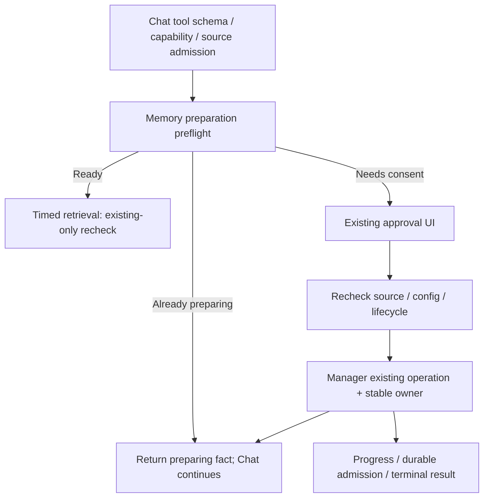

# Memory Preparation Lifecycle Software Design Document

Document status: Approved
Updated: 2026-11-13
Work item: B-197
Authority: GPT-6 在 Owner 选择 A 并授权实施范围内完成的源码设计；运行验证状态见 Tracker。
Product spec: [Product Spec](../../../product/specs/pa-memory-preparation-lifecycle-product-spec.md)
Tracker: [Development Tracker](./tracker.md)

## Current Source Baseline

Baseline `07e638c2825a3fdf62a96d4182b63ac0ae49a5c0`，master；此前仅本任务讨论文档未提交。

- `MemoryManager.ensureReadyForChat` 的 first-use 使用 preparation owner，确认后路径使用 attempt signal；`waitForChatPreparation` / `abortUnsharedChatPreparation` 取消独占 consumer。实际类隔离验证确认两分支差异；不等同完整真实重建复现。
- `pa-agent-host-tools.ts` 先进入 `ChatMemoryRecoveryCoordinator.execute` 再由 `MemorySearchTool.search` 调用 readiness/approval。默认 30 秒，预留 500+250 ms，确认和长准备均消耗该预算。
- `pa-agent-runtime.ts` 已传 `options.signal` 为 owner；正常 finally 关闭 coordinator，Chat 正常 finally 仅清 UI controller 引用，Stop 才 abort。Pagelet 自己传 `request.signal`，不启用本次新 Chat 模式。
- `createTaskSourceMemoryHost` 已将 restricted 查询变为 `existingOnly`，但目前异步 readiness 仅前后 assert，批准后真正副作用前的来源检查必须补齐。
- Manager 已有 `activePreparationRun`、只读 `getStatusSnapshot`、progress 和通知器；Chat `MemoryStatusPort` 未暴露快照。`runPreparation` 只创建一次 Notice；关闭后 updater 仍持有旧 DOM。
- `showTechnicalMemoryStatus` active 优先，只显示五秒快照，无 cancel/hide 原通知逻辑。此前应用隔离通知验证了打开 Status 不隐藏原进度；无法唯一反推历史那次消失原因。

## Design And Data Flow

Proposed narrow interfaces（命名可在保持职责下局部调整）：

1. `MemorySearchTool.prepareForChat(query, signal, owner, guard)`：复用 `forTaskSource` 绑定，返回原 `MemoryDecisionResult`；避免 duplicate result wrapper。Host executor 在原 schema/capability/source admission 后、coordinator 之前调用一次。
2. `MemorySearchPort.ensureReadyForChat` options 增加 `backgroundPreparation` 和 `beforePreparation` 回调；source wrapper 组合自己的有效性检查，不允许上层覆盖 restricted `existingOnly`。Manager 批准后、acquire/start 之前调用，仍校验配置/lifecycle/取消。回调作用于准入瞬间，不将 run-current 绑定为 operation 永久条件。
3. invocation 增加 Host-only 的 readiness 已前置标记；新 Chat attempt 使用 `existingOnly` 复核，不重复弹确认/准备。标记不进入模型 schema。准备中/answer-now 复用现有 MemorySearchResult 和 tool 包装，不能另拼一套结果。
   准备中由 Manager 提供可选的封闭状态事实，经既有结果类型传递；不得用任意 `skipReason` 或本地化文案替代规范 unavailable 投影。准备中固定说明保留“空结果不等于没有匹配笔记、不得推断正文”约束；runtime只精确接受既有规范形态及这个固定新形态，保留来源记录与后续撤销规则。
4. 新后台路径须有明确稳定 owner；消费者保留到完成或 owner abort，复用现有每消费者等待机制，不另加首个owner绕过计数的取消权。ready、只读观察无需准备 owner。旧同步分支继续以原 signal 等待/取消；Pagelet 不启用新模式。first-use 既有 owner 例外保持。所有 Chat（包括携带 Pagelet context-only 附件的 Chat）都适用新模式；附件不是 runtime 身份。现有 cooldown、lexical/refresh 可用旧 Memory 的行为保持。

不得只改 signal 或放大检索预算。后台启动复用既有 active run 和每消费者等待，入口统一为 `startChatPreparation`；不要建新队列、操作台账或暂停系统。结果返回与 coordinator 结算分开，不把操作继续执行投影成准备失败。

## Interfaces And Ownership

遵循 [Command Architecture Contract](../../../architecture/pa-agent-architecture-plan.md#command-architecture-contract)。

| 事项 | Owner / factual input | Effect / boundary |
| --- | --- | --- |
| 搜索语义与是否调用 | Agent / 本次用户问题、已见事实 | Host 不以自然语言关键词判断准备批准 |
| 工具准入与前置调度 | Host / schema、registry policy、真实 source guard、caller signal | 在实际 capability admission 后前置；迟到批准须重验 |
| 确认、operation、共享和终态 | MemoryManager / plan、explicit approval、config/lifecycle、owner | 管理现有 run，等待与执行分离；正常 Chat 完成不撤销批准 |
| 检索期限 | coordinator / 单次检索预算 | 仅影响 attempt，不取消已接受准备 |
| reset/provider/index/admission | VSS / 已准入计划、独占队列、durable handle | 保留 guard/marker/rollback；不改格式或强设 Ready |
| 展示与重看 | Manager snapshot + UI | 查看不加入 shared consumer；具体 Prepare/Update 才可加入 |

## Lifecycle And Cleanup

新增 `MemoryStatusPort.getStatusSnapshot()` 与 `showPreparationProgress(): boolean`。Chat preparing 优先于 plan；await 旧 plan 后重查 active，并只应用当前视图中最新一次请求的结果，避免准备完成后旧请求再覆盖 Ready。开始/结束通知订阅者；进度沿现有节流，避免逐片段查询 SQLite。

Notice 引用归属 active run 的展示对象。使用公开 `containerEl/messageEl`；普通点击记录 dismissed，lexical cancel 保持 stopPropagation。显式重看时，未隐藏且 connected 则复用，否则从当前 snapshot 重建；事件只更新当前展示，不自动重弹。无全局监听、MutationObserver 或轮询。旧 run 清理仅影响自己的引用和监听。

Prepare/Update 在读取 plan/确认之前识别相容有效 run，异步 plan 后也重验。plugin 通用 busy callback 可显示进度但不可加入 shared，因为也覆盖 Reset 等动作。具体命令复用保持 shared 语义。真实 Stop 取消独占 run；配置变化、关闭和卸载保持现有失效/补偿。

新增进程内、配置绑定的 `lastPreparation`：action、outcome(completed/partial/failed/cancelled/interrupted)、安全 message，必要阶段/文件计数及已有安全错误码。不得暴露完整 VSS summary/prepared handle。开始新任务替换；旧配置不得写入新结果。先捕获最后进度计数，再完成/清 active/通知。Manager 统一终态通知，外层失败提示去重。

普通 UI 用阶段与 `filesDone/filesTotal`，称为已处理而非成功；未知总量仅显示阶段。仅明确取消信号可分类 cancelled；VSS `updated=0 && dirty>0` 或 lexical feature-disabled 的非用户 aborted 是 interrupted。旧 Memory 可用性与本次更新结果分别展示。当前会话结果可通过原 Status 入口重看。

## Data, Privacy, Permission And Cost

不写笔记、不新建持久结果库、不改变 provider 与选用配置。保持首次例外、非首次确认及 source restrictions。准备确认后须原配置/来源有效；准入后按持续 Data Boundary 和 Manager 生命周期执行。没有 source authority 的 legacy 调用不伪造来源回调。

开发仅仓库源码、测试与合成材料；私人 vault 不进入 GLM 输入或 app 夹具。真实 provider 不必要：取消/并发/通知由受控 VSS 延迟完成，app 证据不冒充真实 provider 长重建。

## Compatibility, Migration And Rollback

保留 Pagelet 等旧调用、first-use、lexical cancel、共享消费者、fallback只读和旧索引可用性。端口 fixture 只补必要方法。最低 Obsidian 1.11.4 支持 Notice 的公开 DOM 字段。

无 schema 迁移。回退前结束现有准备并等待既有取消补偿，保留 guard/dirty/笔记，再 reload 已验证旧包；不手动删索引或 marker。回退会重新暴露原缺陷。

## Test Matrix

| Requirement / AC | Minimum evidence | App / negative cases | Rerun trigger |
| --- | --- | --- | --- |
| B-197/REQ-01 / B-197/AC-01 | Host + coordinator + MemorySearchTool + Manager 受控跨层回归；确认超过旧预算，准备尚未完成即返回 | 确认前 effect=0；长准备不中止、不误报 timeout | 前置/预算/结果接线变化 |
| B-197/REQ-02 / B-197/AC-02 | 扩展现有 Manager owner/first-use/shared 断言；正常 close 与真 Stop 分开 | 保留 approved-cancel 合法断言 | consumer或取消变化 |
| B-197/REQ-03 / B-197/AC-03 | task-source host、Host tools 与受影响 Pagelet 兼容用例 | 批准期间权限/配置失效零effect；restricted、缺 owner ready | admission/端口变化 |
| B-197/REQ-04 / B-197/AC-04 | Manager/Chat/plugin 现有状态、busy、Notice用例 | 桌面与 CLI mobile：确认→Status→关闭→重看→重复 Prepare | UI/状态/DOM变化 |
| B-197/REQ-05 / B-197/AC-05 | 固定文件计数、partial/failed/cancelled/interrupted结果 | 可重看、单通知；app完成和失败各一条受控分支 | 计数/结果分类变化 |
| B-197/REQ-06 / B-197/AC-06 | 复用现有 durable admission/rollback/lifecycle 回归 | 旧run不能清新展示；无笔记写入 | admission/清理变化 |

先实现前回归验证目标失败，再最小修复和 focused tests。合成 fixture 必须执行生产调用链，不能自己复刻逻辑。无必要真实模型语义变化，不安排模型采样或私人全库重建。统一 gate 由一位执行者对冻结输入运行 lint、生产 build、全组 Jest、diff/DOM/docs 检查；生产 build覆盖类型检查，全组覆盖已含focused。部署复用 `deploy-current` 或 enclosing `make deploy`，不重复昂贵检查。

## Open Design Findings

设计复核要求的批准后来源检查、owner缺失不阻断ready、观察不加入共享、aborted不等于用户取消均已纳入。2026-11-13 首轮实现审查发现的具体偏差见 Tracker，须修复后验收；不因设计批准或局部测试通过推定完成。同步兼容与显式 Chat 后台模式按上文区分，无须额外取消原因协议。

## Approval

- Product authority: Owner 于 2026-11-13 选择 A 并授权按 SDD 开发测试，DEC-080。
- Design authority: GPT-6 源码核对及独立只读复核；本设计不证明实现完成。
- Authorized scope: 本 Spec 全部要求、本地测试与测试 vault 验收。Owner于2026-11-13随后明确授权将当前进展提交并推送master，转MacBook继续；不包含tag/release或closeout。
