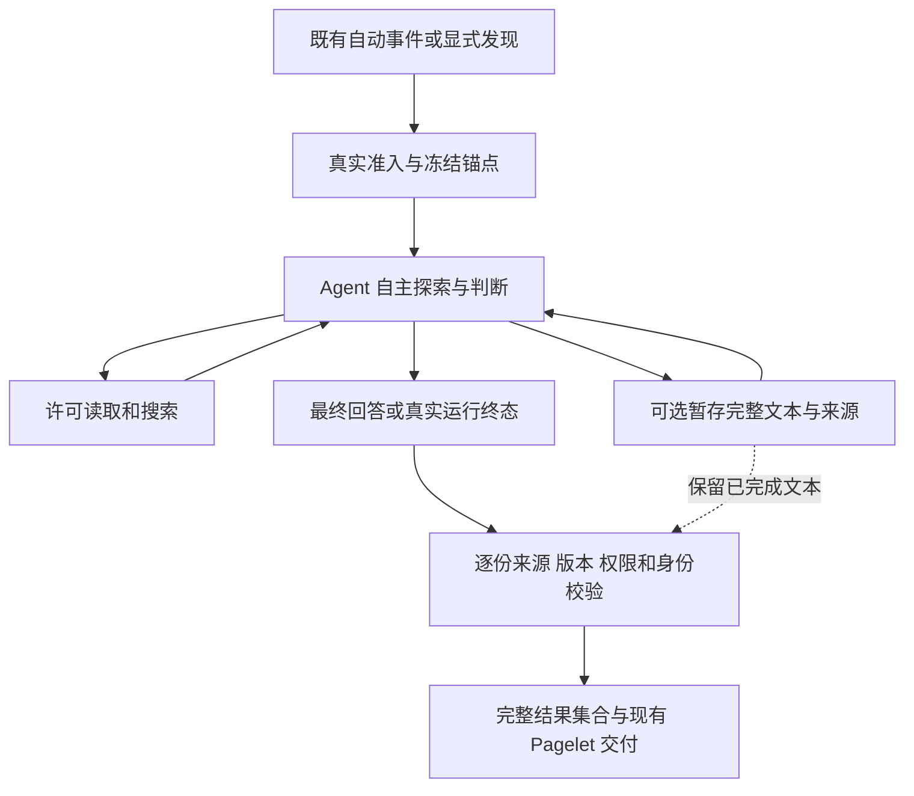

# Pagelet Autonomous Discovery Software Design Document

Document status: Approved
Updated: 2026-10-16
Work item: B-175
Authority: [DEC-065](../../../product/decisions/dec-065-pagelet-autonomous-discovery.md) 与用户认可的第一轮细化方案；仅设计授权。
Product spec: [Pagelet Autonomous Discovery](../../../product/specs/pagelet-autonomous-discovery-product-spec.md)
Tracker: [Development Tracker](./tracker.md)

## Current Source Baseline

基线 `ecddc088`，2026-10-16 只读核对；Pagelet 相关源码相对前次分析 `df49a48c` 无差异。
下列是实际存在的模块和符号；后文是待实施目标，不据文档批准推定当前行为已改变。

产品显式要求由 DEC-065 / Product Spec 定义；下表是已核实源码事实。复用现有数组/状态字段、
沿原搜索 observation 回传等属于与这些要求兼容的工程方案，不能单独扩大用户授权。
实施若发现需要新增持久化、权限、provider 或后续产品能力，须回到对应产品决定，不能借 Approved 状态推导许可。

| 现有链路 | 核实的约束或接线 | 第一轮处理 |
| --- | --- | --- |
| [orchestrator](../../../../src/pagelet/orchestrator.ts) `runExplicitDeepDiscover` | 同锚点 existing candidate 直接打开并 return；收集 pending candidates、来源/前台路由校验 | 区分查看与显式新分析，接通全部有效文本及真实状态 |
| [plugin-deep-discover](../../../../src/pagelet/plugin-deep-discover.ts) | 冻结 snapshot、scheduler、runtime factory、Memory wrapper、用量计入 | 保留准入与调度，补齐新终态的计量/交付接线 |
| [anchor snapshot](../../../../src/pagelet/agent/anchor-snapshot.ts) / [anchor tools](../../../../src/pagelet/agent/anchor-note-tool.ts) | Vault `cachedRead` 冻结内容；当前笔记/read_note 源于该快照 | 不扩大为编辑器实时选区；正文按需读取能力保留 |
| [native model](../../../../src/pagelet/agent/pagelet-native-model.ts) / [runtime](../../../../src/pagelet/agent/pagelet-agent-runtime.ts) | system、user task、initial/per-turn 指令；`buildPageletUserInput`、`buildInitialRuntimeInstruction`；stage 依赖 recoveryEnabled | 同步去语义编排，保留实际来源入模投影与工具能力 |
| [lead-driven-policy](../../../../src/pagelet/agent/lead-driven-policy.ts) | exact-ID、非锚点读取、first/second eligibility、`final_answer_only` | 删除这套语义规划；取消/真实协议等有效处理逐项保留，可缩减或退役文件 |
| [quality gate](../../../../src/pagelet/agent/pagelet-agent-quality-gate.ts) | 双来源、bundled headings、词交集、浅层词、Jaccard distinct 与来源校验混合 | 只留来源/协议/身份事实校验，取消语义深度/独立性裁决 |
| [recovery coordinator](../../../../src/pagelet/agent/pagelet-recovery-coordinator.ts) | 单次 stage、pending-first、unresolvedLead、partial source overlap；`snapshot` 截为两条；stage 回执要求第二条 | 保留搜索恢复，暂存独立；移除角色/邀请/输出上限与指令回流 |
| [controller](../../../../src/pagelet/agent/pagelet-deep-discover-controller.ts) / [cache](../../../../src/pagelet/agent/pagelet-agent-cache.ts) / [types](../../../../src/pagelet/agent/types.ts) | `slice(0, 2)`、集合长度上限、近似语义去重；来源封存/缓存 identity/currentness | 接收完整集合，保留独立 identity、commit seal 和有效缓存校验 |
| [delivery adapter](../../../../src/pagelet/agent/delivery-adapter.ts) / [PanelLayouts](../../../../src/pagelet/panel/PanelLayouts.ts) | adapter 已保留全文；按首个非 anchor 来源推断 Link；Panel 已用 MarkdownRenderer | 移除 Link 推断；全文/来源/单篇发现最低适配，不重建 UI |
| [smoke evidence](../../../../src/pagelet/agent/pagelet-deep-discover-smoke-evidence.ts) | validator 限制集合 1–2，并核对 run/collection/receipt | 去隐藏数量上限，保留真实 receipt/source/run 一致性 |

## Design And Data Flow

此图不规定模型调用顺序。暂存不会触发前台半成品推送；终态时再按真实边界交付。
模型可直接最终回答或明确无发现，不能为了符合图而强制先调用工具/暂存。
关于锚点的结论仍须有实际锚点内容依据；无发现不能被要求先完成 exact-ID 搜索才可结束。

### 1. Agent 与 Host 的职责

依据 [Command Architecture Contract](../../../architecture/pa-agent-architecture-plan.md#command-architecture-contract)，本任务映射如下：

| 决策/准入/状态/效果 | Owner | 事实依据与输出 |
| --- | --- | --- |
| 哪些内容有用、是否深入、读哪里、继续/结束、展示什么 | Agent | 当前任务与合法观察；自然文本/可选暂存/明确无发现，不由 Host 单独判价值 |
| 本次调用身份、anchor snapshot、工具和数据许可、自动运行额度 | Pagelet harness / 既有 domain owner | UI/事件、配置、provider 能力、真实文件及已许可预算；允许/拒绝/取消原因 |
| 搜索和一次 relaxed recovery | Pagelet recovery owner + MemorySearchTool | 有效 rerank 结果、原查询/lexical plan、token、策略/时限；真实搜索 observation |
| 暂存、结果身份、缓存及交付 | Pagelet runtime/controller/cache/orchestrator | 明确完整文本、实际入模来源、当前版本/权限、run/receipt；逐份完整交付或事实性拒绝 |
| 写入、修改、外发效果 | 既有 Operations/其他 effect owner | 后续真实用户请求与当前授权；Pagelet 发现/模型声明不授予权限 |

现有模块已足够承担这些责任；不引入新的通用 agent、planner、result bus 或 capability 框架。

### 2. 模型输入：删除旧约束，不改成柔性指令

核对 system prompt、`buildPageletUserInput`、initial/per-turn instructions、policy corrective
messages、工具 schema/description/plannerGuidance、工具结果 `instruction`、finalization
messages 和 runtime 生成的上下文。以实际组装发给模型的输入为准，不只搜索一个 prompt 文件。

删除：固定 0–2/一条、首/次发现阶段、必须先查 exact-ID、先链接后广搜、已得到一个就停止、
必须双来源/非锚点、关键词定义深度、必须暂存才能继续、Host 邀请才能 stage、固定通常步数。
不把这些改成“优先、通常、建议、尽量”继续塑造路线。示例也不得承担隐性配额或唯一价值方向。

保留：任务目的、已知上下文与可用能力、真实权限/输入信任、来源引用和不确定性表达、
确切的工具参数与错误事实。资源中止时如实报告已完成/未完成部分，不借资源话术提前收束。
不新增 prompt 黑名单运行器或评审模型；实施 review 加少量真实组装输入断言足够。

### 3. 可选暂存与完整文本

保留工具名 `stage_pagelet_insight`，输入沿用 `insightMarkdown` 与 `sourceIds`，移除
`unresolvedLead`、pending-first echo、一次调用上限、min-two 与 first/second 语义。
一次调用表示一份完成文本，不代表“一条语义发现”；可以包含多个小结/问题。
工具从发现开始即按相同只读权限可用，不依赖 recoveryEnabled、partial episode 或 Host 邀请。

暂存在现有 run-local drafts 集合内收集，保留 origin、正文与该文本实际支持来源；终态正文
按相同路径加入。逐份身份复用当前 canonical source/hash 方案。相同 identity 的重复回执可
幂等去重，不用 Jaccard、词交集或语义相似判定合并不同内容。非完全重复的潜在冗余由 Agent 判断。
新增暂存不隐式覆盖先前文本；本轮不引入暂存稿的修订/撤回协议，暂存应当是 Agent 明确完成的候选。

一份文本可以只有锚点来源。来源集必须反映该文本的真实依据，不能把所有读过的笔记一股脑
贴到每份结果。工具回执只描述暂存成功/失败与事实原因，不要求产第二条或立即最终回答。
stage 原有正文/来源数上限须区分真实协议容量与旧产品约束；没有真实边界依据的任意截断/数量
拒绝一并移除，不把它们当新的探索预算。实际 provider/context 容量仍依既有运行机制处理并说明。

一个来源改变使依赖它的完整文本失效；互不依赖的其他文本仍可交付。Host 不解析 Markdown
拆出自认为还成立的段落。受控 error/incomplete 可保留已明确暂存且重新验证通过的文本，
显式 cancel、权限撤销或 run/receipt 失效不以 salvage 绕过既有丢弃规则。
不将普通未完成 final stream、工具中间输出或内部 reasoning 作为完整成果。

### 4. 检索恢复从暂存解耦

复用 [qualifiesForRelaxedRecovery](../../../../src/ai-services/retrieval-recovery-coordinator.ts)
的有效 none / partial + needsMoreEvidence 判断。`executeMemorySearch` 内对合格结果尝试
既有 run-scoped 单次恢复；partial 不再等待第一份暂存、额外 lead 或来源 overlap。
沿用 [MemorySearchTool](../../../../src/ai-services/memory-search-tool.ts) 的原查询、embedding、
lexical plan、显式时间意图和 domain merge/fallback，不更改检索排序/索引算法。

保留 token 原子占用、policy epoch、capability/flag、cancel/deadline、结果晚到丢弃、
原 partial 证据重新校验和失败回退。恢复数据从真实 originating search tool observation
进入 provider，移除以 stage 回执承载恢复证据的 `prepareTranscript` 特殊拼接；来源投影与
实际入模记录仍必须贯穿。token 不能变成禁止 Agent 正常再次检索/阅读的全局限制。

### 5. 事实校验与结果集合

去除双来源、same-line 引用词交集、bundled headings、DEEP_FINDING_LANGUAGE、浅层已链接
推断、first/second distinct 和相似度拒绝。来源路径解析、真实工具 provenance、实际入模
正文、引用与版本对应、anchor 身份、权限、policy/pipeline identity、commit seal、
并发/late result 校验保留。证据到模型的投影应复用现有链路，不能用模型 sourceIds 自证。

移除 recovery snapshot、runtime、controller、cache、smoke validator 中所有“两条”假设；
诊断中的 missing-non-anchor 不再代表失败。使用已有 collection/insights 数组，不造新的批量
发布协议；集合仍可原子提交，成员身份和来源校验独立。一份不合格不应清空其他有效成员。
保留同一内容的精确已看/已交付防重复事实，但显式查看不能因“已看”变成无发现；
完整的已看复访体验留下一轮。

### 6. 最小交付和状态衔接

`runExplicitDeepDiscover` 不再以 existingCandidate 直接代替新分析；兼容命令名/ID 保留，
`Open Pagelet` 等查看入口继续零调用。沿现有 pending candidates/Panel 展示全部有效文本，
若当前路径无法到达某份结果，仅增加所需的本次结果导航，不建立新历史中心。
全文继续 MarkdownRenderer；单锚点问题不被 graph-first 布局或“无关系”判断隐藏。
移除 adapter 的 `buildDirectLinkAction` 按首个非 anchor 来源自动生成主操作的推断；
底层关联能力、来源打开和已有 Chat handoff 不删除。

沿现有 controller result / `runtimeCompletion` 表达状态，仅补确有缺失的字段/分支，
不另建通用状态机。语义如下：

| 真实情况 | 对用户/交付的含义 |
| --- | --- |
| Agent 正常结束且有通过校验的完整文本 | 展示全部有效文本 |
| Agent 正常明确无发现，且没有暂存成果 | 正常无发现；不缓存伪成果 |
| Agent 最后表示没有新增发现，但已有有效暂存 | 保留暂存，不被 `NO_INSIGHT` 抹掉 |
| error / incomplete，存在有效完成暂存 | 展示可用成果并说明整轮未完成 |
| error / incomplete / empty / 事实校验全拒绝 | 真实失败、未完成或失效；不改写为模型无发现 |
| cancel / stale / permission revoke | 按现有身份/撤销边界停止接纳；不伪造无发现或继续处理 |
| 精确重复或已交付内容未产生新提示 | 本次无新增交付，不能据此说 Agent 没有发现 |

前台可以看到明确结果/必要原因，后台无内容的诊断保留且不重复打扰。
`NO_INSIGHT` 只作为模型主动给出的机械终止协议使用，不从异常推断。
usage 汇总覆盖实际发生的成功、失败和未完成调用；不因结果未接纳就漏记调用。
新运行失败不清除仍独立有效的旧候选；原来源失效的旧候选也不能冒充可用成果。

## Lifecycle, Data, Privacy And Permission

沿用 frozen Vault anchor、当前只读 registry (`runKind="review"`, `allowWrite=false`) 和
实际来源/capability admission；不引入 editor/selection/diff/history/profile 读取。
已有 web 许可/provider 限制保持。只是可见建议不能证明无写能力，验证须核对实际 executor
许可与 effect receipt；不以工具目录里没列写工具作为唯一证明。

暂存状态只活在当前 run，结束/取消/卸载清理；缓存、seen、delivery receipt 使用现有
本地 store/identity，不增持久化正文副本、跨设备同步或后台恢复队列。
编辑/离开/重开事件、debounce/coalescing、provider readiness、自动额度与显式调用边界沿用。
既有 source-revocation/currentness 检查保持实际语义，不以此次设计为由重构一般 PA Agent 的
在途请求/快照策略。来源内容和工具数据仍是不可信材料，不能提升为宿主指令或权限。

继续讨论沿现有 [handoff](../../../../src/ai-services/pagelet-handoff.ts) 交付原文、锚点和来源；
不新增 action schema，不自动发送，也不把“建议修改”解释成用户同意。
后续用户明确修改请求交由当前 Operations 契约，本轮不实施该后续流程。
保留 [Write Action Framework](../../../architecture/write-action-framework-sdd.md) 的真实效果与
caller 权限边界；其历史普遍确认要求按现行 scoped successors 理解，不恢复旧确认链。

## Compatibility, Migration And Rollback

- 实施时更新 `PAGELET_DEEP_DISCOVER_PIPELINE_VERSION`，旧 pipeline 缓存不能被重标成新
  结果或新验收证据。若 wire shape 不变，不机械升级持久 schema；形状确需变化时同步
  reader/type/validator。现有用户设置、笔记、Saved Insights 与分享数据不迁移、不清除。
- 保留独立 insight ID / collection ID / source snapshots / commit seal 和 receipt 的关系；
  旧保存文本可读不等于仍满足当前来源许可。不改变平台支持、安装资产或发布路径。
- 入口最小改动须保留 mount/unmount、监听器/定时器清理及现有移动适配。Detail/Save
  全量修复、短点/长按新语义不成为这一轮的迁移前提。
- 回退只撤销本轮代码/测试差量并恢复已记录的旧 build，保留用户数据与其他 workstream。
  旧 renderer 不得把新版本缓存静默解释为旧契约结果；按既有 identity 不兼容处理。
  回退代码不追溯撤销用户新产品决定；任何持久产品方向变更另行讨论。Git/部署须在实际授权内。

## Test Matrix

表中全是**计划**，本次未执行 runtime 验证。用已有 suites 改写不再成立的期望，保留
事实负例，不另建测试框架或逐条 prompt 镜像。各行由 Tracker 对应任务记录实际证据。

| ID / Requirement / AC | 最低充分证据与通过条件 | 失败/保留边界 | 重跑或扩展触发 |
| --- | --- | --- | --- |
| V-01 · B-175/REQ-01 / B-175/AC-01 | `pagelet-agent-runtime.test.ts` 捕获真实组装的初始/后续/tool-result 输入；脚本模型在已读证据后仍可搜索/结束，不被 exact-ID/first/second 锁住；静态复核全部 prompt 面 | 不断言唯一工具顺序或预设洞察；保留真实协议/cancel | 新增模型可见指令或发现仍强制收束 |
| V-02 · B-175/REQ-02 / B-175/AC-02 | runtime/recovery/quality-cache suites：无 stage；多次 stage 加 final 超过旧两条；一份多发现 Markdown 原文保留；recovery flag 关闭仍可 stage | failure/incomplete 保留已完成有效文本；cancel/revoke 不 salvage；暂存后工具仍可用 | drafts/schema/lifecycle 变化或成果丢失 |
| V-03 · B-175/REQ-03 / B-175/AC-03 | `pagelet-agent-anchor.test.ts`、`pagelet-agent-quality-cache.test.ts`、`pagelet-delivery-identity.test.ts`：单锚点通过；一份源变另份保留；未读/伪工具/越界/版本/commit race 仍拒绝 | 证据必须实际入模；精确身份重复不产生双回执；不接受模型自证 | source projection、cache identity 或 commit 接线变化 |
| V-04 · B-175/REQ-04 / B-175/AC-04 | `pagelet-recovery-coordinator.test.ts`：none、partial 无 stage 恢复；同 query/token、实际 search observation；坏/晚/撤销结果 fallback 重验 | standard partial 保留；token 用尽不锁普通读取；不扩展算法矩阵 | recovery/source observation 改动或 token 泄漏 |
| V-05 · B-175/REQ-05 / B-175/AC-05 | `pagelet-orchestrator.test.ts`、`pagelet-panel-tab-view.test.ts` 与 quality-cache 的 adapter 断言：有缓存显式发现仍运行、查看零调用、全部结果/全文/来源可达、无默认 Link 推断 | 不以首条可见代替全集可达，不扩展完整 Tab/Save 回归 | 实际交付阻断或改动相应 UI |
| V-06 · B-175/REQ-06 / B-175/AC-06 | controller/orchestrator、`plugin-deep-discover-integration.test.ts`、`pagelet-deep-discover-smoke-evidence.test.ts`：终态区分、用量不漏、旧有效结果不被失败覆盖、receipt 不含旧数量假设 | 无发现非 error；有暂存终端无新增不清空；失效不可冒充完成 | 终态/计量/receipt 消费者变化 |
| V-07 · B-175/REQ-07 / B-175/AC-07 | 复用 anchor、runtime registry/executor、plugin integration 与现有 handoff 用例：只读发现、真实准入、自动与显式路径、交接不发送不授权 | 不以建议文案或工具列表替代实际效果边界；无新 provider/vault 范围 | 实际权限、调度或 handoff 接线被改动 |
| V-08 · B-175/REQ-08 / B-175/AC-08 | 部署后针对自动提示、显式运行、全部文本滚动/来源/终态做一次实际交互；记录真实 vault、bundle、输入与结果；必要时普通 mobile simulator | 自动不抢焦点；不声称截图/模拟器是真机；未触及平台能力不新增设备矩阵 | 可见交互或具体平台风险变化 |

源码测试位于仓库 `__tests__/`。必要真实模型观察选三个不同风险场景：单篇笔记问题、
有跨笔记探索空间的任务、可能合理无结果的任务。它们用于观察能否自主选择/继续与真实交付，
不要求各自必产某类结果、指定路径/深度/数量，不统计成功率，也不反复采样凑预设答案。
若未观察到某路径，保留模型证据缺口并用确定性证据说明其可达性；不能把可达性说成模型自然涌现。

后续实施的统一 broad gate、部署/证据复用及当前 docs-only gate 见 Tracker。
共享 `pa-agent-loop` 只在实际公共契约受到影响时追加对应 focused 检查；不借此重写通用循环。
当本轮 REQ/AC 和已确认缺陷均有充分证据后结束，不测试后续轮次，也不因答案措辞/长度增加门禁。

## Open Design Findings And Approval

第一轮设计无未决 P0/P1/P2；已识别耦合和范围处理见 Tracker，不将设计处理写成代码已修。
用户 2026-10-16 认可的是本轮细化方案与文档化，运行实现尚未授权。
短点/长按、阅读与 Agent 交接已由 [B-176 SDD](../../proposals/pagelet-reading-loop/sdd.md)独立承接；更多上下文和专用修改流程仍不在两轮范围。后续本地 master 文档提交及 MacBook 接续安排见 Tracker，不据此声称运行实现已完成。
