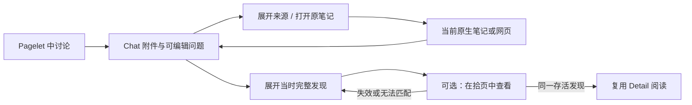

# B-187 Pagelet Chat Continuation SDD

Document status: Approved
Updated: 2026-10-24
Work item: B-187
Authority: Owner 于 2026-10-23 明确要求“按照b-187方案设计完成所有的开发测试”，据此批准本 SDD 的范围内实施与必要验证；拟新增接口不代表基线已有能力。
Product spec: [从 Pagelet 的发现继续思考](../../../product/specs/pagelet-chat-continuation-product-spec.md)
Tracker: [Development Tracker](./tracker.md)

## Current Source Baseline

2026-10-23 设计轮核对于 `43050df2`（v3.0.1）。以下保留实施前源码事实；本轮开发与应用验收证据由 Tracker 承接。
此前 v3.0.0 测试库观察和本对话 HTML 原型仅提供界面参考，不作为该基线的通过证据。

| 现有入口/契约 | 已有行为与本次缺口 |
| --- | --- |
| [ChatView](../../../../src/chat/chat-view.ts)：`uniquePageletVaultSources`、`renderPageletHandoff`、`renderSavedPageletAttachment` | 已持有完整正文、来源、时间；来源当前是拼接后的纯文本，需保留结构化路径并接入阅读控件 |
| 同文件：`renderEmptyState`、`clearPendingPageletHandoff`、`fillComposer` | 配置提示在通用问题之前；现有移除附件不刷新空态；已有草稿保护可直接保留 |
| 同文件：`openChatInternalLink`、`preparePageletHandoffForOpenView` | 前者依赖活动 Markdown 路径且可能替换已有页；后者会准备新对话；两者不能直接用作本次附件导航 |
| [handoff](../../../../src/ai-services/pagelet-handoff.ts)：`PageletChatHandoffContext`、`clonePageletChatAttachment`；[ChatService](../../../../src/ai-services/chat-service.ts)：`validatePageletHandoff` | 新交接及有效历史附件已有正文 hash 与输入来源校验；不需要补无 hash 的旧附件兼容 |
| [delivery adapter](../../../../src/pagelet/agent/delivery-adapter.ts)：`extractInsightTitle` | 文件私有纯展示函数，已有标题/首句提取思路；候选 ID、handoff ID 与正文 hash 已相通 |
| [ChatHost](../../../../src/chat/ChatHost.ts)、[ChatPluginIntegration](../../../../src/chat/plugin-integration.ts)：`ChatHostActions`、`createChatHost` | Chat 宿主接线由此到 plugin；辅助导航目前没有接口 |
| [Plugin](../../../../src/plugin.ts)：`getPageletDetailPathState`、`revealPageletDetailViewForPath` | 可辨别 live/恢复占位/不存在并唤回已有页，但只按路径，不能保证同一发现 |
| [PageletDetailView](../../../../src/pagelet/tab/PageletDetailView.ts)：`getNoteAnchorPath`、`isRestoredPlaceholder`；[TabView](../../../../src/pagelet/tab/TabView.ts)：`selectReading`、`validateDisplayedReading`、`rememberReadingPosition` | 实例已有候选、异步来源校验、按候选 ID 保存的位置和来源展开状态；可窄接线复用 |
| [样式](../../../../src/custom.pcss)：`.pa-chat-pagelet-attachment` 及 `__body`；[中文](../../../../src/locales/plugin/zh.json)/[英文](../../../../src/locales/plugin/en.json)：`plugin.chat.pageletAttachment.*` | 已有主题变量、`max-height: min(38vh, 320px)` 和内部滚动；已有标题、移除、来源、准备时间和默认问题文案 |

## Design And Data Flow

### 核心：在现有 Chat 附件内补齐阅读

1. 将 `uniquePageletVaultSources` 的展示结果保留为路径与标题，原笔记从 `handoff.anchor.path`
   单列，其余笔记按路径、网页按已有 URL 去重。计数只用于显示，不改 `sources/sourceRefs/webUrls`。
   不从「标题 — 路径」显示串反解析目标，不使用当前活动文件推断原笔记。
2. 内容线索复用 `extractInsightTitle` 的纯展示思路；若共享，做一次最小函数抽取即可。
   不增加持久 title 字段、不生成摘要、不改传给 Chat 的完整 `body`。
3. 在现有 pending 和 history 渲染入口补来源/全文两处 disclosure，复用小范围呈现函数即可；
   历史外层消息结构可保留，但收起时仍展示内容线索。移除按钮只属于待发送附件，沿用 streaming 保护。
   原文仍使用当前附件的文本呈现，不借此迁移 Chat 或新增 Markdown 渲染体系。
4. `renderEmptyState` 在配置反馈分支之后、生成通用问题之前判断真实 pending handoff。
   附件移除/变更沿原回调同步刷新空态；无需订阅总线。`pageletReselectionRequired` 仍是原有
   重新选择提示，不是持有真实材料的附件，不向它虚构来源或新增恢复流程。
5. 新控件沿现有 DOM 构建和局部 `pa-` 样式；复用主题、限高/滚动、可换行与键盘操作。
   中文文案以 Spec 为准，英文放现有 locale 命名空间。原型审阅标记不进入产品。

**笔记导航（已实施：ChatView 的 `openPageletAttachmentNote`）**：
按真实 vault 路径查到现存文件后，寻找已打开该文件的 Markdown leaf 并唤回；否则用原生新 tab
的 `openFile`。文件不存在则在附件处给出 Spec 的提示，不走会创建同名笔记的链接解析路径。
不调用交接方法、不重设当前对话、不修改 ComposerDraft；也不复用任意其他 Markdown leaf。
网页用已有 URL 生成普通外链，由 Obsidian/平台承接；当前附件没有专用网页导航 helper，
不虚构已有 API，不新增网页读取、预取或存储。

### 辅助：只定位存活的同一发现

辅助项已在核心之后窄接线实施。下列类型/方法均为当前局部接口，不是新增持久协议：

```ts
type PageletReadingTarget = {
    anchorPath: string;
    candidateId: string;
    bodyHash: string;
};

// ChatHost → ChatHostActions / createChatHost → plugin
hasLivePageletReading(target: PageletReadingTarget): boolean;
revealPageletReading(target: PageletReadingTarget): Promise<boolean>;
```

target 从有效附件的 `anchor.path / id / bodyHash` 派生，只存在于当前调用中。
`hasLivePageletReading` 在附件呈现/全文展开时查询 live、非恢复占位的 Detail；候选 ID、
hash 与原笔记必须匹配，已知权限边界变化的候选不可用。查询不加载、验证、生成或缓存新材料，
不持续监听可用性；正文底部只在已知可用时显示辅助入口。

点击时 `revealPageletReading` 重新查找同一 live leaf，经 Detail 的窄包装委托 TabView：

- 在该实例的已有 `reading.candidates` 中准确匹配，不取最新集合、不调用 `setPayload`
  或 `openPageletDetailView`，不重建关闭的页。
- 不同候选复用现有 `selectReading` 的异步验证、选择与位置恢复；可使该方法返回实际成功与否，
  不复制选择状态机。同一候选已选中时复用并等待当前阅读验证，不重复重建正文或触发选择回调。
  单独 `notifyDisplayed` 不能替代校验：它只在 `readingInitialSelectionPending` 时启动验证。
- 保持现有权限/策略变化拒绝读取的边界。单纯来源已过期仍可阅读相同保留正文并显示原过期提示、
  禁止再次 handoff，不把 freshness 改成新的阅读门槛。
- 校验结束确认候选和 reading 仍属于该存活实例；plugin 在 reveal 前确认 leaf/归属仍相同。
  成功才唤回页面并复用既有显示/阅读生命周期；失败返回 `false`，不新增错误枚举或恢复任务。
- Chat 收到 `false` 就展开附件全文并显示既定事实提示；若原 Chat/附件已经销毁或替换，不再更新旧节点。



## Interfaces, Ownership And Lifecycle

沿用 [Command Architecture Contract](../../../architecture/pa-agent-architecture-plan.md#command-architecture-contract)
与 [UI 状态契约](../../../architecture/pa-ui-state-rendering.md)，只增加显式 UI 导航，无新 command/tool。

| Owner | 输入/事实与决定 | 输出及状态归属 |
| --- | --- | --- |
| ChatView | 用户点击、有效附件正文/路径、当前视图身份 | 呈现、局部展开/提示、原生文件导航；草稿仍由 ComposerDraft 管理 |
| plugin / Detail | live leaf、原笔记归属、候选 ID/hash | 查找并唤回已有页；不创建候选、不把路径命中当作身份一致 |
| TabView / 既有 reading.validate | 实例内候选、取消/来源权限及正文事实 | 准确选择、拒绝或沿用陈旧阅读；复用位置/展开状态和现有取消钩子 |
| 既有 handoff / Agent | 用户主动发送、已批准来源和真实接受回执 | 校验、保存、入模及后续推理；本次不改变其协议或语义判断 |

新增展开状态仅属于附件当前视图，沿既有稳定身份更新，不增加 store、workspace 字段或本地恢复记录。
事件随现有附件节点/视图释放；异步返回沿当前视图、候选与取消检查，不新增监听器或后台任务。
核心无需改变 Detail；辅助项也只增加窄包装与选择结果接线，不向 PageletHost 复制 ChatHost 接口。

实机验收补充：Detail 来源是普通 disclosure，既有 toggle 只更新 DOM；若隐藏通知到达时布局已为零，
阅读控制器无法补采这一变化。为满足同一发现的展开连续性，在该既有 click handler 完成 DOM 更新后，
经窄可选回调通知 TabView 的现有 `readingPosition.capture()`；仍由 `onSnapshot` 维护原
`lastPosition/onPositionChange`。不新增监听器、store、定时器，不改变零尺寸布局拒绝采样的边界。

## Data, Compatibility And Rollback

不修改 handoff schema、聊天保存条件、设置、来源权限、provider 或依赖，无迁移。
正文 hash 是已有有效材料条件，不对未被当前代码接受的材料增加“旧版本兼容”分支。
附件阅读/导航自身不主动发起或依赖重新发现及模型调用；原生切页可能触发的既有后台发现，
仍按用户设置和现有策略运行。本项不新增抑制机制，也不承诺切页期间全系统零模型调用。
网页只因用户点击而打开。移动沿用原生标签/面板与同一阅读语义，
不承诺跨关闭/重启的 Pagelet 恢复或 B-183 异步恢复策略。

回滚只撤销附件呈现/链接、局部样式文案及辅助宿主接线，恢复原呈现；不删除或改写已存聊天。
辅助项可单独撤回或后置，保留来源直达与附件全文，无需新增开关或双轨协议。

## Requirement Mapping And Validation

实施顺序、具体最少证据与重跑条件唯一见 [Tracker](./tracker.md#minimum-validation)。
下表仅映射设计；继承边界不意味着重跑整个 B-175/B-176 验收。

| Requirement / AC | 设计落点 | Tracker |
| --- | --- | --- |
| B-187/REQ-01 / B-187/AC-01 | 内容线索、受控空态与既有草稿/主动发送 | T-01 / V-01 |
| B-187/REQ-02 / B-187/AC-05 | 待发送/历史阅读语义、原有附件接受与保存 | T-01 / V-01 |
| B-187/REQ-03 / B-187/AC-02 | 结构化来源、anchor 与原生文件导航、限高滚动 | T-02 / V-02、V-04 |
| B-187/REQ-04 / B-187/AC-03 / B-187/AC-04 | live exact match、原状态复用与附件全文回退 | T-03 / V-03 |
| B-187/REQ-05 / B-187/AC-05 | 阅读副作用归属与既有 handoff/Agent 边界 | T-01～T-04 / V-01～V-04 |

## Open Design Findings And Approval

没有已确认的阻塞性设计问题。源码支持辅助导航窄接线；若实际需要新增恢复、存储或发现调用，
按已批准范围后置该辅助项并在 Tracker 记明原因，不扩大核心。

产品范围由 Owner 2026-10-23 的收敛指令与 DEC-072 承接；同日 Owner 明确要求按 B-187
方案完成所有开发测试，实施授权自该指令生效，不回写此前文档阶段的授权。兼容性实施细节
可在本边界内收敛；超出已确认边界的实质偏离仍需单独决定。
