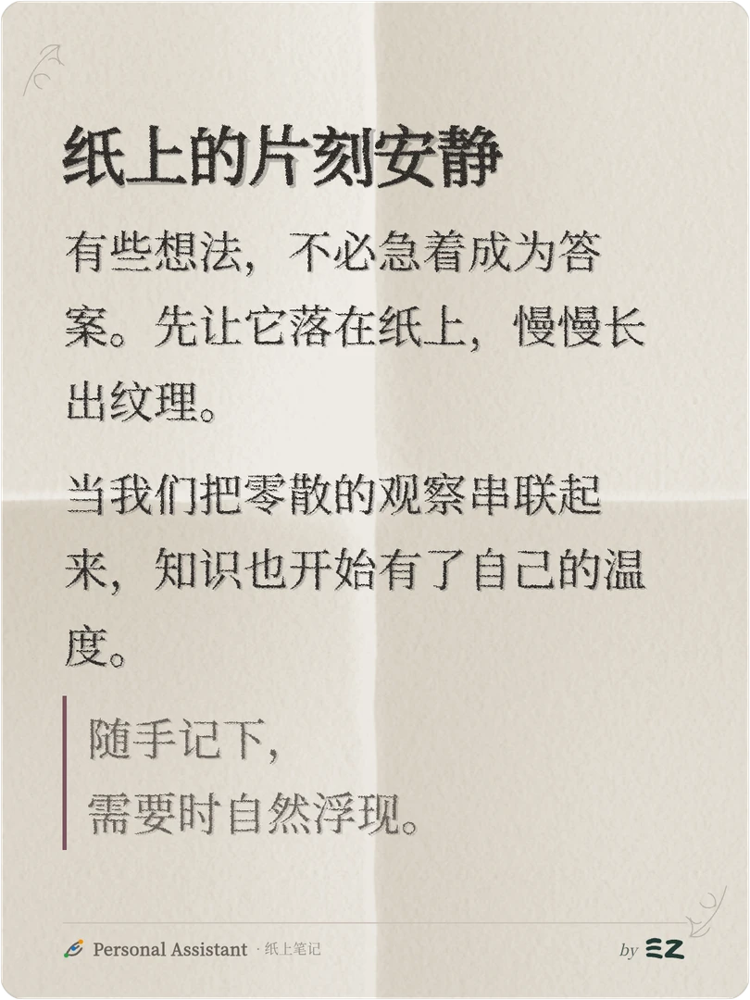
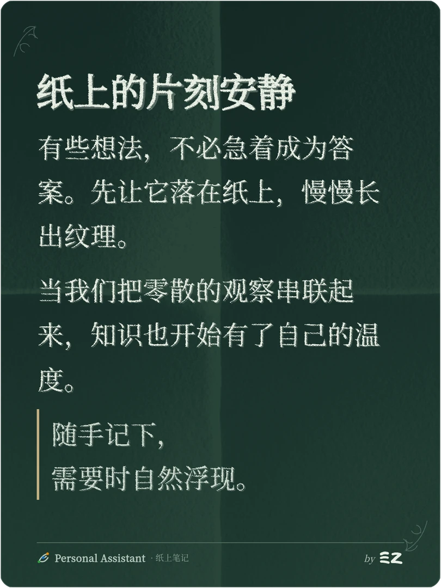

# Share Card 纸灰与夜松墨折痕设计

Document status: Approved
Updated: 2026-10-16
Work item: B-124
Authority: 用户于 2026-10-16 要求将本聊天最后的深浅双主题完整预览落实到文档和代码。
Product spec: [Share Card Product Spec](../../../product/specs/pa-share-card-product-spec.md)
Tracker: [Development Tracker](./tracker.md)

## 目标与确认效果

浅色使用纸灰，深色使用夜松墨；两者均采用固定十字折痕和纤维纸纹。
以下图片来自用户随后要求实施的最后一版完整预览，包含当前 PA 的真实字体、
Xerox 印迹、角花、品牌和 EZ 署名。它们是独立 Chromium 中的 SnapDOM PNG 的展示副本，
不代表 Obsidian 内 Copy/Save 或完整分页验收。

| 浅色：纸灰折痕 | 深色：夜松墨折痕 |
| --- | --- |
|  |  |

## 需求、事实与设计边界

| 依据 | 内容 |
| --- | --- |
| 用户明确要求 | 使用最后预览的“纸灰 + 夜松墨”；深浅都加折痕，深色按松墨配色调整明暗；先落设计文档，再实现，避免过度设计、过度测试 |
| 已核实事实 | 两张纸面均为原生 `540×720` PNG；当前 renderer、字体、Xerox 和 SnapDOM 已能组合此视觉；根背景不在正文 `` 就绪等待范围内 |
| 兼容实现选择 | 固定 PNG 内嵌为 data URI，根背景正常混合、完全不透明、单张铺满；替换旧平铺噪声；渲染前显式解码，复用现有取消/超时和可重试错误流程 |
| 不改变 | 固定卡片及 PNG 尺寸、字体、整批字号、Xerox 参数、内容投影、分页、正文媒体、角花、PA/EZ 几何、临时署名、Copy/Save 路径与原笔记 |
| 非目标 | 不增加运行时 Shader/WebGL、React、依赖、主题选择器、参数设置、模板、provider 请求或远程资源 |
| 未定选择 | 无；后续改变纸面或折痕强度需另行确认视觉 |

## 配色

颜色只作用于 Share Card，不覆盖 Obsidian 宿主主题。

| 用途 | 纸灰 | 夜松墨 |
| --- | --- | --- |
| 纸底生成输入 | `#F1EEE8 → #EAE6DF` | `#152B27 → #203B32` |
| 正文 | `#302D2A` | `#E8EFE3` |
| 次要文字、页脚 | `#68615A` | `#B8CCC0` |
| 引用文字 | `#68615A` | `#D1DED2` |
| 强调、引用竖线 | `#7C5261` | `#C3B081` |
| 细分隔线、代码边框 | `#CBC3B9` | `#506B5C` |
| 代码底色 | `#E7E2DA` | `#29463C` |
| 卡片边框 | `rgba(48,45,42,.10)` | `rgba(184,204,192,.12)` |

页脚 divider 使用独立细线色、opacity 1。浅色 EZ 保留 `#233A34`；深色 EZ 跟随正文色。
纸面实际颜色包含折痕明暗和纤维，不要求每个像素等于纸底色值。

## 冻结资源与来源

纸面来自 `@paper-design/shaders@0.0.81` 的 PaperTexture。沿用已选直线折痕：
`roughness=.12, roughnessSize=.5, roughnessRows=0, fiber=.15, fiberSize=.55,
folds=.7, foldSizeX=.75, foldSizeY=.85, foldOffsetX=0, foldOffsetY=0,
wrinkles=0, crumples=0, drops=0, distortion=0, angle=300, seed=4, scale=1`。
静止 `speed=0/frame=0`，原生物理/逻辑尺寸均为 `540×720`。

- 浅色：纸灰垂直渐变输入；原配方纸色 `#FFFFFF`、阴影 `#C4B9A5`、背色 `#F8F5EF`，
  blending 1、fit contain。不是最初导出包原纸色 PNG 的直接复用。
- 深色：同一 Shader 使用等尺寸中性白输入和白纸/黑影，取得同一折痕明暗场；
  以灰阶中位数 190 为中性点，将正负明暗分别映射到 `#2B473B` 与 `#10231F`，
  强度 `.82`，叠合于夜松墨垂直渐变。此离线处理避免 Shader 深色图像模式的泛白。
- 生产只携带冻结 PNG，不携带 Shader、GPU 调用或调色算法。保留生成工具的许可与声明
  作为来源记录；第三方资源说明见仓库 notices。

| 纸面 | 原 PNG 字节数 | SHA-256 |
| --- | --- | --- |
| 纸灰 | 680727 | `8cdbf029e1332b3cf451093afda2ea96464d9d0826b42d494de782b9269364d2` |
| 夜松墨 | 534809 | `2cb2e29ad81cef4ad013d0048d7c69a30ba9fe18e6fd5a454fb3694f4c536a64` |

这两张纸面一起增加约 1.55 MiB 未压缩 Base64 数据。沿用单 `main.js` 安装布局，
无需外置资源路径、打包规则或新运行时依赖。

## 最小接入与验证

1. 本地纸面模块持有两种 theme 的 PNG data URI，按 owner Document 和 theme 复用解码结果；
   失败可重试，不静默导出缺失纸面的卡片。
2. Renderer 在创建最终页前等待纸面就绪，复用现有取消/超时；卡片根背景使用对应纸面，
   不再追加旧 noise 层。CSS 负责颜色、无重复铺设和整张尺寸。
3. 预览、放大、Copy、Save 继续复用同一 renderer，SnapDOM 仍为 scale 2、dpr 1，
   输出 `1080×1440`；不改 exporter、分页或字体机制。
4. 最近的资源/renderer/export 测试覆盖双主题、decode 失败重试及取消/超时；
   print-style suite 仅为其直接 renderer 调用适配浏览器 decode mock，并保留原断言。
   生产 build、lint、社区源码扫描、docs 和 diff 检查各一次。部署 test vault 后查看
   双主题实际 PNG 与重复打开；证据区分自动化、应用 API/DOM、原生交互，不重复无关长文或全仓测试。

回滚仅撤回本次纸面与配色、恢复旧背景和噪声，不影响内容、分页、设置或用户笔记。
执行状态和实际证据只写 Tracker。
