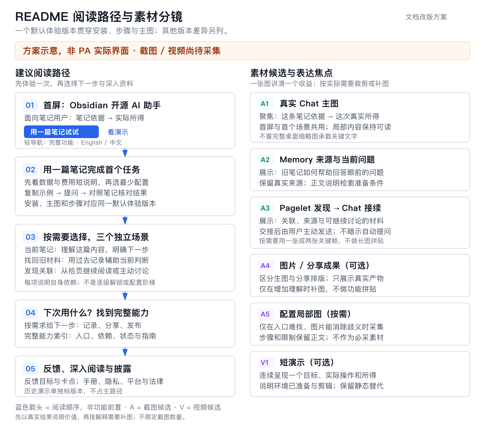

# GOV-007 — README 图文设计与交付契约

Document status: Current
Governance ID: GOV-007
Updated: 2026-11-01
Work item: B-193
Authority: README 的信息表达、示例、素材与文档验收契约；不定义 PA runtime、数据权限或 Obsidian 产品行为。

Bootstrap source: Owner 于 2026-10-30–31 提供原始需求、要求新素材及开发测试计划，
随后明确要求“按照上面的分析优化方案和执行计划，按照项目规范和sdd标准完善任务文档”。

本文件保留已交付 README 的维护契约。B-193 于2026-11-01完成收尾，过程包吸收后删除；
真实场景、素材来源与验证限制见[最终验收记录](../../archive/2026/b193-readme-validation.md)。

## 目标与已确认选择

首次访问者应能理解 PA 是什么、适合什么需求，看到自己的 Obsidian 笔记如何参与
思考、检索和关联阅读，并找到完成首个任务的入口。完整功能、依赖、费用、数据
控制与反馈入口保持可达。与 [North Star](../../product/pa-product-north-star.md)
一致，优先展示笔记的实际复用价值。

已确认的文档选择：单列、真实结果优先、一个主行动、可复制首次任务、独立的后续
使用入口。保留完整能力索引，不以装饰海报、功能拼贴或大量 GIF 代替实际价值。
当前设计优化不增加产品能力；具体文案可在等价承诺内调整。

2026-10-31 Owner 补充：“readme按照最新的master代码能力写，我是计划更新最新的
readme之后发布正式版”。据此，正文、配置步骤和新素材统一采用当前 master，替代
此前以 3.0.4 为主路径的制作选择。发布准备期明确源码与已发布版本的差异，提供
当前 checkout 构建路径，不预填下一版版本号，也不把发布计划当成本轮发布授权。

## Requirements

- B-193/REQ-01：首屏明确插件类别、主要使用对象、可观察收益和“用一篇笔记试试”主入口；完成首次任务后给出按需求选择的下一次使用入口。
- B-193/REQ-02：至少三个真实笔记工作流说明输入、操作、结果、核对或继续；首次任务附用户可取得的虚构笔记正文、可复制问题和结果核对要点。
- B-193/REQ-03：完整能力以当前源码为事实依据，分别说明已发布、开发中可用、规划中及退役状态、必要依赖和平台限制，不将协议兼容等同模型兼容。
- B-193/REQ-04：配置凭据前可见数据、后台调用、费用与控制说明；覆盖 Memory、Chat、Pagelet、图像与 Ghost 的真实边界，不以本地索引或 Data Boundary 暗示全部本地或自动识别敏感信息。
- B-193/REQ-05：按所声明版本新采集真实图像；每张图有明确阅读焦点、来源、替代文字和版本说明。文字可独立使用，配置图、成果图和视频按需，不设素材数量配额。
- B-193/REQ-06：中英文核心信息等价；主图、按钮、配置和示例统一对应最新 master 能力及其可复现构建路径。发布前说明与已发布版本的差异；正式版取得路径不得暗示未发布能力已上架。
- B-193/REQ-07：手册、工程与法律披露、历史演示和反馈入口保持准确可达；邀请描述目标、卡点和改善期望，并提醒不公开私人笔记或密钥。
- B-193/REQ-08：本任务只改变授权文档和素材，不改变运行逻辑、默认配置、模型服务商、付费、遥测或合作关系；计划、源码核对、运行观察与读者理解证据分别报告。

## Non-goals

- 不新增功能，不通过改产品代码制造更好看的演示，不恢复退役能力。
- 不改法律条款，不引入合作 Logo、推荐或追踪链接，不产生 Ghost 发布或合作邮件。
- 不凭本契约推定 Git 提交、推送、发布、部署、外部上传或模型调用授权；以当次用户指令为准。
- 不为文档维护新增 runtime SDD、产品 Decision/Spec、素材平台或重复测试体系。

## 已核事实与证据限制

源码基线：`bfe02fffe9a63fcd64f70da69d61f9d64c058c8f`（2026-10-31），加 Owner
另行授权的 Terra 默认值与官方 Responses 兼容修复。后续high／large默认修订的范围
见[连接契约](../../product/specs/pa-multi-provider-connections-product-spec.md)，
实现／应用证据见[最终验收记录](../../archive/2026/b193-readme-validation.md)。
本表是有日期的核对结果，后续制作时只刷新发生变化的事实。

| 事实／证据等级 | 依据 | 对改版的影响 |
| --- | --- | --- |
| 当前源码已有多连接、三用途配置、Memory profiles 和 OpenAI 图片适配；源码／契约确认 | [DEC-077](../../product/decisions/dec-077-multi-provider-connections.md)、[服务定义](../../../src/ai-services/provider-definitions.ts) | 不沿用旧单一 Provider 配置截图；协议适配不等于所有模型均可用 |
| 2026-10-31 读取的最新公开稳定版为 3.0.4，发布于 2026-10-29，未包含上述新增实现 | [发布记录](https://github.com/edonyzpc/personal-assistant/releases/tag/3.0.4)、本地 tag 与后续提交 | 源码已实现、公开版本可用、规划中三种状态分开；manifest 同号不证明功能已发布 |
| 当前 manifest 最低 Obsidian 为 1.11.4；2026-10-30 官方目录存在 PA 条目；未安装实测 | [manifest](../../../manifest.json)、[官方目录](https://github.com/obsidianmd/obsidian-releases/blob/master/community-plugins.json) | 可提供社区安装入口；最终制作时核对发布版本和实际步骤 |
| 插件／主题更新、插件启停、旧自动记录和 metadata 更新等已退役；Memos 未发现当前入口 | [DEC-075](../../product/decisions/dec-075-legacy-surface-cleanup.md)、[当前注册](../../../src/plugin.ts) | 清除现行功能承诺，保留历史资料入口；不恢复旧功能 |
| Memory 默认开启，符合首次使用条件时可能后台准备允许范围内的笔记；换配置不自动全量重建 | [默认设置](../../../src/settings.ts)、[准备路径](../../../src/memory-manager.ts)、[索引存储](../../architecture/vss-sqlite-wasm-architecture.md) | 配置前说明数据／费用；区分首次准备、后续维护与切换复用 |
| Pagelet 有真实发现与 Chat 接续路径，自动发现默认开启但受运行条件约束 | [当前调度](../../../src/pagelet/orchestrator.ts)、[设置](../../../src/settings/pagelet/index.ts)、[Chat 接续契约](../../product/specs/pagelet-chat-continuation-product-spec.md) | 展示来源与继续入口；交接不等于自动发送，打开面板不等于启动发现 |
| Chat 明确授权的笔记操作与 Ghost 发布有不同边界 | [命令架构](../../architecture/pa-agent-architecture-plan.md#command-architecture-contract)、[Ghost 工作流](../../../skills/blog2ghost/SKILL.md) | 不概括为“只读”或“每次写入都确认”；Ghost 保留桌面、凭据、草稿／首发／更新区别 |
| 现有 GIF 单个最大约 16.8 MiB；已看过的验证截图含测试占位内容或旧状态 | [现有 README](../../../README.md)、[历史验证截图](../../assets/validation/b001-pagelet-tab/desktop-tab-navigation.jpg) | Owner 已要求新增；旧素材仅作为历史资料，不用于证明当前界面 |
| 素材与三场景的构建身份和渲染缺口 | [最终验收](../../archive/2026/b193-readme-validation.md) | 规划示意不算产品截图；仅依据真实操作记录判定完成 |

语音“规划中”来自本次用户需求输入，不表示已有实现、已排期或指定交付版本。
Android VSS 继续保留实机验证不足的边界，不从桌面、iOS 历史证据或模拟器推定。

## 推荐版式与视觉分镜



[打开可缩放 SVG](../../assets/readme-redesign/readme-storyboard.svg)。这张图用于评审方案，
不是 README 首屏的产品图，也不证明真实场景已执行。

| 阅读位置 | 文案与入口 | 视觉职责 |
| --- | --- | --- |
| 1. 首屏 | 明确类别／使用对象与具体收益；“用一篇笔记试试”为主行动，看演示为次入口，完整功能／语言为轻导航 | A1：聚焦一组笔记依据与真实所得，直接看懂使用对象与结果 |
| 2. 用一篇笔记试试 | 短数据／费用说明 → 对应版本安装 → 最少连接配置 → 复制示例 → 提问 → 核对结果与排错 | A1 复用；只有设置入口难辨时补 A5 局部图，文字仍可独立完成 |
| 3. 三种独立需求 | 理解眼前这篇／找回已记材料／发现未想到的关联；各写输入、操作、结果和继续入口 | A2 说明旧材料与当前问题的关系；A3 说明真实发现及主动继续，均不强制先完成其他场景 |
| 4. 下一次使用与完整能力 | 按需要选择 Chat、Memory 或 Pagelet；完整能力表继续覆盖记录、图像、分享和发布 | A4 按需展示成果；不把三种需求画成必须逐级配置的阶梯 |
| 5. 反馈与深入阅读 | Issues、手册、平台限制、工程披露、License／NOTICE／商标／第三方声明 | 清晰链接；历史演示集中到独立入口并注明适用版本 |

类别与用途先于口号。文案候选：“Personal Assistant 是 Obsidian 的开源 AI 助手，
帮助你理解正在看的笔记、找回以前记下的材料，并继续探索笔记之间的关联。”主要
面向已有阅读、学习或项目笔记、希望更方便理解和复用材料的 Obsidian 用户；这不是
排除其他用法。英文采用同等承诺的自然表达，不逐字翻译，也不承诺每次都有洞察。

唯一主行动是 **“用一篇笔记试试”**。看演示为次入口，完整功能和语言为轻量导航；
用 GitHub Markdown 的位置、粗体与链接表达主次，不新增按钮系统。主图只要求读者
迅速读懂一组“笔记依据 → 实际所得”；通过取景聚焦，必要时另给局部关键帧，
不把完整桌面缩到所有文字不可辨。完整功能入口提醒还有记录、分享与发布能力。

首屏通过锚点让读者直接跳到安装或完整能力，不要求从头看完三个场景。约 30 秒理解、
约 2 分钟找到关键入口是信息组织目标；没有新读者观察时不声称已经验证时间指标。

## 统一演示故事

使用一个完全虚构的学习项目，三篇短笔记即可：`学习计划.md` 写本周目标，
`阅读摘记.md` 写两个方法及适用条件，`实践记录.md` 写尝试结果与尚未解决的问题。
公开示例见[演示笔记](../../guides/readme-examples.md)；采集只在明确的测试 vault 中创建副本，避免读取私人材料。

| 场景 | 示例输入／操作 | 应当观察并拍到的事实 |
| --- | --- | --- |
| 理解当前笔记 | 选取下述公开示例：“根据这篇笔记，我可以先做什么，还需要决定什么？请区分笔记中的已知信息、待验证假设和你的建议。只分析，不修改笔记。” | 回答能对照原文；已知安排与建议区分，不能把尚未选择的工具说成已确定。主图呈现一项有依据的实际所得，不预设固定答案 |
| 让旧笔记参与当前任务 | Memory 已按演示范围准备后：“找出与本周学习计划相关的阅读摘记和实践记录，比较它们提供了哪些支持或不同意见，并列出你使用的笔记。” | 找回相关材料、可核对的来源及回答；先拍真实状态，不将关键词命中或空结果伪装成成功检索 |
| 从关联阅读继续探索 | 打开计划，运行当前“发现关联”入口；核对洞察与来源，选择“在聊天中讨论”，输入：“这条关联对我的学习计划有什么启发？先给分析，不修改笔记。” | 发现结果、来源阅读、交接材料和用户主动发送的连续过程。无有效洞察可能是正常结果，不为拍摄伪造卡片或反复付费刷结果 |

首个任务选择“理解当前笔记”，只配置该任务必需的聊天能力。Memory 与图片服务
按需配置，不把安装、注册、付费、全库索引算进短演示时间。默认后台行为仍须解释；
打开一篇非敏感笔记不代表其他允许范围内的笔记不会参与后台工作。

### 交给读者的首次任务

两种 README 的快速开始各包含一段可复制笔记、一个问题和结果核对要点。它是正式
用户文档内容，不只是拍摄者的临时测试数据；两种语言等价，不要求下载整个 vault。
中文输入基稿如下，明确是虚构示例：

```markdown
# 学习计划（虚构示例）

目标：本周用虚构数据完成一张柱状图。
已确定：周三和周六各安排 30 分钟；使用七天虚构阅读时长；完成后写 100 字复盘。
待验证：先做小项目、遇到问题再查教程，是否适合我？
尚未决定：使用哪个绘图工具。
```

用户新建自己的示例笔记、复制正文、按当前版本步骤选择上下文，再输入第一场景
的问题。成功核对看：回答是否使用原文的目标与安排、是否保留工具尚未决定的事实、
是否区分建议与笔记已有信息、原笔记是否未被修改；不要求模型使用指定措辞。
若没有回应或上下文缺失，指向对应连接／上下文排错入口，不引导先配置所有能力。

后续两篇材料围绕“先读教程还是先做小项目”提供不同条件和虚构尝试记录，支持比较；
它们可以作为扩展场景的公开材料按需提供，不能将待发现结论预写成模型结果。

### 成功后与下一次使用

- 继续理解当前材料：在 Chat 追问，并回到原笔记核对。
- 下次需要以前写过的材料：进入 Memory 指南，先了解准备、数据范围和费用，再决定是否启用相关能力。
- 下次阅读想探索关联：进入 Pagelet 指南，查看发现、来源及继续讨论的入口；不依赖先完成 Memory 演示。

三个入口按用户需求独立选择。首次结果旁放简短选择，完整能力表继续保留其他用法，
底部反馈入口承接具体卡点，不能用反馈链接代替下一次使用提示。

## 新素材采集单

基本组合是 A1 一张、A2 一张、A3 一至两张；A5、A4 和视频按需，数量不作为验收项。
可共用真实画面；删除没有新增信息的重复图。以最新源码核对能力，按对应版本新采集画面，
不能用 AI 生成界面或合成成功答复代替；本方案的分镜图仅作为设计说明。

| ID | 必须表达的内容 | 拍摄条件与用途 |
| --- | --- | --- |
| A1 主图 | 一组看得清的笔记依据、真实所得和上下文关系 | 对应默认体验版本的真实任务；首屏兼任第一个场景。取景聚焦，正文说明实际帮助，不强塞完整桌面或虚构按钮 |
| A2 Memory | 找回的旧材料、来源入口与当前问题的关系 | 演示范围内索引可用；仅声称实际使用的材料，不展示整个私人文件树 |
| A3 Pagelet | 洞察与来源；进入 Chat 后的材料及继续入口 | 可用单图或两张顺序关键帧；不拼成手机无法阅读的长图，不暗示自动发送 |
| A4 成果（可选） | 生成图片或 Share Card 的真实成品与对应入口 | 不把 Share Card 说成模型生图。生成图片需真实调用及适用模型；无法完成则不放虚构成品。Ghost 展示不是必需素材，不为宣传图产生外部发布 |
| A5 最少配置（按需） | 难找或有歧义的聊天连接选择／数据控制入口 | 仅在截图能消除操作歧义时制作；文字必须独立可用。不展示密钥、个人地址或账户信息，不将开发版配置图用于稳定版步骤 |
| V1 主演示（可选） | 一个用户目标从笔记进入回答、核对或继续的完整过程 | 建议 45–90 秒，可分章；环境已准备。标注剪辑／等待加速，不以剪后时长承诺性能；静态图与文字应足以独立理解 |

统一主题、字号、窗口布局和内容主题。通过实际窗口尺寸与拍摄区域聚焦操作，
保留辨认 Obsidian 与上下文所需的环境；不叠加仿造按钮或遮盖关键状态。
图片优先采用保持文字清晰的 PNG；只有实际能明显减小体积且不影响可读性时才选
其他格式。以压缩和减少冗余控制首屏负担，不用强制体积阈值牺牲可读性。

双语可共用截图，图注分别解释界面语言；涉及必须对应的按钮或设置步骤时按需采集
中英文画面。关键标题、条件、步骤、预期结果和费用提醒留在 Markdown 正文，
不全部烘焙进图片。每张图提供描述能力／结果的替代文字，支持打开原图。

素材随本任务保留简短来源信息：拍摄日期、源码 SHA／实际构建版本、Obsidian 版本、
桌面或模拟器／实机、界面语言、演示材料范围、实际操作与剪辑情况。图注显示读者
需要的版本／平台；不要把内部测试 ID 放到 README 主路径。后续记录放在本任务的
已有记录中，不另造素材管理平台。

## 全功能与信任信息的保留方式

| 能力组 | 必须保留的内容 | 依赖或控制提示 |
| --- | --- | --- |
| Chat 与笔记操作 | 笔记上下文、回答、可用工具／来源、图片输入、明确授权的笔记操作 | 聊天模型的工具／视觉能力逐项区分；预览、授权、结果与可用 Undo 按当前契约说明 |
| Memory | 笔记索引检索、准备状态、个人理解／上下文相关管理入口 | 区分笔记检索与个人记忆；embedding 可能外发允许的文本，切换配置不等于强制重建 |
| Pagelet | 关联发现、来源核对、继续阅读／Chat、单独保存 | 需要适用的聊天能力；Memory 可提供线索但不是发现的统一前提；自动发现有数据和费用条件 |
| 图像与分享 | 图片输入、生成／编辑、Featured Images、Share Card | 各自模型／连接和素材边界分开；Custom 不自动获得图像生成能力，远程图片获取也可能联网 |
| 记录与辅助 | Quick Capture、Records Preview、统计、Callout、局部图谱、AI 摘要 | 基础本地功能不要求模型；可选 AI 后处理、AI 摘要及特定图谱呈现依赖另列 |
| Ghost | 准备草稿、预览、首次发布、已发布文章更新 | 桌面连接与凭据；文章／媒体到 Ghost，必要元数据处理到 AI；保留实际确认边界 |
| 规划与历史 | 语音标规划中，无发布日期；退役功能进入历史资料 | 不将旧插件／主题管理、Memos 或旧 metadata 入口继续列为现有能力 |

隐私／费用短说明放在任何配置凭据步骤之前：本地索引不等于全部本地处理；Memory
首次准备、后续维护和 Pagelet 自动发现可能产生后台请求；Data Boundary 是明确范围
规则，不是自动识别所有敏感信息。说明关闭入口与模型费用由服务商决定，不编造价格。
Chat 图片、笔记理解、Ghost 元数据、图片结果下载与 Share Card 远程资源分别解释。

详细网络、Base64、WASM 与依赖来源可迁入一份对应的披露文档；迁移时逐项核对，
尤其旧能力统计开关已退役，不能逐字搬运过时说明。保留 LICENSE、NOTICE、
THIRD_PARTY_NOTICES、TRADEMARKS 及已有引用关系。不要把商标条款改写成新的法律承诺。
反馈优先使用现有 Issues，邀请说明“想完成什么、卡在哪里、希望怎样改善”，提醒
不要公开密钥和私人笔记。本轮不添加 Modelflare 等合作 Logo、推荐或数据安全背书。

## 版本与文件安排

- 依 Owner 最新决定，以当前 master 核实并展示完整能力，使用同一构建新拍主图和三个场景；配置步骤与图片对应当前多连接界面。
- D-01 固定一组对应关系：可取得的版本／安装路径、源码或构建身份、主图、配置步骤、样例、按钮名称。不让读者从两套版本说明拼接首次任务；不能将开发版主图配稳定版步骤。
- 发布准备期给出当前 checkout 的源码构建／安装路径，并简短说明最新版正式包可能尚不包含这些能力；不把未提交修复说成远端 master 或正式版已提供。发布后按真实版本对齐，不能自行发版消除差异。
- 重新核实发布后，才能合并已对齐的使用说明；不预填下一版版本号。
- 后续正文编辑白名单建议：两个 README、两个 Manual 的直接关联段落、`docs/guides/` 的入口／图片／Pagelet 指南，以及必要新增披露／历史演示文档与其导航。
- 正式新增截图建议放在 `docs/assets/readme/`，用任务含义命名；本次设计图单独放在 `docs/assets/readme-redesign/`，避免误用。
- 历史图片先保留原文件与引用；历史演示入口标版本，是否删除资产另按实际入链判断，不因新版不用就批量删除。
- GitHub 原生 Markdown 单列阅读为主，避免依赖自定义 CSS 或五列宽表；视频保留明确播放链接与静态替代，不依赖 autoplay。

## 交付与验证入口

正式内容见[英文README](../../../README.md)、[中文README](../../../README-CN.md)、
[公开示例](../../guides/readme-examples.md)、[历史演示](../../guides/historical-demos.md)
与[网络和依赖披露](../../operations/network-and-dependencies.md)。
素材来源、独有应用证据和验证限制集中保留在[最终验收记录](../../archive/2026/b193-readme-validation.md)。

## Acceptance Criteria

| 要求／风险 | 最低充分证据 | 通过条件／重验触发 |
| --- | --- | --- |
| B-193/AC-01：定位、入口、完整能力与双语对应 | 对照需求、源码与发布记录逐项阅读两种正文 | 类别／对象／收益明确、主入口突出、下一次使用可达，核心承诺／依赖／状态一致；不将 30 秒／2 分钟目标记为实测 |
| B-193/AC-02：三场景与首次任务真实 | 合成笔记范围内的实际操作及关键画面；来源信息 | 操作、上下文、结果和下一步可核对；相关界面／调用路径变化后补对应场景，不要求模型固定措辞 |
| B-193/AC-03：隐私、费用、平台与权限准确 | 源码／当前契约＋配置前文案位置检查 | 默认后台行为、范围规则、服务限制、Ghost 边界和 Android 缺口未被隐藏；不扩张平台结论 |
| B-193/AC-04：图文可读且可信 | 查看全部新素材；检查 GitHub 桌面／窄屏呈现、链接和视频入口 | 关键文字不靠缩小图片才能读，正文不横溢；图注版本清楚，视频有静态替代。实际 GitHub 未验证则明确列缺口 |
| B-193/AC-05：披露与历史链接连续 | `npm run docs:check`、`git diff --check`；必要时受影响的既有文档契约 suite | 无本次新增断链／孤立文档／误删披露；不为纯文案新增镜像测试，不重复无关 build、TypeScript 或全量 Jest |
| B-193/AC-06：范围与授权守住 | 最终 diff／未跟踪文件检查与实际执行记录 | 只有授权文档及素材变化，无产品修改、隐性外部发布、合作背书或伪造实测 |
| B-193/AC-07：首次任务输入公开且可复现 | 从用户实际可见的示例文本开始，按步骤操作并核对结果 | 无内部笔记依赖；问题、核对要点和后续入口齐全，两种语言等价；没有固定答案要求 |
| B-193/AC-08：默认体验版本一致 | 对照当前 checkout 构建路径、实际加载实例、主图、配置和任务步骤 | master 能力与场景一致；已发布包的取得入口不冒称包含未发布修复 |

成品阶段可做一次轻量陌生读者阅读检查，核对能否理解用途、找到第一步和外发说明；
没有合适读者时如实保留理解效果缺口，不增计时研究或人数门槛。当前图示与源码
检查不能代替真实场景或读者理解证据。

## Traceability

| Requirement / AC | Design | Delivery evidence |
| --- | --- | --- |
| B-193/REQ-01 / B-193/AC-01 | 推荐版式、成功后与下一次使用 | 双语README；最终验收 Requirement And Evidence |
| B-193/REQ-02 / B-193/AC-02 / B-193/AC-07 | 统一演示故事、交给读者的首次任务 | 公开示例；最终验收 Real Scenes And Material Provenance |
| B-193/REQ-03 / B-193/AC-01 / B-193/AC-03 | 已核事实、全功能与信任信息 | README能力表、Manual和网络披露 |
| B-193/REQ-04 / B-193/AC-03 | 配置前说明、独立能力依赖 | README配置前说明；最终验收 Requirement And Evidence |
| B-193/REQ-05 / B-193/AC-04 | 新素材采集单 | 正式图片；最终验收 Presentation And Recovery |
| B-193/REQ-06 / B-193/AC-01 / B-193/AC-08 | 版本与文件安排、双语材料 | README构建路径；最终验收构建及语言记录 |
| B-193/REQ-07 / B-193/AC-05 | 全功能与信任信息、迁移入口 | 网络披露、历史演示及法律入口；最终文档检查 |
| B-193/REQ-08 / B-193/AC-06 | Non-goals、权限与证据边界 | 最终验收 Outcome And Disposition、Presentation And Recovery |

## Authority And Change Boundary

当前权威只约束 README 及直接关联文档的表达和交付，不取代引用的 PA 产品契约。
标题、图片数量和排版细节可在本目标内调整；修改产品行为、数据或权限必须另按
产品流程取得授权。B-193的已完成结果见最终验收记录，新操作仍需当次授权。

## Terminal Disposition

Owner已于2026-11-01授权并完成B-193收尾：稳定说明吸收到README／指南与本契约，
Home、Plan、Tracker删除，Active Registry入口移除；独有证据保留在最终验收记录。
本契约保持Current，不由文档完成推定正式版本已发布。
