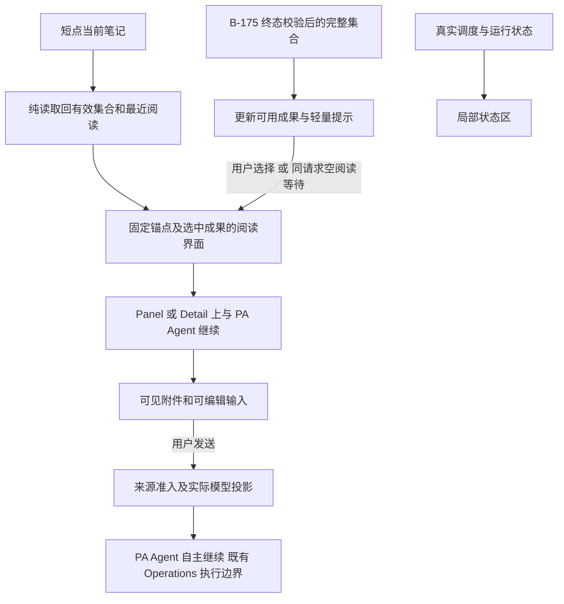

# Pagelet 入口与阅读闭环 Software Design Document

Document status: Current
Delivery status: Blocked
Updated: 2026-10-16
Work item: B-176
Authority: [DEC-066](../../../product/decisions/dec-066-pagelet-reading-loop.md) 与用户认可的第二轮方案；本文件承载源码核实后的开发设计和必要测试设计，不承载实施完成记录。
Restart condition: B-175 的交付契约可接续、用户授权实施且 Active 的唯一 Next 可用后，复核受影响源码，将本 SDD 迁入 Active Package 并创建唯一 Tracker；不改第一轮状态来腾出位置。
Product spec: [Pagelet 入口与阅读闭环](../../../product/specs/pagelet-reading-loop-product-spec.md)

本次为 sdd-only。Blocked 仅表示尚未进入执行队列且未获实施授权，不表示产品方案未定或已发生代码实施阻塞。
一般 Proposal 按现有规范保持 Current；设计认可见 Approval。开发和测试设计放在本文件，不另建 Plan、测试计划、
Feature Home 或平行 Tracker。开始执行时按 [Documentation Workflow](../../documentation-workflow.md)迁移，不复制两份权威。

## Current Source Baseline

2026-10-16，基线 ecddc088，相关 src/tests 无未提交差量。B-175 仅完成文档设计，仍有旧运行逻辑。
下表为静态源码事实；下文为待实施方案。沿用已有模块是工程选择，不代表用户新增授权。

| 链路与现有位置 | 已核实事实 / 第二轮影响 |
| --- | --- |
| [BubbleCoordinator](../../../../src/pagelet/BubbleCoordinator.ts) / [PetView](../../../../src/pagelet/pet/PetView.ts) | 短点立即分支与 Memory readiness 异步分支均可转 Ring；长按 Ring 已存在 |
| [orchestrator](../../../../src/pagelet/orchestrator.ts) currentAgentInsightCandidate / openAgentInsightPanel | getter 过滤 seen 并推进 pending；当前打开候选与最新候选已有分离，但缺按笔记复访 |
| [cache](../../../../src/pagelet/agent/pagelet-agent-cache.ts) / [controller](../../../../src/pagelet/agent/pagelet-deep-discover-controller.ts) | 缓存按 anchor 保存最新集合；getValidCollection 零 provider；run 缺缓存仍可运行模型；validateInsight 不依赖最新集合成员身份 |
| [scheduler](../../../../src/pagelet/agent/pagelet-deep-discover-scheduler.ts) / [plugin adapter](../../../../src/pagelet/plugin-deep-discover.ts) / [Host](../../../../src/pagelet/PageletHost.ts) | pending/active 事实已有；缺纯读和活动状态对外接口。onRunStart 先于缓存读取，不能证明模型已运行 |
| [PanelView](../../../../src/pagelet/panel/PanelView.ts) / [TabView](../../../../src/pagelet/tab/TabView.ts) | 当前刷新重建正文 DOM；后台 accept 本身不会重开正文，但显式运行成功无条件打开 Panel |
| orchestrator expandPanelToTab / [PageletDetailView](../../../../src/pagelet/tab/PageletDetailView.ts) | 先关 Panel 再开目标；交接回调仍依赖 panelView.isOpen；现有 Detail 会话缓存可复用 |
| [delivery adapter](../../../../src/pagelet/agent/delivery-adapter.ts) / [handoff DTO](../../../../src/ai-services/pagelet-handoff.ts) | 正文完整；来源含 anchor/sources 快照，web observation 在 DTO 中只剩 URL，不等于完整输入来源依赖 |
| [ChatView](../../../../src/chat/chat-view.ts) / [ChatService](../../../../src/ai-services/chat-service.ts) / [runtime](../../../../src/ai-services/pa-agent-runtime.ts) | UI 同时传 pageletHandoff 与 runSourceSelection；runtime 因后者存在而排除附件；成功轮次仍可能清除附件 |
| [projector](../../../../src/ai-services/context/PaAgentContextProjector.ts) / [InputLineage](../../../../src/ai-services/input-lineage.ts) | projector 支持 context-only 全文；requestLineage 对 Pagelet 仍记 unknown，Writing 元数据可引用未实际投影附件；现有 via: pagelet 可复用 |

## Design And Data Flow

### 1. 与第一轮衔接

B-175 继续拥有模型自主探索、所有模型可见面的旧语义约束移除、可选多份完整暂存、检索恢复、
逐份来源/身份校验、完整集合、真实终态和最小交付。B-176 只消费这些终态成果并补齐阅读/交接。
暂存不是流式阅读事件，不在 stage 时推送 UI；受控失败可交付哪些完整成果仍由第一轮合同决定。

第二轮补充 Chat 交接必需的来源承载，涉及同一 types/runtime 文件也不意味着把任务或测试移回 B-175。
实施开始先复核第一轮实际交付接口，只调整本轮适配，不复做第一轮探索、恢复或模型价值验收。

### 2. 纯读入口与真实活动状态

短点在 orchestrator 绑定当前 Markdown anchor 后，经 PageletHost → plugin → 已存在 scheduler/controller
读取有效集合。拟新增的纯读和活动查询/订阅接口均为 Proposed，当前代码尚无对应入口；具体命名沿实现模块习惯。
controller 复用现有缓存 prepare/commit、source/policy/pipeline/时效校验与并发 epoch，不新造运行回执。
scheduler 只转发纯读，不排队、取消或 coalesce；plugin 不为查看初始化 AI 或模型 runtime。
未初始化、缓存空、过期或不可读取都不触发分析；不可读取原因与模型无发现分开。

活动由 scheduler 的真实队列/活动事实与 runtime 实际进入节点提供；onRunStart 不直接翻译成“正在分析”。
必要时保留每个 anchor 最近一次真实终态的最小内存元数据；不保存运行历史列表，不从正向缓存 miss 补造终态。
内容与活动分开投影，同一笔记可以同时有旧正文与新分析。显式开始发现走第一轮入口，不再由查看动作隐式触发。

### 3. 最近阅读、已看与稳定正文

沿现有 openAgentInsightCandidate 扩展最小阅读状态：anchor、正在阅读的集合快照、selected insightId、
必要滚动/来源展开状态，以及仅在等待时存在的请求身份。按笔记保留最近阅读，不累计所有历史批次。
正文复用现有成果对象与 MarkdownRenderer；提醒继续使用 seen/receipt，纯读不调用会消费 pending 的候选 getter。

普通重开先验证并恢复最近阅读；没有有效快照才取当前有效集合。最新缓存被同笔记新集合替换时，不清除最近阅读快照。
只有用户选择新集合才推进阅读对象；不为被替换的每个历史批次另建存储。列表呈现不批量 markSeen，实际打开成员才标记。
沿用独立 insightId；集合重组不重置其余成员 seen。不得新增“必须属于最新 cache”作为旧阅读有效性的条件。

新成果/活动变化只更新轻量状态和可选导航，不调用重建正文的 open/refresh；明确更换阅读内容才重绘。
空阅读等待同一次请求可自动填入；已有正文时只提示。关闭撤销前台打开意图，不隐式取消发现；
仍合法完成的后台成果可保留，已取消/撤权/失效 run 不因 UI 需求重新接纳。异步读 A 返回时检查打开身份，不能覆盖 B。

阅读 A 时打开来源 B，保留 A 的标题和锚点；在 B 再次短点才转入 B。已有来源/权限失效处理继续作用于对应完整成果，
可保留界面外壳和真实原因，不展示失效正文为有效内容；其他独立有效成员仍可访问。复访/动作前复用现有校验，不新增轮询。

### 4. Panel 与 Detail 承接

展开传递正在阅读的完整 payload、选中项、原始顺序、anchor 和必要阅读位置。目标成功承接后关闭 Panel；
失败保留原现场。Detail 回调绑定其自身界面生命周期和选中成果身份，不再依赖原 panelView.isOpen。
保留异步取消/身份检查，不能简单删掉所有有效性判断。后台结果不通过持续 setPayload 重建 Detail。
复用 PageletDetailView 的现有会话能力；不扩展为所有操作/保存的通用框架或新的持久恢复协议。

### 5. 到 PA Agent 的完整交接

从实际选中成果冻结交接对象，经 Host 和现有 Chat 准备接口生成可移除附件及可编辑提示；不取最新候选替代所选正文。
忙碌/草稿冲突保持原界面内容和用户输入，不自动发送、清稿或另开强制会话。

发送接入现有 TaskSourceRun / InputLineage，给予 Pagelet 独立、可核验的来源准入后再合入 injectedContext。
不能只删除 runtime 的 runSourceSelection 条件：backgroundInputLineage 当前明确排除了 Pagelet。
从实际来源观察保留必要依赖与版本，沿 verified result → delivery adapter → handoff DTO 到接纳点；
网页 URL/observation hash 或正文引用不足以伪造现有 web provider/resultKey 依赖。缺失的旧来源事实保持 unknown，
不靠模型 sourceIds 自证，不额外读取全部笔记以填满字段。必要字段只表达本轮真实来源，不建立第二套来源系统。

展示引用与输入依赖分开：准入依赖覆盖生成该份文本时实际入模的材料及派生祖先，不能仅凭引用列表宣称完整。
较早完成文本不因本 run 后来才读取其他来源而被反向追加依赖；保留当时的真实输入事实，沿现有来源 owner 接续。

按来源范围验证：纯笔记成果在许可 notes/combined 中可用；含 web 依赖的成果必须满足综合模式及独立来源许可；
web-only 仍排除 Pagelet 私有笔记材料。范围不相容、来源不完整或当前不可交接时，明确反馈并保留附件，
不静默完成无附件回答后将其消费，不自动放宽范围。用户可移除附件、修改来源选择或显式重新发现。

Pagelet 在交接及首次 Chat 接纳前遵循已有 current-evidence 边界；一经纳入 Chat 接受的输入，当前生成、
网络重试/fallback 和后续 loop 按 DEC-055 处理，不追加逐次发送重新读取文件或撤销已接受响应的规则。
后续新读取与实际操作仍由原 owner 核验权限/目标。成果来源身份不由当前活动笔记覆盖。

实际投影的对象及其来源依赖用于 requestLineage、Writing generationInput 和附件使用事实；从原始 options
生成未入模的来源记录必须修正。复用现有事件/结果通道传递“该附件实际被接受并投影”的最小事实，不增加通用事件总线。
保留成功轮次完成后清除附件的现有语义，并增加确实使用该附件的前提；拒绝、失败、未完成或取消不冒充成功消费。
正常后续对话通过现有 Chat 历史/来源投影保持连续性，不能只修首次输入后又因 unknown lineage 丢掉合法派生回答。

projector 继续 context_only 与不授予工具/写入/网络/外部操作权限的边界。用户真实输入决定继续研究、讨论改进或明确修改；
原笔记和附件文本是材料，不是宿主指令。Agent 可按需读正文和使用既有能力，不增加必须先读/先问/先确认的提示词路线。

## Interfaces And Ownership

遵循 [Command Architecture Contract](../../../architecture/pa-agent-architecture-plan.md#command-architecture-contract)，不另定义职责体系。

| 决策 / 状态 / 效果 | Owner | 事实依据与输出 |
| --- | --- | --- |
| 发现价值、深入程度、继续研究和修改意图理解 | Agent | 原任务、用户后续输入及合法材料；自主选择工具与结论 |
| 调度、真实活动与终态 | 现有 scheduler/controller/runtime | run、anchor、取消、准入与实际 runtime 进入事实；不由 UI 猜测 |
| 按笔记有效读取与成果校验 | controller/cache，经 Host 转发 | 真实来源版本、权限、policy/pipeline、时效和提交身份；完整集合或事实原因 |
| 选中成果、阅读位置、seen 与前台打开意图 | orchestrator + 实际 Panel/Detail | 用户打开/切换/关闭、独立 insightId；不决定内容质量 |
| Chat 附件准备、投影和消费 | ChatView / Runtime / TaskSourceRun / projector | 真实附件、当前用户输入、来源选择、实际模型输入和终态；准入事实不授予效果 |
| 笔记修改或其他副作用 | 既有 Operations / domain owner | 用户请求、当前权限、目标冲突与真实 receipt；交接按钮不构成写许可 |

## Development Sequence

下表是未来实现顺序，不是新增产品轮次、审批阶段或已经开始的任务。实施时由 GPT-6 管理契约与验收，
GLM 按 [交付流程](../../workflows/gpt6-glm-delivery-workflow.md)负责限定代码/测试；共享 runtime 默认一个 writer。

| Slice | Requirement / AC | 修改范围与完成点 |
| --- | --- | --- |
| D-01 入口与复访 | B-176/REQ-01、B-176/REQ-02、B-176/REQ-03；B-176/AC-01、B-176/AC-02、B-176/AC-03 | Host/plugin/controller 纯读和活动状态；短点两个分支；按 anchor 阅读与独立 seen |
| D-02 稳定阅读与展开 | B-176/REQ-04、B-176/REQ-05；B-176/AC-04、B-176/AC-05 | 局部状态更新、关闭/晚到归属、Panel/Detail 阅读转交及独立动作生命周期 |
| D-03 完整 Agent 交接 | B-176/REQ-06、B-176/REQ-07；B-176/AC-06、B-176/AC-07 | 可信来源承载、准入/实际投影、输入记录/附件消费与连续对话；现有操作边界回归 |

每片只补对应缺失行为的 focused tests；完整路径接通后集中做统一 gate 与三条 app 旅程。
B-141 纳入 D-02/D-03，待真实验收再处置旧项；B-002 其他 async UX 范围不自动进入本轮。

## Lifecycle And Cleanup

最近阅读快照、活动订阅和等待身份限当前插件会话，沿用既有 owner 的 dispose/unload 清理；
关闭界面解除该界面监听及晚到打开意图，保留用于普通重开的最近阅读。Detail 独立管理其生命周期。
无正文磁盘副本、全批次历史、跨设备同步或后台恢复。来源变化只处理相应成果，不语义拆分一份正文。
开启/关闭、展开失败及取消都不得残留重复订阅或让旧回调作用于新界面。

## Data, Privacy, Permission And Cost

零调用查看只读取现有本地成果及校验所需来源；发现、Chat 外发与真实用量沿用既有许可和 owner。
新增交接字段仅为真实来源准入所需，不包含内部推理、隐藏提示词、工具原始日志或新增私有上下文。
不新增 provider、预算、自动分析频率、写权限、遥测或能力分类器；UI 文案变化不形成 Agent 方法约束。

## Compatibility, Migration And Rollback

沿用命令 ID、既有显式发现别名、设置和 seen receipt；不恢复 generic preload、范围控件或旧提示词规则。
阅读实现复用 MarkdownRenderer、现有长按/键盘能力及 scoped CSS；必要文案沿现有中英 locale 更新。
仅核对受影响移动入口、正文滚动和操作可达性，不重做全产品几何。

交接来源结构变化应更新相应 DTO/缓存身份，旧或缺字段来源保持 unknown 并给出不可交接原因，
不从引用列表补造完整证明；无用户笔记迁移。实现时确定最窄版本接续，不扩大为旧会话数据迁移。
回退限第二轮阅读/交接适配，保留 B-175 已交付的自主发现及真实来源边界；不能用绕过来源准入作为临时恢复。

## Test Matrix

证据按 [GOV-001](../../governance/gov-001-agent-managed-project-lifecycle.md#validation-evidence-and-diagnosis)复用。
以下为未来最低充分验证设计；当前没有运行实现测试。结果在实施时唯一 Tracker 记录，不在本 Proposal 维护执行台账。

| Risk / Requirement / AC | 最低确定性证据与现有 suite | 通过条件 / 必要反例 | 扩展或重跑触发 |
| --- | --- | --- | --- |
| V-01 入口误路由/隐式运行；B-176/REQ-01 / B-176/AC-01 | pagelet-bubble-coordinator、pagelet-action-ring、pagelet-agent-quality-cache | 同步及延迟 readiness 短点均阅读，长按保留；纯读命中/空/不可用零模型、零配置准备、不抢占运行 | 手势、读取准入或调度接线改变 |
| V-02 复访与状态混用；B-176/REQ-02、B-176/REQ-03 / B-176/AC-02、B-176/AC-03 | pagelet-orchestrator、pagelet-agent-quality-cache | 已看关闭重开、A/B 取回、新集合到达仍能恢复上次阅读；只标实际打开成员；旧内容与活动并存，cache miss 不假报无发现 | 成果身份、缓存生命周期、活动/终态映射改变 |
| V-03 正文打断与晚到；B-176/REQ-04 / B-176/AC-04 | pagelet-orchestrator、pagelet-panel-tab-view | 状态更新保持正文节点/选中项/滚动/展开；明确选择才换；关闭不重开，晚到 A 不盖 B；真实来源失效仍阻止使用 | 渲染刷新、路由 token 或来源失效处理改变 |
| V-04 展开后回调失效；B-176/REQ-05 / B-176/AC-05 | pagelet-orchestrator、pagelet-panel-tab-view | 选中全文/anchor/位置承接；Panel 已关仍可在 Detail 交接；目标打开失败原现场保留 | 目标 view 生命周期/回调归属改变 |
| V-05 显示附件却未入模；B-176/REQ-06 / B-176/AC-06 | pagelet-chat-handoff、chat-view、chat-service、task-source-runtime-admission | 带正常 runSourceSelection 贯穿实际服务/runtime，获准 notes/combined 正文入 provider；web-only、混合来源不相容、越界/unknown 不入模且不假消费；输入依赖、Writing 元数据及后续合法对话一致 | DTO、来源准入、projector、历史来源或消费语义改变 |
| V-06 隐含授权/草稿破坏；B-176/REQ-07 / B-176/AC-07 | 复用 chat-view、chat-service 与现有 Operations 边界测试 | 不自动发送、不覆草稿；失败/取消保留；附件中的修改命令不授予效果；明确用户修改仍走原合同 | 真实效果准入或用户意图入口改变 |

这些 suite 均位于 [__tests__](../../../../__tests__)；只运行实际改动覆盖的文件/用例，不将表格当成每片全跑清单。
已有 cache mutation fence、独立校验、seen identity、长按和草稿保护测试优先复用，不为每个 UI 字段造镜像测试。

### App 与实际模型证据

部署到核实的测试 vault 并重载后，合并观察三条用户旅程：

1. 已看 A → 关闭 → 切 B → 回 A 短点，恢复正文与阅读位置，长按仍可达快捷操作。
2. 阅读 A 并打开来源 B，期间有新结果/状态更新；正文不跳；关闭等待界面后结果到达不重开。
3. 从选中成果 Panel → Detail → PA Agent，确认原锚点/全文、可编辑附件、不覆盖草稿，并完成一次发送衔接。

测试使用可控异步完成覆盖竞态，不以反复等待真实模型制造 UI 条件。provider 输入断言证明交接接线，
app 观察证明实际界面；二者不互相冒充。第三条可复用一次真实模型的自然继续对话，核对其收到所选材料及实际来源，
不规定答案、工具顺序或洞察质量。若随后取得明确修改请求，沿已有 Operations 证据核对，不额外制造完整效果矩阵。
不重复 B-175 的自主发现模型样本，不统计惊喜率/准确率，不用重复采样追求预设结果。

触摸入口和阅读布局用 Obsidian CLI mobile simulator 覆盖受影响小屏滚动与操作可达性；
只有明确真机请求或已证实 iOS 专属风险才增加 iPhone 验证。模拟器不宣称真机证据。

### Gates 与停止条件

- 当前仅文档：npm run docs:check、git diff --check，并覆盖新增未跟踪 Markdown 的空白检查；未改 checker/skills，
  不跑它们的实现自测、TypeScript、build、模型、部署或设备验证。
- 后续实施先 focused source suites。共享 Chat 输入与多模块行为收口后，在冻结输入上统一运行 lint、production build、
  npm run test:all -- --runInBand、diff check 与 AGENTS 的 DOM/style 注入扫描；build 已覆盖 TypeScript。
- 使用 [test-vault skill](../../../../.agents/skills/obsidian-test-vault-smoke/SKILL.md)部署及观察；make deploy 已含的
  lint/build/full tests 不再先跑一遍。已有同输入有效 gate 和 build 时用 deploy-current，其身份校验不充当测试成功。
- 一个执行者负责昂贵 gates，GPT-6 核对实际 diff、原始证据与所需交互；来源/共享 runtime 变更安排实现者之外的只读审阅。
  只因改动、失败或具体未覆盖风险扩验，不按每个 slice/reviewer 重复全量检查。满足上述 AC 后结束本轮，不附加后续轮次。

## Open Design Findings

无未决产品阻断。已确认的 seen/读取耦合、晚到重开、Detail 回调及实际入模缺口均由上述设计覆盖，代码尚未修复。
新增接口名、最小来源字段及适配位置是实施细节；若现有事实不足以可靠承载来源，不得降级准入或改写批准范围，
只暂停有实质偏差的部分并说明具体缺口。B-141 不因设计完成就标解决；B-175/B-002 其余范围保持。

## Approval

- 产品与设计依据：用户认可第二轮方案后，于 2026-10-16 要求新 work item 的方案及 SDD 开发/测试设计；DEC-066 / Product Spec 承接。
- 设计记录日期：2026-10-16；本文件为待接续的技术设计，源码基线与方案已区分。
- 文档编写时授权止于设计与文档检查；用户于 2026-10-16 后续授权本地 master 提交，并选择在 MacBook 上继续开发。本主机不启动 runtime/tests code 修改或部署，推送尚未授权。
- 进入开发：满足 Restart condition 后迁入 Active，SDD 设为 Approved，创建 Tracker 承接 REQ/AC 与验证结果；不重置第一轮范围。
