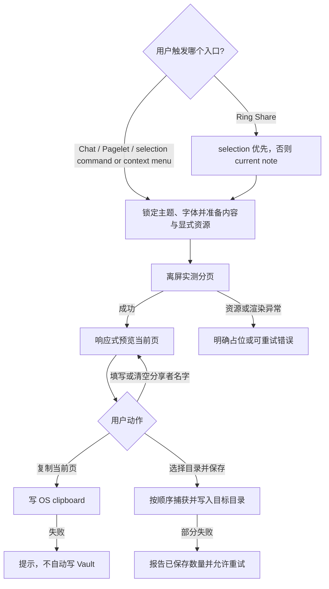

# PA Share Card Product Spec

Document status: Approved
Updated: 2026-10-15
Work item: B-124
Decision: [DEC-026 — Share Card 采用本地、显式导出的完整渲染卡片](../decisions/dec-026-local-share-card.md)
Authority: Share Card 的入口、可分享内容、视觉、分页、导出、失败、数据与兼容性边界。

> [!note] Owner amendment 2026-10-15 — Independent diagrams
> 用户明确批准独立完整图表整体等比缩小入页，已知本次 941px → 585px 约为 62%，
> 图内 24px 文字随图缩到约 15px；正文和脚注的批次字号不变。本轮准入为最终静态
> DOM 的单顶层 TABLE（可含 nested 树图），只缩完整图表，不混缩正文、不裁剪或
> 丢失节点/关系，不泛化所有 HTML。详见 B-124/REQ-13、B-124/AC-13；此为新增规则，
> 不代表实现或整篇 `cat` 已通过。

> [!note] Owner amendment 2026-10-15 — Footnotes
> 原完整渲染契约未定义脚注位置。用户现明确批准正文保留全批统一的可见
> 编号，脚注正文统一放到整组卡片末尾继续分页，避免重复并保留全部内容。
> 这是新的位置规则，详见 B-124/REQ-12、B-124/AC-12；仅改变本地分享投影，
> 不修改原笔记，不以规则批准冒充实现或整篇导出验收。
> 兼容设计用普通 `[n]` 呈现编号；这是本次实现选择，非用户指定的字形细节。

> [!note] Owner amendment 2026-10-15
> 用户确认当前预览并授权实现分享者署名：产品品牌保留在左侧，右下角默认显示
> 低强调斜体 `by` + `32×24` CSS px 的 EZ SVG；填写自定义名字后显示 `by` + 名字，
> 清空后恢复默认。名字仅属于当前 Modal，不新增全局设置或持久状态；详见
> B-124/REQ-11、B-124/AC-11。当前修订执行与证据见
> [Share Card Sharer Tracker](../../development/active/share-card-sharer/tracker.md)，
> 原有验收不证明本次修订完成。

> [!note] Owner amendment 2026-10-06
> 用户要求放大 Share Card 文字，使常规预览可以辨认 Xerox 效果；正文基准改为
> `24px`，多页不再以缩小文字减少页数，短单页依次试 `26/28/30/32px` 并取仍能完整
> 容纳的最大字号。整批分页、preview、Copy、Save 共享最终字号；固定导出尺寸不变。
> 用户要求笔记右上三点菜单提供 Share Card：Markdown 笔记菜单直接分享对应笔记，
> 有对应编辑器时采用非空选区优先，否则采用完整当前正文；复用有效 frontmatter
> 剥离、basename 和资源解析语义。原有编辑器选区入口继续有效。
> 已确认 iOS 的旧 Export image 菜单由独立 Export Image 插件注册；用户后续选择
> 暂不处理并保持该插件启用。本轮不修改该插件；PA 不按菜单文案删除其他插件的条目。

> [!note] Owner amendment 2026-10-05
> [DEC-051](../decisions/dec-051-proportionate-confirmation-and-contract-alignment.md)
> 取消 50,000 字符/24 页整批拒绝；保留完整分页、取消、真实资源失败和 SnapDOM。
> 下列 REQ-04/08、AC-05/09 已接续目标合同；新实现与验收仅见
> [B-161 最终验证](../../archive/2026/b161-contract-alignment-validation.md)，旧证据不证明本次交付。

> [!note] Owner decision 2026-08-05
> 用户选择完整渲染保真（方案 C）与 SnapDOM 窄例外（方案 A）。REQ-04、REQ-05、
> REQ-09 已据此修订；执行状态与验证证据仅以 Active Package Tracker 为准。

> [!note] Owner amendment 2026-08-06
> 用户新增 Pagelet Action Ring 的第四项 Share，并锁定 selection-first / current-note
> fallback、有效 YAML frontmatter 剥离、basename、图形 logo、`Personal Assistant`、
> Ring 可见中英本地化标签、local-only Source Han Serif、端侧 Ring 几何与整批自适应字号。REQ-01..04、
> REQ-09/10 与对应 AC 已据此修订；2026-08-05 证据只证明修订前基线。

> [!note] Owner amendment 2026-08-07
> 用户明确选择以当前 `master` 为准：短单页在 `18 / 20 / 22px` 中取仍保持单页的
> 最大字号，多页保持 `16 → 15 → 14px` 的减页规则且整批字号一致；保存目录可在每次
> Modal 内选择、不持久化，默认有效 attachment folder、否则 `PA-Cards`；Desktop/iPad
> Ring 优先内向弧，空间不足时整组降级为紧凑横排或竖排。

> [!note] Owner amendment 2026-09-18
> Ring 在可悬停的非 phone-toolbar 设备上默认只显示图标，完整名称在 hover 或键盘
> focus-visible 时显示；无悬停能力的触控设备与 iPhone toolbar 保留可见文字。
> 这替代 2026-08-06 的全端常显标签规则，用于缩小弧线而不改变动作语义。

## Problem And Product Outcome

> [!note] Owner amendment 2026-09-13
> 用户确认增加 PA 专属编辑器右键选区分享入口，复用 Chat 的 Share Card 渲染链。
> 保留第三方 Export Image 的原菜单和功能，不修改其图片样式。

> [!note] Owner amendment 2026-09-17
> 常见窗口打开 Modal 后，完整卡片缩略图、保存路径与主要操作同屏可见；极小窗口
> 优先让操作可见，预览可滚动。点击预览可只读放大看当前页细节，不改变导出卡片
> 的尺寸、内容、分页或印刷样式。

- User problem: 用户想复用一段 PA 回复或洞察时，需要手工排版或截取带 UI chrome 的
  屏幕内容，难以得到安静、清晰且一致的分享图片。
- Product outcome: 用户从当前内容自然地打开一张可预览、可分页、可复制或保存的
  本地品牌卡片，不引入发布流程或新的管理负担。
- North Star fit: 让已返回的有价值内容更容易被用户带走和复用；入口由用户主动触发、
  无队列、无 provider 调用、无意外写入，保持“安静且可信”。

## Scope

### In Scope

- B-124/REQ-01: 所有入口使用同一 `ShareCardData` 契约。Chat 仅为已完成、非空的
  assistant 回复显示低优先级 action；Pagelet 仅提交当前 visible findings，Prepared
  read-only Panel 不可分享；编辑器命令和 PA 专属右键菜单项仅在 selection trim 后非空时
  可执行/显示，payload 保留原始 selection 的空白、缩进与 Markdown。右键菜单明确标注
  `PA`，与第三方图片导出菜单区分，并复用相同的 Share Card Modal；Pagelet Action Ring 的第四项 Share 在
  点击时优先采用当前 active Markdown editor 的非空 selection，否则采用当前 Markdown
  note。Markdown 笔记菜单也提供 PA 分享入口，含移动端右上三点；分享菜单对应的
  file，有对应 editor 时非空选区优先，否则分享当前正文（含未保存内容）；没有对应
  editor 时读取该 file。用户 Chat 消息、生成中内容、dismissed finding、隐藏缓存与空内容不进入卡片。
  `completed_with_warning` 只有在 warning 不代表 provider error、assistant idle timeout
  或 wall-clock interruption 时才属于已完成；带部分文本的上述中断必须 fail closed。
- B-124/REQ-02: Chat/Pagelet 卡片保留稳定产品来源文案。Ring/笔记菜单的 selection payload 原样
  保留且永不显示文件名或 Vault path；note fallback 只在 leading frontmatter 被 Obsidian
  识别且其中 YAML 语法有效时剥离该 frontmatter，其余正文原样保留，并显示 active file
  的 basename，不显示目录或 `.md`。无 active Markdown note 或有效正文时 Share 不打开
  Modal，并显示本地化可恢复提示。Pagelet findings 只组合当前可见的 title、description、
  insight text；重复字段只输出一次，不加入隐藏 diagnostics、action、provider metadata
  或来源路径。
- B-124/REQ-03: v1 卡片固定为 `540×720` CSS px、DPR 2 PNG（`1080×1440`），提供
  neutral paper light 与 warm dark 两个由 Modal 打开时当前主题选定的样式，并保持可见
  纸张纤维纹理。每页有一致内容区、细 divider、PA 图形 logo + `Personal Assistant`
  品牌和必要页码；预览同时响应 modal/viewport 的宽度和高度，常见窗口应与保存路径、
  主要操作同屏，极小窗口优先保证操作可见并允许预览滚动。点击预览可放大当前页
  查看细节，关闭后返回原状态；放大仅影响检查视图，导出尺寸不受预览缩放影响。
  非代码文字以 Source Han Serif 为主字体，并只能从随插件提供的
  本地字体字节生成的 `data:` URL 加载；不得引用外部字体 URL/CDN 或发起字体网络请求。
  固定子集未覆盖的 Unicode 字符使用同字号的设备本地 serif glyph fallback；这不允许
  外部字体发现或请求，也不替代主字体加载。主字体加载/就绪失败必须显示可重试错误，
  不得静默换成系统/外部字体后冒充固定设计。
- B-124/REQ-04: 渲染型 Markdown 支持 headings、paragraphs、emphasis、lists、quotes、
  links、inline/fenced code 及可捕获的视觉内容。分页必须使用最终 card CSS 的实际 rendered height，优先语义
  块边界；超高单块可继续拆分但不得丢字、重排页序或产生空页。原始内容不得因
  frontmatter-like 开头或 thematic break 被静默删除。不以固定字符数或页数拒绝整批，
  不静默截断；真实资源不足时准确报告。分页先以 `24px` 建立有效 baseline；
  多页内容保持该字号。结果为单页时，再依次评估 `26px`、`28px`、`30px`、`32px`，选择仍保持
  单页的最大字号。所有候选须通过同一套 no-loss 与实际 overflow 校验，失败时
  保留最近的有效结果。选定字号必须在同一 batch 的全部页面、preview、copy 与 save
  中一致。开闭明确成对的 `***...***` 与 `___...___` 长段落应能跨页保留原文、
  加粗兼斜体及原始 source offset，不因分隔符为三个字符而一律拒绝；真实歧义、
  不成对或仍不能证明安全的结构继续准确失败，不承诺所有 CommonMark/HTML 均可拆分。
  安全、完整配对的有限 `sup` / `span` / `sub` 行内格式及标注作为不可拆 token 保留
  标签、获准属性与可见内容，周边长段落仍可分页；闭合不全、错配或其他不能证明
  安全的 HTML 不放行。这是既有完整渲染与安全拆分的兼容目标，不另造逐 tag 用户决定。
- B-124/REQ-05: 远程图片、Vault 图片与 Markdown note embed、Mermaid/Canvas/SVG 图表及
  浏览器可捕获的静态视觉结果应尽量进入预览和 PNG。Markdown note embed 支持整篇、
  heading 与 block anchor，只沿显式 embed 有界递归；通过去重缓存、resource/byte/time/depth
  budget、32 MiB localized-output budget、cycle guard 与取消信号限制读取。只解析输入明确
  引用的资源，不扫描无关 Vault
  内容；直接网络请求、引用内容读取、超时与 CORS/解码失败必须可观察。失败资源显示
  明确占位或使 capture 可重试失败，不得静默删除并声称完整保真；不使用未批准的 proxy。
- B-124/REQ-06: `Copy current page` 只写 OS clipboard；API 不可用、permission/gesture
  失败或 capture 失败时显示本地化错误，并保持 Modal 可重试，不自动保存。`Save image`
  单页保存当前页；`Save all pages` 按页捕获并按顺序写入用户在本次 Modal 选择的目录，
  最终只汇总一次。Modal 默认使用有效的 Vault attachment folder；配置不可用、为空或
  使用以 `.` 开头的相对路径时回退 `PA-Cards`。用户可选择已有目录、输入新目录或选择
  Vault 根目录；该选择不持久化为插件设置。目录建议仅在用户主动点击或键盘操作
  `Save to` 输入框时展开，锚定输入框的当前位置；打开 Modal 或程序化初始焦点不展开
  建议，选择目录或关闭 Modal 后收起建议。
- B-124/REQ-07: 保存使用 timestamp batch name 和确定性 page suffix，整批避让 Vault
  已有 path，不覆盖旧文件。目标被文件占用或目录创建失败时明确失败；完整成功提示
  数量和实际目录，部分失败提示已保存数量，不把 partial success 冒充完整成功，也不
  删除已经成功创建的本轮文件。
- B-124/REQ-08: preview loading、render fallback、pagination/export failure 与 busy state
  都有可读状态。前后页按钮与保存目录输入具备本地化 accessible name，按钮保留
  disabled state 和页码；放大预览具备可访问名称、键盘进入和关闭路径，关闭后焦点
  返回预览；action 在导出期间 exactly once。分页、测量、资源准备和导出均可取消，
  关闭 Modal 或取消后停止后续工作并释放临时资源，不得继续写 UI；已完成保存如实报告。
  已知的 typed 分页/测量失败在 Modal 中显示中英本地化、安全可读的原因；未知错误
  保留通用准备失败提示，不直接显示原始 error message、stack、笔记正文或路径。
- B-124/REQ-09: Share Card 从调用方已经持有的内容开始，只能解析该内容明确引用的
  远程或 Vault 资源；不调用 AI provider、不上传、不扫描无关 Vault、不使用未批准的
  CORS proxy，也不新增设置/ledger。capture 精确锁定 `@zumer/snapdom@2.23.2`，使用
  `scale:2`、`dpr:1`、`type:"png"`、`useProxy:""`、`embedFonts:false`、
  `reconcile:false`、`outerShadows:false`、`resolvePicturePlaceholders:false` 与
  `cache:"disabled"`。PA 必须在交给它之前用 Obsidian/Vault API 本地化显式资源并生成
  完整性报告；Source Han Serif 同样必须在 capture 前成为本地 `data:` font，SnapDOM
  不得直接请求剩余 HTTP(S) 资源或任何外部 font。只有用户点击 Save 才产生 Vault PNG；
  失败后重试仍由用户决定。
- B-124/REQ-10: Desktop、iOS 与 Android 共享核心逻辑；clipboard capability 按当前
  Modal window 运行时检测。Modal lifecycle 使用 Obsidian `Component` owner 和 owner
  document/window；plugin unload/Modal close 清理 render owner、离屏 DOM 与 pending token。
  Action Ring 顺序固定为 `Capture / Review / Discover / Share`，前三项行为不变；Desktop
  与 iPad 优先朝内容区形成内向弧，按钮无法无重叠容纳时整组降级为紧凑横排或
  竖排；iPhone 在可用宽度能完整容纳四项时横向排列，否则整组纵向排列，不混排。
  四项均保持至少 `44×44px`。非 phone-toolbar 且支持精确指针 hover 时默认仅显示图标，
  hover 或键盘 focus-visible 显示当前 UI locale 的完整文字；无 hover 能力的触控设备
  与 iPhone toolbar 保持直接可见的文字标签：英文
  `Capture / Review / Discover / Share as card`，中文 `随手记下 / 审阅 / 发现关联 /
  分享为卡片`；视觉方向不改变逻辑、键盘或焦点顺序。
- B-124/REQ-11: 每页页脚左侧保留 PA 图形 logo、`Personal Assistant` 与原有来源规则，
  右下角显示分享者署名。默认使用低强调斜体 `by` + EZ SVG，EZ 为 `32×24` CSS px，
  保持原始比例与字形；Light 保持 `#233A34`，Dark 使用同一几何的可读墨色。Modal
  提供带本地化可访问名称的名字输入框；输入 trim 后非空时显示 `by` + 名字，空字符串
  或仅空白时恢复默认 SVG。名字按纯文字处理，HTML/Markdown 不作为标记执行。名字仅
  在当前 Modal 存在，重开恢复默认，不写入设置、原始内容或其他持久状态。预览、放大、
  当前页复制与整批保存复用同一署名；导出期间禁用输入并冻结本次署名，禁止跨页混用。
  多页页码位于右侧组内的署名前，页码、署名、品牌及来源互不遮挡；名字单行显示，
  最大可用宽度 `170px`，超长时在署名区省略显示，不设最大字符数。页脚为测量、
  预览和捕获预留一致高度，不挤出内容或通过裁剪、缩字改变既有完整分页和正文批次
  字号规则。
- B-124/REQ-12: 脚注采用当前批次统一、稳定的可见 `[n]` 编号，对应关系不因切页、
  preview、Copy 或 Save 改变。正文中的同一脚注可多次引用，完整脚注正文只在整组
  正文之后输出一次，并作为普通 Markdown 语义块沿既有实测高度继续分页，不挤进
  每个引用段尾或重复每页。正文及脚注内的文字、Markdown、资源和顺序应完整保留，
  未引用的脚注定义也不得丢弃。投影仅作用于本次本地分享，不修改原笔记；普通
  链接/图片引用定义、代码中的字面量与显式资源权限不变。未解析引用、重复冲突定义
  或不支持结构不得静默删除或覆盖；不能证明完整时准确失败，不声称成功。
- B-124/REQ-13: 独立完整图表可按卡片正文区可用宽高整体等比缩小至一页，缩放
  比例不大于 1；本轮仅准入最终静态 DOM 的单顶层 TABLE 图表，包括内部嵌套树图。
  图内文字随图缩小是本条批准的例外，正文及脚注仍沿用既有批次字号，多页为 24px。
  不把混合正文一起缩，不裁剪、丢节点或拆开关系，不以 overflow hidden 隐藏溢出
  后声称适配。fit、preview 与 capture 使用同一测量及适配结果，必须可验证完整图表
  bounds 位于正文可用区域；不能泛化为任意 HTML 缩放，不改变内容投影、资源权限
  或固定导出尺寸。

### Non-goals

- NG-01: 不做通用笔记/页面截图、整段 Chat transcript、Bubble/Pet 或 Obsidian UI 捕获。
- NG-02: 不提供模板编辑器、比例/字体/产品品牌/持久保存目录或名字设置、上传自定义
  logo、无品牌导出或历史卡片库；本次 Modal 内的临时目录选择与分享者名字不属于持久设置。
- NG-03: 不把图片上传到社媒、云盘或外部服务，不接入 account/system share flow。
- NG-04: 不保证任意第三方插件交互视图、DRM/跨域受限资源或持续动画都能无损捕获；
  但必须提供明确失败/占位，不能静默降级为 text-only 后声称完整成功。
- NG-05: 不修改原始 Markdown、Chat history、Pagelet finding、Memory 或 Review Queue。
- NG-06: 不分享 Prepared read-only raw background cache；若该内容未来需要导出，必须以
  独立 `shareable` capability 重新批准，不能复用 read-only 推断写权限。

## User Flow And States

| State | Visible behavior | Allowed action |
| --- | --- | --- |
| Preparing | 显示本地化准备状态；名字可编辑，export disabled | Edit name / Close |
| Ready, single page | 预览 + 分享者名字 + Copy current page + Save image | Edit name / Copy / Save / Close |
| Ready, multiple pages | 预览 + 分享者名字 + page nav + Copy current page + Save all pages | Edit name / Navigate / Copy / Save all / Close |
| Exporting | 当前动作 busy，名字输入及其余 export/navigation disabled | Close；异步结果不得回写已关闭 UI |
| Clipboard unavailable/failed | 保留预览并给出可恢复提示 | 用户可显式 Save 或 retry |
| Capture/save failed | 保留预览；报告完整或 partial failure | Retry / Close |

## Trust, Data And Authority

- Source evidence: 起点只使用当前 assistant response、Pagelet 当前可见投影、原始 editor
  selection，或 Ring fallback 的当前 active Markdown note；selection 与 note 的优先级、
  frontmatter/basename 投影遵守 REQ-01/02。允许解析其中明确引用的远程/Vault 资源，不
  扫描无关笔记，也不把隐藏 metadata 当作分享内容。
- Data sent / stored: 远程资源可产生面向其原始地址的直接网络请求，Vault Embed 可读取
  被明确引用的本地内容；不调用 AI provider、不上传卡片。Copy 写 OS clipboard，Save
  写入本次 Modal 选择的 Vault 目录；默认有效 attachment folder，否则 `PA-Cards`。
  自定义分享者名字只存于当前 Modal，并进入用户明确复制或保存的 PNG，不单独持久化。
- Capture exception: 用户批准 SnapDOM 在离屏图片文档中所需的 runtime style 与已审计
  dependency 模式；该例外不适用于 Obsidian live UI，不豁免固定版本、资源预本地化、
  no-proxy、bundle/community scan 或 Desktop/mobile runtime gate。
- User disclosure / confirmation: 打开 Modal 无 durable effect；Copy/Save 按钮就是当前
  低后果动作的明确授权，不增加阻断确认。Copy 失败不升级为 Save 权限。
- Reversibility / recovery: 保存的 PNG 是普通 Vault 文件，可由用户通过 Obsidian 管理；
  原始内容不变，现有文件不覆盖。失败可在同一 Modal 重试。

## Acceptance Criteria

- B-124/AC-01: 历史和新完成的 assistant 回复出现可访问的 Share Card action；用户消息、
  生成中空回复和 terminal error 不出现该 action，点击使用最新 `copyContent/sourcePath`。
- B-124/AC-02: Pagelet 只导出当前 visible findings；dismissed/hidden finding、Prepared
  read-only content、diagnostics/action/source path 不进入 payload，空 payload 不执行分享。
- B-124/AC-03: editor selection command 只在 trim 后非空时可执行；同样条件下才显示
  PA 右键分享项，空选区不显示。两者使用同一选区分享链，payload 保留原始 Markdown/空白，
  相对资源以菜单所属文件解析，不自动暴露文件名。右键入口的卡片复用 Chat 的纸张、
  字体、装饰、品牌和自适应分页规则，保留 selection 不显示 `PA Chat` 来源标签的差别；
  不改动第三方菜单。Ring Share 在同样的 nonblank selection 存在时优先
  生成 `source:"selection"` payload；否则从 active Markdown note 生成 `source:"note"` payload，
  只剥离有效 YAML frontmatter 并显示 basename；invalid/frontmatter-like 开头原样保留，
  无 active Markdown 或空正文时不打开 Modal。
  Markdown 笔记菜单（含移动端右上三点）显示 PA 分享项，分享菜单对应文件；匹配
  leaf 的非空选区优先，否则使用其未保存正文；无匹配 editor 时读取菜单文件，不能
  混用其他 active note。空正文/读取失败提供可恢复提示，插件卸载后的读取结果不再
  打开 Modal。非 Markdown 或目录不显示该项。
- B-124/AC-04: light/dark 预览和 PNG 均显示图形 logo 与 `Personal Assistant`；Source Han
  Serif 只由本地 data URL 提供，font network request 为 0。窄桌面/
  移动 viewport 可完整查看预览与 44px actions；常见窗口无需滚动即可发现保存路径和
  主要操作，极小窗口仍优先保证操作可见。点击预览放大后可查看当前页细节，退出后
  回到原缩略图；导出 blob 为 `1080×1440`。覆盖
  `24px` 的多页 fixture 证明不会为减少页数而缩小正文；短单页 fixture 覆盖
  `26/28/30/32px` 最大可容纳选择、候选失败回退，以及 preview/copy/save 整批一致。
- B-124/AC-05: 覆盖中英文、列表、引用、代码块、长段落与 50+ 行内容的测试证明顺序
  保持、无丢字/空页；代表内容超过 50,000 字符且超过 24 页时仍完整到末尾，
  preview/copy/save 使用同一完整批次；运行时测量 smoke 证明每页 body 无 vertical overflow。
  明确成对的 `***...***` 与 `___...___` 跨页用例证明原始 source offset、文本顺序及
  加粗兼斜体保持；真实歧义、不成对输入仍由安全门拒绝，不能为通过该用例移除保护。
- B-124/AC-06: remote image、Vault image、Markdown note embed（整篇、heading/block anchor、
  嵌套、cycle/depth）与 Mermaid/Canvas/SVG fixtures 能进入预览和 PNG，且只请求/读取
  显式引用资源；网络/CORS/解码/processor 失败产生明确占位或可重试 capture error，
  不调用未批准 proxy、不扫描无关 Vault，也不冒充完整成功。
- B-124/AC-07: clipboard success 只复制当前页；clipboard API 缺失/拒绝/capture 失败不
  创建 Vault 文件，错误后可继续显式保存或重试。
- B-124/AC-08: 单页与多页保存数量、顺序、suffix、unique batch 与 partial failure 有
  focused tests；默认 attachment folder、`PA-Cards` 回退、已有/新建/root 目录与空输入
  均按契约工作，文件占位和命名冲突 fail safe；同名文件永不覆盖，成功/失败 notice 与
  真实结果一致。首次打开和关闭重开不自动展开目录建议；主动操作 `Save to` 后建议
  贴近输入框，输入筛选、键盘选择与关闭均正常，Modal 关闭后不残留浮层。
- B-124/AC-09: 快速切页、重复点击、导出中 close 与 Modal reopen 不产生并发写、stale
  preview、遗漏 cleanup 或 unhandled rejection；分页与导出取消停止后续工作，实际资源
  失败或部分保存不冒充完整成功，不承诺任何设备拥有无限资源。
  已知 typed 分页/测量失败分别有中英本地化原因；未知错误回退通用失败提示。错误
  状态不把任意原始异常文本、笔记内容或路径插入 Modal。
- B-124/AC-10: focused Jest、typecheck、docs/community scan、lint/build/bundle audit 通过；
  依赖精确为 SnapDOM 2.23.2，测试锁定 REQ-09 的完整选项（包括 `cache:"disabled"`）、
  无剩余 HTTP(S) resource/external font 进入 capture，并在已部署 Obsidian test vault 观察
  四个入口、Ring selection/note 两条分支、可见中英本地化 action 标签、Desktop/iPad
  内向弧优先与整组 compact fallback、iPhone 可容纳时横排/不可容纳时整组竖排、两种主题、分页、clipboard/save 与
  preview/PNG 一致性。2026-08-06 owner 明确允许本轮 iPhone 验证使用 Obsidian mobile
  emulation + `393x852` phone viewport；证据必须标为模拟，不得冒充真实 iPhone/iPad
  触控、WKWebView、safe-area 或设备性能。真实设备作为后续 release residual，不阻断
  本轮 closeout。
- B-124/AC-11: Light/Dark 的预览、复制及保存 PNG 均保留左侧产品品牌，右下角默认
  显示 `by` + `32×24` CSS px EZ；填写中文或英文名字后替换为 `by` + trim 后名字，
  清空或仅空白恢复 EZ。含 HTML/Markdown 的输入只显示文字；长名字在 `170px` 内单行
  省略，不遮挡来源、多页页码或正文。单页与多页预览、放大、当前页 Copy、Save all 使用同一署名和字号，
  busy 期间无法修改名字造成混批；页脚实测几何、正文无 overflow、PNG 尺寸保持一致。
  Modal 关闭重开恢复默认名字，未新增设置或持久字段；窄桌面/移动 viewport 中名字
  输入及现有主要操作可达。相关 focused suites 与部署后的交互/PNG 证据分别记录，
  不以独立预览或历史 smoke 代替本次验收。
- B-124/AC-12: 覆盖同一脚注多次引用、多个及未引用定义、脚注内 Markdown、长脚注
  继续分页的用例，证明正文编号全批稳定对应、脚注正文仅在整组正文之后出现一次，
  所有内容与顺序保留且每页无 overflow。普通链接/图片引用和代码字面量保持既有
  语义；未解析引用、重复冲突及不支持结构准确失败，不静默丢弃。preview、Copy、
  Save 复用同一准备结果，固定尺寸、字号及资源契约不变，原笔记字节不被改写。
  focused 证据与已部署整篇测试/PNG 证据分别记录；先前三星修复或短样例 PASS 不能
  证明脚注投影及整篇 `cat` 已成功。
- B-124/AC-13: 独立单顶层 TABLE 图表在过高或过宽时以同一比例缩小，包含嵌套树图
  的全部节点、文字与关系；原已适配图表不放大。验证完整 bounds 位于可用宽高内，
  没有裁剪、丢失或靠隐藏溢出获得的假 fit；混合正文与非准入 HTML 不误入缩放。
  preview、fit、PNG 的适配一致，正文和脚注保持原批次字号。focused 测试与部署后的
  独立图表/真实整篇运行及 PNG 分别记录；旧 selection 两页结果不得作为整篇成功。

## Open Decisions

内容/媒体方案 C 与 capture runtime 方案 A 均已于 2026-08-05 确认；Action Ring、来源、
视觉、字体、布局和分页字号修订，以及 iPhone 可用 Obsidian mobile emulation 的本轮
验证边界，已于 2026-08-06 确认。用户于 2026-08-07 再确认以当前 `master` 的短内容字号、
per-Modal 保存目录和 Ring compact fallback 为最终规则。模板自定义、持久目录偏好、系统
分享和外部发布仍不在 v1。2026-10-15 已确认默认 EZ、自定义名字替换和清空恢复，
名字仅当前 Modal 的实现沿用无新增持久设置边界；同日用户已确认脚注集中于整组
末尾并完整分页，并明确批准独立完整图表等比缩小入页。上述产品选择已解决，
当前无产品阻断决定；实现与验收状态仍见 Tracker。

## Current Implementation

- Architecture contract: [Share Card Architecture](../../architecture/share-card-architecture.md)
- Validation evidence: [Pagelet and Share Card smoke checklist](../../development/validation/pagelet-smoke-checklist.md)
- Current amendment: [Share Card Sharer Tracker](../../development/active/share-card-sharer/tracker.md)
- Release / rollout boundary: B-124 原交付已关闭，本次署名修订执行状态仅见 Tracker；
  后续 closeout、commit、push、beta/stable packaging 与 release 仍需独立授权。
